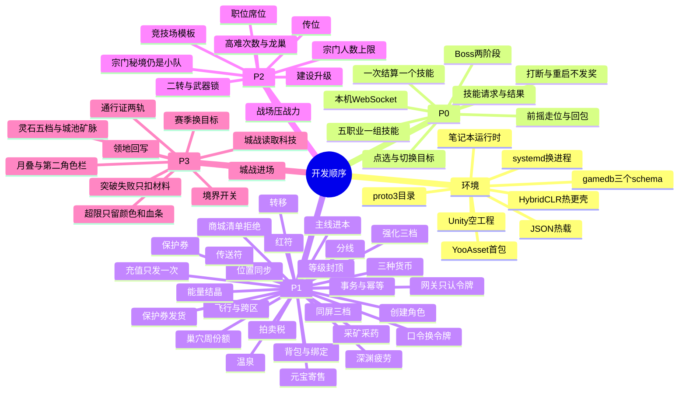

# 双世界 MMO · 开发架构

工作室：云锦繁星。

这份文档按《[MMO系统架构方案](MMO系统架构方案.html)》和《[技术架构](技术架构.md)》拆开发模块。玩法以方案正文为准，进程边界以技术架构为准。这里写每个模块谁来做、读什么、写什么、先做哪一块。第 10 节起是任务卡，第 13 节把每张卡拆成功能点，第 14 节是启动顺序。一次只派第 14 节的一行。

数值、技能表和掉落表仍留到 P0 原型后再填。语言、传输和存储见第 2 节。不把联机放进 Unity 自带的网络方案。

## 1. 开发时守住的边界

表世界负责走路、采集、交易、领地和飞行，同步 5–10Hz，不在这张图上结算技能。副本、竞技场和城战从入口进实例，一场一个战斗进程。

客户端用 Unity，首发只做 Android。它负责表现、点选目标和发送请求。伤害、命中、冷却、疲劳、副本次数、强化、转移、商城发货和拍卖扣款，都以服务端结果为准。客户端不回传伤害数字。

角色的持久数据只有一个写入方，下面称为角色服。世界服、战斗服、社交服和全局服务要改背包、金币、灵石、元宝、装备或次数时，都向角色服提交一次事务。战斗过程中的生命、冷却和仇恨只活在该场战斗进程的内存里，结束时丢弃，不写回主库。

## 2. 技术选型

客户端和服务端的业务都用 C# 写。进程仍然分开，战斗不进 Unity 播放器。

| 层 | 选型 |
| --- | --- |
| 客户端引擎 | Unity 2022.3.62f3 |
| 渲染 | URP |
| 界面 | UGUI |
| 资源 | YooAsset。按区域和副本分包，首包只带炼体到结丹 |
| 代码热更 | HybridCLR。玩法界面和表现放热更程序集，启动和资源加载留在主包 |
| 输入 | Input System |
| 打包 | IL2CPP，ARM64，只出 Android |
| 服务端 | .NET 10 LTS。网关、世界服、战斗服、角色服、社交服、全局服务各是独立进程。笔记本上已装 .NET SDK 10.0.403 |
| 手机到网关 | TLS 上的 WebSocket。网关用 Kestrel 接这条长连接 |
| 服与服 | gRPC |
| 消息 | Protobuf，proto3。客户端和各服共用同一套 `.proto` |
| 主库 | 笔记本上的 PostgreSQL 17，库名 gamedb，用户 game_dev，驱动 Npgsql。服务跑在笔记本上时读 `/srv/mmo/gamedb.env`（127.0.0.1:5432）。从 Mac 连接时，同一局域网用 192.168.1.117:5432，其他网络用 YOUR_SERVER_IP:15432。密码不进仓库 |
| 在线状态 | P0 放在对应进程内存。这台笔记本还没有单独的 Redis，不为此再装一套库 |
| 配置 | 仓库里的 JSON，服务端热载 |
| 部署 | 服务跑在笔记本的 Linux 上，用 systemd 拉起，战斗服预先多开。首发不用 Kubernetes |
| 日志 | 结构化 JSON 文件，不写入角色库 |

手机长连接用 WebSocket，是因为 Android 上要保持一条能断线重连的通道。服和服之间用 gRPC，是因为角色服的扣款和发奖要有明确的一次请求、一次结果。Protobuf 把字段定死，避免每个服各写一种 JSON。

资源用 YooAsset 下载和加载，不用 Addressables。会热更的玩法代码放进 HybridCLR 程序集。伤害、扣费和发奖仍以服务端结果为准，不把权威逻辑只放在热更包里。

gamedb 这个账号不能新建数据库。角色、宗门、交易分 schema 放在同一个 gamedb 里。连接数上限是 20，连接池要留在这个数以内。密码只放在笔记本的 `/srv/mmo/gamedb.env`，不写进代码，也不提交到仓库。

支付渠道的 SDK 只在客户端拉起付款。元宝只在服务端确认支付回调之后发放。P0 不接真实渠道，用内部订单把「同一笔只发一次」走通。P0 的账号是账号加口令，换成会话令牌。渠道登录以后再加，网关仍然只认令牌。

战斗公式放在服务端的普通测试里验证，不进手机包。Unity Netcode、Mirror、Photon 不作为 MMO 主干。不用别的数据库替换 gamedb，也不把一场战斗的过程写进数据库。

## 3. 客户端模块

Unity 工程按模块分，不按场景把逻辑写进关卡脚本。场景只负责把人放进表世界、副本或城战。

| 模块 | 做什么 | 不做什么 |
| --- | --- | --- |
| 启动与分包 | 启动、YooAsset 检查更新并按区域下载。首包只带炼体到结丹的地图和副本。玩法界面和表现放 HybridCLR 热更程序集 | 不在首包里塞后续大境界的地图。不把伤害和发奖写进热更包当权威 |
| 会话 | 连网关、保持登录、断线重连、把回包分给对应模块 | 不在本地保存可提交的战斗结果 |
| 表世界表现 | 几块相连密区的加载、行走、采集动作、飞行动作 | 不结算技能，不判断采集是否成功 |
| 同屏分级 | 近处完整模型，远处简模，再远只留名字。别人的拖尾和光效关掉 | 不在主城把所有人画全 |
| 点选目标 | 玩家点中一个目标，可手动切换。把目标编号放进后续技能请求 | 不做全场景自动索敌，不做无锁定朝向 |
| 技能表现 | 播放前摇。前摇期间可以走位，命中前可以发打断。回包成功才写伤害和硬直，失败就停掉这次施法 | 不做动作预测、命中回滚、逐帧攻击盒、翻滚和无敌帧 |
| 副本表现 | 队伍人数内的模型和技能按完整规格显示。主线、深渊、巢穴最多 4 人，龙巢最多 8 人 | 不在副本里降成名字 |
| 城战表现 | 专门战场。周围的人完整显示，超出同屏上限的只留队伍颜色和血条 | 不在无缝野区上打城战 |
| 界面 | 背包、装备、强化、能量结晶、境界、任务、商城、拍卖、宗门、副本入口、社交 | 界面只展示服务端已经确认的结果 |
| 输入 | 移动、点选、技能按钮、采集和交互 | 不在手机上做连段缓存 |

五个职业、十条分支的差别放在技能配置和界面图标上。换一把本职业兵器，只换模型和装备数值的展示，不换分支技能。

Android 是 P0 的验收环境。要在真机上确认目标好不好选、技能分不分得清、Boss 阶段读不读得懂。主城用同屏分级扛人数，不靠把战斗搬进主城。

## 4. 服务端模块

玩家的长连接只进网关。网关做鉴权、频控和加解密，再按消息类型转到对应进程。

### 4.1 角色服

角色服是持久数据的唯一写入方。账号下可以有第二个角色栏，装备、等级和境界不共享，外观收藏可以共享。

| 模块 | 写入什么 |
| --- | --- |
| 账号与角色 | 账号、角色栏、种族、职业、分支。种族只存外观和出身 |
| 等级 | 1–100。到 100 封顶，大版本不抬 |
| 境界 | 十一段及初、中、后、大圆满。版本未开放时拒绝突破 |
| 背包与装备 | 格子、绑定、强化等级、能量结晶、幻形 |
| 货币 | 金币、五档灵石、元宝、绑定资源。灵石相邻档 10000:1 的兑换也在这里做 |
| 计数 | 疲劳、温泉、巢穴周份额、高难次数、宗门秘境活跃 |
| 商城资产 | 已购外观、传送符、红符、保护券、月叠剩余、通行证进度 |

一次事务里要么全部成功，要么全部退回。强化扣材料、拍卖扣金币、商城发货，都不允许写成一半。

### 4.2 世界服

世界服按分线加载几块相连的区域。同步频率 5–10Hz，内容是坐标、朝向、外观档位，以及是否在采集、是否可飞行。

| 模块 | 做什么 |
| --- | --- |
| 场景与分线 | 首发只开炼体到结丹用到的密区。新区随境界版本再接 |
| 移动校验 | 速度、是否允许飞行、目标区域的境界门槛。不通过就拉回 |
| 同屏档位 | 按距离算出完整、简模或只留名字，发给周围的人 |
| 采集 | 矿脉和药草的占用与刷新。成功与否由这里判定，产物写入角色服 |
| 灵石矿脉 | 归属记在主城上，不做成玩家个人采集点。开采权变更写在城池数据里 |
| 入口 | 副本、竞技场、城战的报名转到战斗服或匹配。世界服不发奖励 |

采集不扣疲劳。灵石不从矿点进个人背包。

### 4.3 战斗服

一个副本或战场一个进程。进程池预先拉起，冷启动控制在 3 秒内。场内状态在内存里。结束、失败或掉线时，把奖励和次数一次提交给角色服，然后进程可以回收。

| 模块 | 做什么 |
| --- | --- |
| 进本资格 | 人数、等级、境界、疲劳、周份额、高难次数。主线只允许 1 人，不扣疲劳 |
| 人数结算 | 低级本和高级本的产出与扣除乘以进本人数，当日或当周总量不变。高难进一次扣 1 次，产出不乘人数 |
| 技能结算 | 一次只处理一个技能请求。检查是否在本里、目标是否还在、冷却、距离，再算伤害、治疗、仇恨和硬直 |
| 仇恨 | 坦克用体力计算稳定度。体力不进入坦克的攻击 |
| 属性 | 战士用力量，射手用敏捷，法师和牧师用精神。体力是所有人的生命 |
| 掉落 | 怪物掉能量结晶和副本表里的强化石、装备。灵石基本不掉 |
| 阶段 | Boss 阶段和读招走配置。不设霸体条和破防窗口 |
| 红符与丹药 | 只回复自己。回复不超过同级回春丹、气血丹，和丹药、牧师治疗共用冷却。不复活，不治疗队友 |
| 崩溃 | 奖励还没写入角色服，这场就不发奖。高难次数以角色服里已经写下的记录为准 |

怪物生命和伤害按进本人数缩放，机制不改。世界服再忙，也不改已经进本的这场结算。

### 4.4 社交服

社交服不写伤害公式。

| 模块 | 做什么 |
| --- | --- |
| 宗门名册 | 五级。1 级 10 人，2 级 30 人，3 级 60 人，4 级 100 人，5 级 200 人。满员不再收人 |
| 职位 | 掌门 1、副掌门 1、长老 4、执事 12，其余弟子。1 级只有 10 个席位。传位只给副掌门 |
| 建设与贡献 | 升级耗建设。建设和贡献来自宗门秘境和宗门任务，不从商城买 |
| 科技 | 只在城战里提供加成。战斗服开城战时来读，社交服不算伤害 |
| 展示 | 山门、旗帜、披风只是外观，从商城资产读 |
| 聊天、邮件、好友、师徒 | 邮件不作为发奖依据。可交易的金币和物品仍走拍卖或摆摊的交易事务 |
| 洞府与家园 | 摆放和访客可见。家园币只换外观和便捷 |

宗门秘境的进本人数仍是 1–4 人。200 人是名册，不是进本人数。

### 4.5 全局服务

| 模块 | 做什么 |
| --- | --- |
| 拍卖行 | 金币标价。成交时按配置抽 5%–8% 的金币，抽走的金币销毁。装备、材料、灵石挂单和元宝寄售都走这里的扣税 |
| 摆摊 | 摊位显示在世界服。成交仍提交同一套交易事务，不在世界服里直接改背包 |
| 元宝寄售 | 付费玩家挂元宝，搬砖玩家用金币买。商城不卖金币 |
| 商城 | 只收元宝，商品直接标价，不做抽卡。发货前对照上架清单。保护券和红符绑定。没写在清单里的拒绝 |
| 充值 | 支付渠道回调发元宝。同一笔订单只发一次 |
| 匹配 | 竞技场、战场、跨服只交换报名和结果，不合并两个服的角色库 |
| 排行与赛季 | 赛季更换秘境目标。通行证进度记在角色服 |
| 配置 | 技能、掉落、强化概率、人数上限、每周次数、境界门槛、采集节点、商城清单。热更后新请求用新表，已经进本的那场用进本时的表 |

支付回调、拍卖成交和商城发货都要能重放而不会发两次。

## 5. 八条主流程

每条流程都写明请求从哪来、谁判定、谁落库。

**登录。** 客户端把凭证交给网关。网关核对接号，角色服返回角色列表和第二个角色栏是否已购买。客户端进入上次所在的世界分线。

**在表世界移动。** 客户端上报位移。世界服按 5–10Hz 校验并广播档位。飞行和跨区先问角色服的境界。不通过就拉回，不在客户端上改权限。

**采集。** 世界服占住矿或药的节点，成功后让角色服放入矿石或药材。灵石矿脉不走这条。

**进副本。** 世界服把入口请求交给战斗服。战斗服向角色服申请扣疲劳、份额或次数。扣成功才把人放进实例。主线不扣。高难少于 2 人直接拒绝。元婴及之后的新副本还要检查境界，旧副本只看等级。

**放技能。** 客户端发送技能编号、目标编号和自己认为的施放时刻。战斗服结算后把结果发给本里的人。客户端先播前摇，回包失败就停。治疗和红符走同一段冷却检查。

**结算离开。** 战斗服把掉落、经验和历练一次交给角色服。写入成功后回收进程。历练只从这次已经有资格进入的副本累计。

**强化与转移。** 角色服检查石头等级、金币和保护券。失败只掉 1 级。保护券只挡住这一次掉级。转移要求来源强化高于目标，来源变为 +0，绑定规则在同一次事务里改完。

**突破。** 角色服检查修为、历练、炼心和灵石。版本未开则拒绝。失败只扣材料，境界不掉。灵石档位兑换也在角色服，不进拍卖。

**买商城。** 全局服务对照清单，角色服扣元宝并发货。月叠只发传送符和红符。通行证不发金币、强化石、灵石、装备和副本次数。

## 6. 数据放哪

| 数据 | 放在哪 | 丢了会怎样 |
| --- | --- | --- |
| 账号、角色、背包、装备、货币、境界、疲劳、次数、商城资产 | gamedb 的角色 schema | 不能丢。这是发奖依据 |
| 宗门名册、职位、建设、邮件 | gamedb 的社交 schema | 与角色表分开，避免抢同一批行锁 |
| 拍卖、寄售、充值订单 | gamedb 的交易 schema | 订单号唯一，重复回调不二次发货 |
| 在线位置、AOI、采集占用、匹配队列、玩家所在实例 | P0 放进程内存 | 可以丢。重进场景后由世界服或战斗服重建 |
| 一场副本的过程 | 战斗进程内存 | 进程崩溃则这场不发奖 |
| 行为日志 | 单独的日志流 | 不参与发奖，用来查工作室和掉单 |

城池上的灵石矿脉归属放在世界或城战结果写回的城池表，不放进个人采集节点。

## 7. 配置谁读

配置由全局服务下发。世界服读区域、采集和飞行门槛。战斗服读技能、掉落、人数和 Boss 阶段。角色服读强化概率、灵石兑换、商城清单和境界版本开关。客户端可以提前下载后续地图，但服务端拒绝时进不去。

首发包只带炼体到结丹。元婴及之后的区域、副本和境界外观随该版本再下。

## 8. 按阶段做哪些模块

顺序不能倒。前一阶段的写入方没稳定，后一阶段不往上叠。

**P0 战斗验证。** 客户端的会话、点选、技能表现，加一个战斗服和一份技能配置。五个职业各一组主动技能，一场单人 Boss。验收在 Android 真机上完成。此阶段可以暂时把角色数据放在战斗进程旁的一张表里，但接口要按角色服的样子留好，避免 P1 再改协议。

**P1 一天的循环。** 角色服落地。世界服的分线、移动和采集。深渊疲劳、巢穴周份额、强化、能量结晶、拍卖行。商城先做保护券、红符、传送符和外观发货，确认绑定和清单拒绝有效。

**P2 人会留下来。** 社交服的宗门名册、职位、宗门秘境计分。竞技场和战场的匹配。高难次数和龙巢。二转只推进一步已经选中的分支。城战仍是战斗服里的战场，科技从社交服读。

**P3 长线。** 境界版本开关、灵石矿脉的城池归属、领地税收、赛季和通行证。十一段不要在首发进程里一次做完。洞府、第二角色栏和月叠可以跟商城清单一起开，不挡 P0。

## 9. 模块依赖

角色服先于一切会改背包的模块。战斗服的进本资格依赖角色服的等级、境界和次数。世界服的飞行和跨区依赖角色服的境界。拍卖、摆摊和商城依赖角色服的货币事务。城战依赖战斗服的实例，以及社交服的科技。匹配只依赖报名和结果，不依赖把角色库并到一起。

客户端的技能表现依赖战斗服回包，不依赖本地伤害。同屏分级依赖世界服给出的档位，不在手机上自行决定远处的人该不该画全。

## 10. 怎么派工

一次只派第 14 节的一行。这一行做完，并用它的核对结果看过之后，再派下一行。不要把后面的行和前面的行拼进同一次开发。任务卡仍是这些行的上一级，卡的完成标准不变。

每次派工都带上这三份文档，并写明卡号：

- `docs/MMO系统架构方案.html`：玩法以这里为准
- `docs/技术架构.md`：进程边界以这里为准
- `docs/开发架构.md`：只做指定的那一张卡

派工时把下面这段放在前面，再写卡号：

> 只实现开发架构里的这一张任务卡。不要提前做后面的卡，不要改方案里已经写定的玩法。数值还没定的地方留成配置，不要在代码里写死概率。语言、传输和存储按开发架构第 2 节，不要另起一套。做完后按这张卡的完成标准逐条说明结果。遇到规则冲突就停下来，不要自行改规则。

开发时若发现两份文档不一致，以方案正文为准，并停下来说明冲突，不在同一次改动里悄悄改掉玩法。

## 11. 任务卡

每张卡都包含交付、完成标准和不要做的事。完成标准是可以演示或可以核对的结果，不是「代码已写完」。

### P0-1 消息与一场战斗

交付：用 proto3 定义技能请求和技能结果。请求里有技能编号、目标编号、客户端认为的施放时刻。结果里有是否命中、伤害或治疗、硬直、冷却。一个 .NET 战斗进程能打一场单人 Boss。手机到这个进程可以先走一条本机 WebSocket，网关鉴权放到后续。一次只结算一个技能。冷却没好、目标不在、距离不够，都拒绝，并且不改目标生命。

完成标准：连续发出两个还在冷却中的技能，只有第一次生效。打断后这次施法没有伤害。战斗进程重启后，这场没有写入的奖励不会出现。

不要做：世界服、拍卖、商城、宗门、五个职业的完整技能表。不要在客户端算伤害。

### P0-2 手机上的点选和前摇

交付：Unity 的 Android 包。能点选目标、切换目标、按下技能。先播放前摇，前摇期间可以走位，命中前可以打断。回包成功才显示伤害和硬直，回包失败就停掉这次施法。

完成标准：在真机上能选中 Boss，能看清一次技能的前摇和结果。故意发一个会被拒绝的技能时，画面上的施法停住，血量不变。

不要做：自动索敌、无锁定朝向、翻滚、无敌帧、动作预测、命中回滚、逐帧攻击盒、输入缓冲。

### P0-3 五个职业各一组技能

交付：坦克、战士、法师、射手、牧师各一组主动技能加普攻，放进配置。战士攻击读力量，射手读敏捷，法师和牧师读精神。体力是所有人的生命。坦克的仇恨稳定读体力，体力不进入坦克的攻击。Boss 至少两个阶段，阶段走配置。

完成标准：换成坦克后，提高体力不会提高这一下的伤害，但仇恨更不容易被拉开。五个职业的技能在手机上能分清。

不要做：十五条分支的全部技能、觉醒、纹章、霸体和破防。

### P1-1 角色服

交付：账号、角色、背包、装备、金币、灵石、元宝、疲劳、副本次数的唯一写入。一次事务要么全成功，要么全退回。等级写入封顶 100。种族只存外观和出身。

完成标准：同时提交两笔会把金币扣成负数的操作，只有一笔成功，背包不会出现扣了钱却没得到物品。重复提交同一笔已完成的事务，不会发两次。

不要做：在世界服或战斗服里直接改背包。不要把第二个角色的装备和境界设成共享。

### P1-2 进副本

交付：主线只允许 1 人，不扣疲劳，不占周份额。深渊 1–4 人，疲劳按人数倍增，日上限 6000，温泉只恢复 1500 点疲劳。巢穴每周 12 个单人份，4 人进一次，每人得 4 份、扣 4 份。怪物生命和伤害按人数缩放。旧副本只看等级。

完成标准：一天内把疲劳打到 6000 后不能再进深渊。4 人打巢穴一次后，这周剩余份额是 8 个单人份，每人拿到的是 4 份而不是 1 份。单人巢穴一周能打 12 次，总产出与 3 次满员相同。

不要做：高难次数、宗门秘境、元婴副本的境界门槛。这些在后面的卡。

### P1-3 表世界

交付：几块相连密区、分线、5–10Hz 的位置和外观档位。近处完整、远处简模、再远只留名字。矿和药可以采，成功后把产物交给角色服。采集不扣疲劳。飞行和跨区读取境界，不允许就拉回。

完成标准：主城里远处的人不再是完整模型。采一次矿，背包里出现矿石，疲劳不变。没有飞行权限时，客户端发起飞请求会被拉回地面。

不要做：在表世界结算技能。不要让玩家从灵石矿脉直接采到灵石。

### P1-4 强化、转移和结晶

交付：强化最高 +12。+1 到 +6 只用低级强化石，+7 到 +9 只用中级石，+10 到 +12 只用高级石。失败掉 1 级，不碎、不清零，没有失败累计必成。保护券只挡住掉级，不提高成功率，绑定且只从商城来。转移要求来源强化高于目标，来源变为 +0，绑定规则在同一次事务里完成。能量结晶可拆，分攻击、防御、功能，部位限定。

完成标准：用低级石点 +7 被拒绝。失败后强化等级只少 1。用保护券失败后等级不变，成功率与不用券时使用同一套配置。来源 +3、目标 +5 的转移被拒绝。

不要做：把概率写死在代码里。不要做纹章、装备碎掉、强化清零。

### P1-5 拍卖、寄售和商城

交付：拍卖用金币标价。成交销毁配置中的 5%–8% 金币。元宝可以寄售成金币，商城不直接卖金币。商城只收元宝，直接标价，对照第 12.1 节的上架清单发货。保护券和红符绑定。红符只回复自己，回复不超过同级丹药，和丹药、牧师治疗共用冷却，不复活。充值订单重复回调只发一次元宝。

完成标准：清单外的商品请求被拒绝，元宝不扣。红符不能治疗队友，也不能在死亡时把人拉起来。同一笔充值订单回调两次，元宝只增加一次。拍卖成交后，卖方少掉一笔税，这笔税不进任何角色背包。

不要做：抽卡、蓝符、卖疲劳、卖副本次数、卖强化石、卖灵石、卖装备。不要在这一张卡里做月叠、第二角色栏和通行证，它们在 P3-4。

### P2-1 宗门

交付：宗门五级，人数上限依次是 10、30、60、100、200。职位是掌门 1、副掌门 1、长老 4、执事 12，其余弟子。1 级只有 10 个席位。传位只给副掌门。掌门不能直接退出。升级耗建设，建设不从商城买。名册满了不再收人。

完成标准：1 级宗门第 11 个人被拒绝。把掌门传给弟子被拒绝。宗门秘境仍是 1–4 人进本，不会因为名册有 200 人就变成 200 人副本。

不要做：把宗门科技算进日常副本伤害。科技只留给城战读取。

### P2-2 高难本

交付：高难至少 2 人，龙巢最多 8 人，每人每周 1 次。进一次扣 1 次，产出不按人数翻倍。怪物生命和伤害仍按人数缩放。进程在奖励写入前崩溃，则这次不发奖；次数以角色服里已经写下的记录为准。

完成标准：单人进龙巢被拒绝。8 人进一次，每人只得 1 份奖励，并且这周不能再进。模拟奖励写入前崩溃，角色背包没有这次掉落。

不要做：把龙巢改成可以单人一层层打。

### P2-3 匹配、竞技场和战场

交付：竞技场 1v1、3v3 使用统一属性模板，只保留职业和分支。战场 10v10，装备生效后再压到同队 1.3 倍以内。跨服只交换报名和结果。

完成标准：竞技场里换装不改变模板属性。战场里同队两人的有效战力差不超过 1.3 倍。匹配结果写回后，两个服的角色库仍然是分开的。

不要做：城战。城战在 P3-3。

### P2-4 二转

交付：15 级选定的分支，在 45 级只把这一条分支再推进一步。换兵器不改分支。穿戴等级不到 15 的武器仍全职业可装备，15 级起只能装备本职业兵器。

完成标准：45 级之后不能改去另一条分支。战士不能装备 15 级以上的法杖。不满 15 级的武器可以给五个职业装备。

不要做：觉醒。觉醒留在满级之后，不在这张卡里打开。

### P3-1 境界版本

交付：十一段按顺序开放。首发可到结丹，元婴及之后每段由配置开关。未开放时不能突破，也不能进入该段的新副本。旧副本不提高境界门槛。突破消耗修为、历练、炼心和灵石，失败只扣材料。历练只从当前能进的副本累计。

完成标准：元婴开关关闭时，等级已满也不能突破，也不能进入元婴副本。已开放的深渊和巢穴在境界不够元婴时仍然能进。突破失败后境界不变，灵石减少。

不要做：把等级上限抬过 100。不要一次把十一段的地图打进首包。

### P3-2 灵石与城池

交付：灵石五档，相邻 10000:1，在角色服兑换。仙晶不是元宝。灵石从主城掌管的矿脉经任务发放，打怪基本不掉。矿脉归属在城池上。城池税收和拍卖销毁的金币分开记账。

完成标准：玩家对灵石矿脉发采集请求被拒绝。任务发放的灵石可以进拍卖。兑换时 10000 个下品变成 1 个中品，不经过拍卖。

不要做：在商城卖灵石或境界加速。

### P3-3 城战与领地

交付：城战是战斗服里的战场，从 40 对 40 起。周围的人完整显示，超出同屏上限的只留队伍颜色和血条。装备全额生效，再加上宗门科技。胜负写回城池的税收和灵石矿脉归属。世界服不结算这场技能。

完成标准：城战里的技能请求由战斗服结算。结束后城池归属改变，个人采集仍然采不到灵石。同屏超限的单位没有完整模型。

不要做：在无缝野区里直接打城战。

### P3-4 赛季、通行证和其余商城

交付：赛季更换一处秘境目标。通行证免费轨只有称号和外观碎片。付费轨是当季外观、洞府摆件和很少几张保护券。月叠只含三十天的传送符和红符。第二角色栏不共享装备、等级和境界，可以共享外观收藏。

完成标准：通行证奖励里没有金币、强化石、灵石、装备和额外副本次数。月叠到账后背包里只有传送符和红符。第二个角色的强化等级是 0。

不要做：抽卡。不要用通行证发战力材料。

## 12. 派工顺序

按这个顺序派。前一张没有达到完成标准，不派后一张。

1. P0-1 消息与一场战斗
2. P0-2 手机上的点选和前摇
3. P0-3 五个职业各一组技能
4. P1-1 角色服
5. P1-2 进副本
6. P1-3 表世界
7. P1-4 强化、转移和结晶
8. P1-5 拍卖、寄售和商城
9. P2-1 宗门
10. P2-2 高难本
11. P2-3 匹配、竞技场和战场
12. P2-4 二转
13. P3-1 境界版本
14. P3-2 灵石与城池
15. P3-3 城战与领地
16. P3-4 赛季、通行证和其余商城

主线十二场、采集采药的完整节点、洞府摆放，放在对应系统已经能发奖之后再派，不单独插进 P0。派这些内容时仍要写明卡号范围，并写上「只加内容和配置，不改前面任务卡已经完成的规则」。环境准备和功能点的先后以第 14 节为准。

## 13. 功能点

下面每条都是可以单独派工的功能点。玩法规则仍以方案正文为准，不在这里加新系统。

**环境**

- E1 笔记本运行时：确认 .NET SDK 10.0.403、PostgreSQL 17 的 gamedb、用户 game_dev 能连上。服务读 `/srv/mmo/gamedb.env`。密码不进仓库。
- E2 三个 schema：在 gamedb 里建角色、社交、交易。不新建数据库。连接池留在 20 以内。
- E3 空进程与换进程：systemd 能拉起一个空的 .NET 进程。改代码时等手头事务写完，再换进程。不在进程里卸载重载程序集。
- E4 JSON 热载：配置目录和读取口先在。新请求用新表，已经进本的那场用进本时的表。
- E5 Unity 空工程：Unity 2022.3.62f3，URP、UGUI、Input System，IL2CPP，ARM64，能打出 Android 空包。
- E6 YooAsset 首包：能启动并检查更新。首包只留炼体到结丹的占位，不塞后续地图。
- E7 HybridCLR 热更壳：能加载热更程序集。表现放热更程序集，伤害和发奖不放进去当权威。
- E8 proto3 目录：客户端和各服共用同一套 `.proto`。这一步只建目录和生成方式，不写玩法消息。

**P0-1 消息与一场战斗**

- P0-1a 技能请求与结果：请求含技能编号、目标编号、客户端认为的施放时刻。结果含是否命中、伤害或治疗、硬直、冷却。
- P0-1b 一次只结算一个技能：冷却没好、目标不在、距离不够都拒绝，并且不改目标生命。
- P0-1c 本机 WebSocket：手机或本机先连战斗进程。网关鉴权放到 P1-1a2。
- P0-1d 打断与重启：打断后这次没有伤害。进程重启后，没写入的奖励不会出现。

**P0-2 手机上的点选和前摇**

- P0-2a 点选与切换目标：点中一个目标，可手动换。目标编号放进后续技能请求。
- P0-2b 前摇、走位与回包：先播前摇，前摇期间可以走位，命中前可以打断。回包成功才显示伤害和硬直，失败就停掉这次施法。

**P0-3 五个职业各一组技能**

- P0-3a 五职业一组技能：坦克、战士、法师、射手、牧师各一组主动技能加普攻，放进配置。战士读力量，射手读敏捷，法师和牧师读精神。体力是所有人的生命。坦克仇恨稳定读体力，体力不进入坦克攻击。
- P0-3b Boss 两阶段：阶段走配置。不设霸体条和破防窗口。
- P0-3c 真机验收：Android 真机上能看清点选、一次技能的前摇和结果、Boss 阶段。

**P1-1 角色服**

- P1-1a1 口令换成会话令牌：正确口令得到令牌，错误口令进不去。
- P1-1a2 网关只认令牌：没有令牌或令牌过期的连接不能再发技能。这一行替换 P0 的本机直连。
- P1-1b1 创建角色：种族只存外观和出身。职业和分支能写入。
- P1-1b2 等级写入封顶 100：写入超过 100 被拒绝，等级停在 100。
- P1-1b3 背包与绑定：物品能进格子。绑定物品不能直接交易。
- P1-1b4 三种货币：金币、五档灵石、元宝都能加能减。减到负数被拒绝。
- P1-1b5 事务与幂等：同一事务要么全成功，要么全退回。同一笔已完成事务不会发两次。

**P1-2 进副本**

- P1-2a 主线进本：只允许 1 人，不扣疲劳，不占周份额。
- P1-2b1 深渊疲劳：1–4 人，疲劳按人数倍增，日上限 6000。到上限后不能再进。
- P1-2b2 温泉：只恢复 1500 点疲劳。
- P1-2c 巢穴周份额：每周 12 个单人份。4 人进一次，每人得 4 份、扣 4 份。怪物生命和伤害按人数缩放。旧副本只看等级。

**P1-3 表世界**

- P1-3a1 分线：加载几块相连密区。人能进入一条分线。
- P1-3a2 位置同步：坐标和朝向按 5–10Hz 发给周围的人。
- P1-3a3 同屏三档：近处完整、远处简模、再远只留名字。
- P1-3b 采矿采药：成功后把矿石或药材交给角色服。采集不扣疲劳。对灵石矿脉发采集请求要被拒绝。
- P1-3c 飞行与跨区：读取境界。没有权限就拉回，不在客户端上改权限。

**P1-4 强化、转移和结晶**

- P1-4a 强化三档：最高 +12。+1 到 +6 低级石，+7 到 +9 中级石，+10 到 +12 高级石。失败掉 1 级，不碎、不清零，没有失败累计必成。概率留在配置。
- P1-4b 保护券：只挡住掉级，不提高成功率。绑定，只从商城来。
- P1-4c 转移：来源强化必须高于目标，来源变为 +0。绑定规则在同一次事务里完成。
- P1-4d 能量结晶：可拆。分攻击、防御、功能，部位限定。

**P1-5 拍卖、寄售和商城**

- P1-5a 拍卖税：金币标价。成交销毁配置中的 5%–8% 金币。这笔税不进任何角色背包。
- P1-5b 元宝寄售：元宝可以换成金币。商城不直接卖金币。
- P1-5c1 商城清单：只收元宝，直接标价。清单外的请求拒绝，元宝不扣。
- P1-5c2 保护券发货：买到的保护券绑定。
- P1-5c3 红符：只回复自己，不超过同级丹药，和丹药、牧师治疗共用冷却。不复活，不治疗队友。
- P1-5c4 传送符：买到后进入背包，并且绑定。
- P1-5d 充值只发一次：同一笔订单回调两次，元宝只增加一次。P0 用内部订单，不接真实支付渠道。

**P2-1 宗门**

- P2-1a1 人数上限：五级依次是 10、30、60、100、200。1 级第 11 个人被拒绝。
- P2-1a2 职位席位：掌门 1、副掌门 1、长老 4、执事 12，其余弟子。超出席位的任命被拒绝。1 级只有 10 个席位。
- P2-1a3 传位：只给副掌门。传给弟子被拒绝。掌门不能直接退出。
- P2-1a4 建设升级：升级只耗建设。建设不从商城买。
- P2-1b 宗门秘境人数：仍是 1–4 人。名册有 200 人也不变成 200 人副本。科技只留给城战读，不算进日常副本伤害。

**P2-2 高难本**

- P2-2a 高难次数与龙巢：至少 2 人，龙巢最多 8 人，每人每周 1 次。进一次扣 1 次，产出不按人数翻倍。奖励写入前崩溃则不发奖。次数以角色服里已经写下的记录为准。

**P2-3 匹配、竞技场和战场**

- P2-3a 竞技场模板：1v1、3v3 使用统一属性模板，只保留职业和分支。换装不改变模板属性。
- P2-3b 战场压战力：10v10。装备生效后再压到同队 1.3 倍以内。跨服只交换报名和结果，不合并两个服的角色库。

**P2-4 二转**

- P2-4a 分支推进与武器锁：15 级选定的分支，45 级只把这一条再推进一步。穿戴等级不到 15 的武器全职业可装备，15 级起只能装备本职业兵器。

**P3-1 境界版本**

- P3-1a1 境界开关：十一段按顺序开放。首发可到结丹，元婴及之后每段由配置开关。未开放时不能突破，也不能进该段新副本。旧副本不提高境界门槛。
- P3-1a2 突破：消耗修为、历练、炼心和灵石。失败只扣材料，境界不变。

**P3-2 灵石与城池**

- P3-2a 灵石五档与城池矿脉：相邻 10000:1，在角色服兑换。仙晶不是元宝。灵石从主城掌管的矿脉经任务发放。矿脉归属在城池上。城池税收和拍卖销毁的金币分开记账。

**P3-3 城战与领地**

- P3-3a1 城战进场：战斗服里的战场，从 40 对 40 起。技能由战斗服结算。世界服不结算这场技能。装备全额生效。
- P3-3a2 同屏超限：超出上限的单位只留队伍颜色和血条，没有完整模型。
- P3-3a3 城战科技：战斗服开城战时读取宗门科技。日常副本不读这份加成。
- P3-3a4 领地回写：胜负写回城池税收和灵石矿脉归属。

**P3-4 赛季、通行证和其余商城**

- P3-4a1 赛季：更换一处秘境目标。
- P3-4a2 通行证：免费轨只有称号和外观碎片。付费轨是当季外观、洞府摆件和很少几张保护券。奖励里没有金币、强化石、灵石、装备和额外副本次数。
- P3-4b 月叠与第二角色栏：月叠只含三十天的传送符和红符。第二角色不共享装备、等级和境界，可以共享外观收藏。

**主顺序之外**

这些只加内容和配置，不改前面已经完成的规则。

- C1 主线十二场：等 P1-2a 能发奖之后再派。十二场都是单人，不扣疲劳。
- C2 采集节点铺开：等 P1-3b 能把矿石和药材写入背包之后再派。
- C3 洞府摆放：等 P3-4a2 的洞府摆件能发货之后再派。

## 14. 启动顺序

先做环境，再做功能。前一行没有核对通过，不派后一行。

| 顺序 | 编号 | 先做 | 核对 | 紧挨的上一行 |
| --- | --- | --- | --- | --- |
| 1 | E1 | 笔记本上的 .NET 10 和 gamedb 能连上，密码只留在环境文件 | 服务读 `/srv/mmo/gamedb.env` 连上 gamedb | 无 |
| 2 | E2 | 在 gamedb 建角色、社交、交易三个 schema | game_dev 能在这三个 schema 建表，不能新建数据库 | E1 |
| 3 | E3 | systemd 拉起空进程，代码更新用换进程 | 重启后旧进程已退出，新进程能起来 | E1 |
| 4 | E4 | JSON 配置目录和热载 | 新请求读到新表，已进本的那场仍用旧表 | E3 |
| 5 | E5 | Unity 2022.3.62f3 的 Android 空包 | 真机能装上并打开 | 无，可与 E1 并行 |
| 6 | E6 | YooAsset 首包启动 | 启动时能检查更新，包内没有后续大境界地图 | E5 |
| 7 | E7 | HybridCLR 热更壳 | 热更程序集能加载，伤害不在热更包里结算 | E6 |
| 8 | E8 | 共用的 proto3 目录和代码生成 | 客户端与服务端生成出同一份空消息 | E3、E5 |
| 9 | P0-1a | 技能请求和技能结果 | 字段含技能编号、目标编号、施放时刻、命中、伤害或治疗、硬直、冷却 | E4、E8 |
| 10 | P0-1b | 一场单人 Boss，一次只结算一个技能 | 冷却中的第二次请求被拒绝，目标生命不变 | P0-1a |
| 11 | P0-1c | 本机 WebSocket 连战斗进程 | 请求能发出，结果能回到客户端 | P0-1b、E7 |
| 12 | P0-1d | 打断，以及重启不补奖 | 打断没有伤害。重启后背包没有这场未写入的奖励 | P0-1c |
| 13 | P0-2a | 点选和切换目标 | 真机上能选中 Boss，再换到另一个目标 | P0-1c |
| 14 | P0-2b | 前摇、走位、回包表现 | 会被拒绝的技能在画面上停住，血量不变 | P0-2a、P0-1d |
| 15 | P0-3a | 五职业各一组技能和属性 | 坦克提高体力后这一下伤害不变，仇恨更稳 | P0-2b、E4 |
| 16 | P0-3b | Boss 两个阶段 | 阶段切换来自配置 | P0-3a |
| 17 | P0-3c | 真机验收点选、技能和阶段 | 三个都能看清 | P0-3b |
| 18 | P1-1a1 | 口令换成会话令牌 | 错误口令进不去。正确口令得到令牌 | P0-3c、E2 |
| 19 | P1-1a2 | 网关只认令牌 | 没有令牌或令牌过期的连接不能再发技能 | P1-1a1 |
| 20 | P1-1b1 | 创建角色 | 种族只存外观和出身。职业和分支能写入 | P1-1a1 |
| 21 | P1-1b2 | 等级写入封顶 100 | 写入 101 被拒绝，等级停在 100 | P1-1b1 |
| 22 | P1-1b3 | 背包与绑定 | 物品能进格子。绑定物品不能直接交易 | P1-1b1 |
| 23 | P1-1b4 | 金币、五档灵石、元宝的增减 | 三种货币都能加减。减到负数被拒绝 | P1-1b1 |
| 24 | P1-1b5 | 同一事务全成或全退，重复提交不发两次 | 两笔会扣成负数的操作只有一笔成功。重复事务不发两次 | P1-1b3、P1-1b4 |
| 25 | P1-2a | 主线单人进本 | 第二个人被拒绝。疲劳和周份额不变 | P1-1b5、P0-1b |
| 26 | P1-2b1 | 深渊按人数扣疲劳，一天到 6000 不能再进 | 4 人进一次扣 4 倍疲劳。到 6000 后不能再进 | P1-2a |
| 27 | P1-2b2 | 温泉只恢复 1500 | 使用后疲劳只加回 1500 | P1-2b1 |
| 28 | P1-2c | 巢穴周份额和人数缩放 | 4 人打一次后，这周剩余 8 个单人份，每人拿到 4 份 | P1-2b1 |
| 29 | P1-3a1 | 分线加载几块相连密区 | 人能进入一条分线 | P1-1b5 |
| 30 | P1-3a2 | 5–10Hz 位置同步 | 周围的人能看到移动 | P1-3a1 |
| 31 | P1-3a3 | 同屏三档 | 近处完整、远处简模、再远只留名字 | P1-3a2 |
| 32 | P1-3b | 采矿和采药 | 背包出现矿石或药材，疲劳不变。灵石矿脉采集被拒绝 | P1-3a1、P1-1b3 |
| 33 | P1-3c | 飞行和跨区 | 没有权限时飞请求被拉回地面 | P1-3a2 |
| 34 | P1-4a | 强化三档和失败掉 1 级 | 低级石点 +7 被拒绝。失败后只少 1 级 | P1-1b5、E4 |
| 35 | P1-4b | 保护券 | 失败后等级不变，成功率与不用券时同一套配置 | P1-4a |
| 36 | P1-4c | 强化转移 | 来源 +3、目标 +5 被拒绝。成功后来源变为 +0 | P1-4a |
| 37 | P1-4d | 能量结晶 | 装上后可拆下，部位不对的结晶被拒绝 | P1-1b3 |
| 38 | P1-5a | 拍卖和销毁税 | 卖方少掉一笔税，这笔税不进任何背包 | P1-1b5 |
| 39 | P1-5b | 元宝寄售 | 元宝换成金币。商城没有金币商品 | P1-5a |
| 40 | P1-5c1 | 清单外的商品拒绝，且不扣元宝 | 清单外请求被拒绝，元宝不变 | P1-1b4 |
| 41 | P1-5c2 | 保护券绑定发货 | 买到的保护券不能交易 | P1-5c1、P1-4b |
| 42 | P1-5c3 | 红符只回复自己 | 不能治疗队友，不能复活。回复不超过同级丹药 | P1-5c1、P0-3a |
| 43 | P1-5c4 | 传送符绑定发货 | 买到的传送符进入背包，并且不能交易 | P1-5c1 |
| 44 | P1-5d | 充值订单只发一次 | 同一笔内部订单回调两次，元宝只加一次 | P1-1b4 |
| 45 | P2-1a1 | 宗门五级人数上限 | 1 级第 11 人被拒绝 | P1-1b1、E2 |
| 46 | P2-1a2 | 职位席位 | 掌门、副掌门、长老、执事超过席位的任命被拒绝 | P2-1a1 |
| 47 | P2-1a3 | 传位只给副掌门 | 传给弟子被拒绝。掌门不能直接退出 | P2-1a2 |
| 48 | P2-1a4 | 升级只耗建设 | 建设不足不能升级。商城买不到建设 | P2-1a1 |
| 49 | P2-1b | 宗门秘境仍是 1–4 人 | 名册到 5 级上限时，第 5 人进秘境被拒绝 | P2-1a1、P1-2a |
| 50 | P2-2a | 高难次数和龙巢 | 单人被拒绝。8 人进一次，每人 1 份奖励，这周不能再进 | P1-2c |
| 51 | P2-3a | 竞技场统一属性模板 | 换装不改变模板属性 | P0-3a、P1-1b5 |
| 52 | P2-3b | 战场把同队战力压进 1.3 倍 | 同队两人的有效战力差不超过 1.3 倍，两个服的角色库仍分开 | P2-3a |
| 53 | P2-4a | 二转和 15 级武器锁 | 45 级不能改去另一条分支。战士不能装备 15 级以上的法杖 | P1-1b1、P1-1b2 |
| 54 | P3-1a1 | 境界开关 | 元婴开关关闭时不能突破，也不能进元婴副本。旧深渊仍能进 | P1-1b2、P1-2c、E4 |
| 55 | P3-1a2 | 突破失败只扣材料 | 失败后境界不变，灵石减少 | P3-1a1、P1-1b4 |
| 56 | P3-2a | 灵石五档和城池矿脉 | 10000 个下品换成 1 个中品。任务发的灵石可以上拍卖。个人采集矿脉被拒绝 | P1-3b、P1-5a |
| 57 | P3-3a1 | 40 对 40 进入战斗服战场 | 技能由战斗服结算。世界服不结算这场技能 | P2-1b、P2-3b |
| 58 | P3-3a2 | 超限单位只留队伍颜色和血条 | 同屏超限的单位没有完整模型 | P3-3a1 |
| 59 | P3-3a3 | 城战读取宗门科技 | 加成只出现在这场城战。日常副本没有这份加成 | P3-3a1、P2-1b |
| 60 | P3-3a4 | 胜负写回城池税收和矿脉归属 | 结束后城池归属改变。个人采集仍然采不到灵石 | P3-3a1、P3-2a |
| 61 | P3-4a1 | 赛季更换一处秘境目标 | 新赛季目标与上一季不同 | P3-1a1 |
| 62 | P3-4a2 | 通行证免费轨和付费轨 | 奖励里没有金币、强化石、灵石、装备和额外副本次数 | P3-4a1、P1-5c1 |
| 63 | P3-4b | 月叠和第二角色栏 | 月叠到账只有传送符和红符。第二个角色强化等级是 0 | P1-5c3、P1-5c4 |

C1 排在第 25 行之后，C2 排在第 32 行之后，C3 排在第 62 行之后。这三行不占上面的序号，也不提前插进 P0。环境和 P0 的前 17 行没有再拆。五职业仍是 P0-3a 一行。
