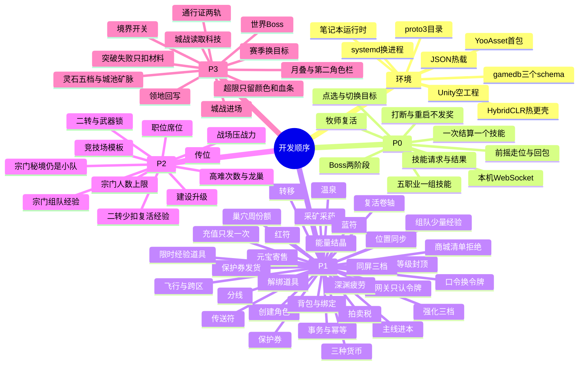

# 双世界 MMO · 开发架构

工作室：云锦繁星。

这份文档按《[MMO系统架构方案](MMO系统架构方案.html)》和《[技术架构](技术架构.md)》拆开发模块。玩法以方案正文为准，进程边界以技术架构为准。这里写每个模块谁来做、读什么、写什么、先做哪一块。第 10 节起是任务卡，第 13 节把每张卡拆成功能点，第 14 节是启动顺序，第 15 节是目录、资源和热更从哪一行开始，第 16 节是两台开发机之间的同步。一次只派第 14 节的一行。

数值、技能表和掉落表仍留到 P0 原型后再填。语言、传输和存储见第 2 节。不把联机放进 Unity 自带的网络方案。

## 1. 开发时守住的边界

表世界负责走路、采集、交易、领地和飞行，同步 5–10Hz，不在这张图上结算技能。副本、活动战斗、竞技场、战场、城战和世界 Boss 从入口进实例，一场一个战斗进程。

客户端用 Unity，首发只做 Android。它负责表现、点选目标和发送请求。伤害、命中、冷却、疲劳、副本次数、强化、转移、商城发货和拍卖扣款，都以服务端结果为准。客户端不回传伤害数字。

角色的持久数据只有一个写入方，下面称为角色服。世界服、战斗服、社交服和全局服务要改背包、金币、灵石、元宝、装备或次数时，都向角色服提交一次事务。战斗过程中的生命、技能冷却和仇恨只活在该场战斗进程的内存里，结束时丢弃，不写回主库。复活卷轴的冷却是例外，写入角色服，跨场保留。

## 2. 技术选型

客户端和服务端的业务都用 C# 写。进程仍然分开，战斗不进 Unity 播放器。

| 层 | 选型 |
| --- | --- |
| 客户端引擎 | Unity 2022.3.62f3 |
| 渲染 | URP |
| 界面 | UGUI |
| 资源 | YooAsset。按区域和副本分包，首包只带炼体到结丹 |
| 代码热更 | HybridCLR。玩法界面和表现放热更程序集，启动和资源加载留在主包 |
| 包来源 | Unity 包从 OpenUPM 拉，`manifest.json` 的 `scopedRegistries` 指向 package.openupm.com，YooAsset 写版本号 2.3.19，不用 git 依赖。HybridCLR 按版本放仓库里，是嵌入式包 |
| 输入 | Input System |
| 打包 | IL2CPP，ARM64，只出 Android |
| 服务端 | .NET 10 LTS。网关、世界服、战斗服、角色服、社交服、全局服务各是独立进程。笔记本上已装 .NET SDK 10.0.403 |
| 手机到网关 | TLS 上的 WebSocket。网关用 Kestrel 接这条长连接 |
| 服与服 | gRPC |
| 消息 | Protobuf，proto3。客户端和各服共用同一套 `.proto` |
| 主库 | 笔记本上的 PostgreSQL 17，库名 gamedb，用户 game_dev，驱动 Npgsql。服务跑在笔记本上时读 `/srv/mmo/gamedb.env`（127.0.0.1:5432）。从 Mac 连接时，同一局域网用 192.168.1.117:5432，其他网络用 YOUR_SERVER_IP:15432。密码不进仓库 |
| 在线状态 | P0 放在对应进程内存。这台笔记本还没有单独的 Redis，不为此再装一套库 |
| 配置 | 仓库里的 JSON，服务端热载 |
| 部署 | 服务跑在笔记本的 Linux 上，用 systemd 拉起，战斗服预先多开。首发不用 Kubernetes。单元模板在 `deploy/systemd/mmo@.service`，环境核对脚本是 `tools/check/check-e3.sh` |
| 日志 | 结构化 JSON 文件，不写入角色库 |

手机长连接用 WebSocket，是因为 Android 上要保持一条能断线重连的通道。服和服之间用 gRPC，是因为角色服的扣款和发奖要有明确的一次请求、一次结果。Protobuf 把字段定死，避免每个服各写一种 JSON。

资源用 YooAsset 下载和加载，不用 Addressables。会热更的玩法代码放进 HybridCLR 程序集。伤害、扣费和发奖仍以服务端结果为准，不把权威逻辑只放在热更包里。

gamedb 这个账号不能新建数据库。角色、宗门、交易分 schema 放在同一个 gamedb 里。连接数上限是 20，连接池要留在这个数以内。密码只放在笔记本的 `/srv/mmo/gamedb.env`，不写进代码，也不提交到仓库。

支付渠道的 SDK 只在客户端拉起付款。元宝只在服务端确认支付回调之后发放。P0 不接真实渠道，用内部订单把「同一笔只发一次」走通。P0 的账号是账号加口令，换成会话令牌。渠道登录以后再加，网关仍然只认令牌。

战斗公式放在服务端的普通测试里验证，不进手机包。Unity Netcode、Mirror、Photon 不作为 MMO 主干。不用别的数据库替换 gamedb，也不把一场战斗的过程写进数据库。

## 3. 客户端模块

Unity 工程按模块分，不按场景把逻辑写进关卡脚本。场景只负责把人放进表世界、副本或城战。

| 模块 | 做什么 | 不做什么 |
| --- | --- | --- |
| 启动与分包 | 启动、YooAsset 检查更新并按区域下载。首包只带炼体到结丹的地图和副本。玩法界面和表现放 HybridCLR 热更程序集 | 不在首包里塞后续大境界的地图。不把伤害和发奖写进热更包当权威 |
| 会话 | 连网关、保持登录、断线重连、把回包分给对应模块 | 不在本地保存可提交的战斗结果 |
| 表世界表现 | 几块相连密区的加载、行走、采集动作、飞行动作 | 不结算技能，不判断采集是否成功 |
| 同屏分级 | 近处完整模型，远处简模，再远只留名字。别人的拖尾和光效关掉 | 不在主城把所有人画全 |
| 点选目标 | 玩家点中一个目标，可手动切换。把目标编号放进后续技能请求 | 不做全场景自动索敌，不做无锁定朝向 |
| 技能表现 | 播放前摇。前摇期间可以走位，命中前可以发打断。回包成功才写伤害和硬直，失败就停掉这次施法 | 不做动作预测、命中回滚、逐帧攻击盒、翻滚和无敌帧 |
| 副本表现 | 模型和技能按完整规格显示。主线、深渊、巢穴最多 4 人，龙巢最多 8 人。竞技场是 1 对 1 或 3 对 3。世界 Boss 一场最多 20 人 | 不在副本里降成名字 |
| 城战表现 | 专门战场。周围的人完整显示，超出同屏上限的只留队伍颜色和血条 | 不在无缝野区上打城战 |
| 界面 | 背包、装备、强化、能量结晶、境界、任务、商城、拍卖、宗门、副本入口、社交 | 界面只展示服务端已经确认的结果 |
| 输入 | 移动、点选、技能按钮、采集和交互 | 不在手机上做连段缓存 |

五个职业、十条分支的差别放在技能配置和界面图标上。换一把本职业兵器，只换模型和装备数值的展示，不换分支技能。

Android 是 P0 的验收环境。要在真机上确认目标好不好选、技能分不分得清、Boss 阶段读不读得懂。主城用同屏分级扛人数，不靠把战斗搬进主城。

**热更程序集的泛型口径（v1.195 写定，M2 的教训）**：`Assets/HotUpdate` 里只用单层泛型容器（`List<T>`、`T[]`），**不写 `Dictionary<TKey, TValue>` 一类的字典泛型**。AOT 侧不会为热更代码用到的组合精确实例化，真机一调 `TryGetValue` 就 `MissingMethodException`——M2 第一轮撞在嵌套的 `Dictionary<ulong, List<EffectSnapshot>>`、第二轮撞在 `Dictionary<ulong, double>`。热更里要按 key 找，一律单层 `List` + 小类 + 线性查（同场单位、效果都是个位数）。`List<T>` 对引用类型参数的共享在老包里已验证可用（`List<SkillInfo>` / `Skills.Find` 在 P0-3c 真机段跑过）。这条由 `tools/check/check-p0-3c.sh` 静态段守着。

## 4. 服务端模块

玩家的长连接只进网关。网关做鉴权、频控和加解密，再按消息类型转到对应进程。

### 4.1 角色服

角色服是持久数据的唯一写入方。账号下可以有第二个角色栏，装备、等级和境界不共享，外观收藏可以共享。

| 模块 | 写入什么 |
| --- | --- |
| 账号与角色 | 账号、角色栏、种族、职业、分支。种族只存外观和出身 |
| 主线与道路 | 主线走到第几场，以及立仙或立魔。创建时都为空。战斗进程不写这两项 |
| 等级 | 1–100。活动、副本、任务、竞技场、战场、城战和世界 Boss 结算经验。到 100 封顶，大版本不抬 |
| 境界 | 十一段及初、中、后、大圆满。版本未开放时拒绝突破 |
| 背包与装备 | 格子、绑定、强化等级、能量结晶、幻形 |
| 货币 | 金币、五档灵石、元宝、绑定资源。灵石相邻档 10000:1 的兑换也在这里做 |
| 计数 | 疲劳、温泉、巢穴周份额、高难次数、宗门秘境活跃 |
| 商城资产 | 已购外观、传送符、红符、蓝符、复活卷轴、解绑道具、限时经验道具、保护券、月叠剩余、通行证进度。卷轴冷却到期和经验道具剩余时间也记在角色上 |

一次事务里要么全部成功，要么全部退回。每笔发奖带一个用过就不能再用的事务号。副本结算和以后的交任务用同一笔写入。强化扣材料、拍卖扣金币、商城发货，都不允许写成一半，也不允许同一个号发两次。

### 4.2 世界服

世界服按分线加载几块相连的区域。同步频率 5–10Hz，内容是坐标、朝向、外观档位，以及是否在采集、是否可飞行。

| 模块 | 做什么 |
| --- | --- |
| 场景与分线 | 首发只开炼体到结丹用到的密区。新区随境界版本再接 |
| 移动校验 | 速度、是否允许飞行、目标区域的境界门槛。不通过就拉回 |
| 同屏档位 | 按距离算出完整、简模或只留名字，发给周围的人 |
| 采集 | 矿脉和药草的占用与刷新。成功与否由这里判定，产物写入角色服 |
| 灵石矿脉 | 归属记在主城上，不做成玩家个人采集点。开采权变更写在城池数据里 |
| 入口 | 副本、竞技场、城战的报名转到战斗服或匹配。世界服不发奖励 |

采集不扣疲劳。灵石不从矿点进个人背包。

### 4.3 战斗服

一个副本、活动、竞技场、战场、城战或世界 Boss 一个进程。进程池预先拉起，冷启动控制在 3 秒内。场内状态在内存里。结束、失败或掉线时，把奖励、等级经验和次数一次提交给角色服，然后进程可以回收。生息的复活冷却留在这场内存里，结束就丢。

| 模块 | 做什么 |
| --- | --- |
| 进本资格 | 人数、等级、境界、疲劳、周份额、高难次数。主线只允许 1 人，不扣疲劳 |
| 人数结算 | 低级本和高级本的产出与扣除乘以进本人数，当日或当周总量不变。高难进一次扣 1 次，产出不乘人数 |
| 技能结算 | 一次只处理一个技能请求。检查是否在本里、目标是否还在、冷却、距离，再算伤害、治疗、仇恨和硬直 |
| 仇恨 | 坦克用体力计算稳定度。体力不进入坦克的攻击 |
| 属性 | 战士用力量，射手用敏捷，法师和牧师用精神。体力是所有人的生命。五个职业都有蓝量，上限是职业基础蓝量加上精神乘职业系数。蓝量不进入伤害 |
| 掉落 | 怪物掉能量结晶和副本表里的强化石、装备。灵石基本不掉 |
| 阶段 | Boss 阶段和读招走配置。不设霸体条和破防窗口 |
| 红符、蓝符与丹药 | 红符只回复自己的生命，不超过同级回春丹、气血丹，和红药、牧师治疗共用冷却。蓝符只回复自己的蓝，不超过同级凝神丹、回灵丹，和蓝药共用冷却。两者不复活，蓝符不回血。复活卷轴只拉起自己。卷轴冷却写入角色服，跨场保留，时间更长。生息冷却留在这场，时间更短 |
| 崩溃 | 奖励还没写入角色服，这场就不发奖。高难次数以角色服里已经写下的记录为准 |

怪物生命和伤害按进本人数缩放，机制不改。世界服再忙，也不改已经进本的这场结算。

P0 这一版的战斗服只开一条本机 WebSocket（`/battle`），一条连接就是一场，连上就开，没有进本协议，也没有网关鉴权。监听地址、Boss 血量、站位和技能表都在 `config/battle.json` 与 `config/skills.json` 里，端口写 0 由系统分配，启动后打一行 `listen=`。通关的结算先落在 `var/battle/settlements/`，一场一条，文件名就是事务号；接上角色服以后整条换成那一笔事务，事务号的含义不变。中途崩掉，这场就没了，重启既不恢复也不补发。

### 4.4 社交服

社交服不写伤害公式。

| 模块 | 做什么 |
| --- | --- |
| 宗门名册 | 五级。1 级 10 人，2 级 30 人，3 级 60 人，4 级 100 人，5 级 200 人。满员不再收人 |
| 职位 | 掌门 1、副掌门 1、长老 4、执事 12，其余弟子。1 级只有 10 个席位。传位只给副掌门 |
| 建设与贡献 | 升级耗建设。建设和贡献来自宗门秘境和宗门任务，不从商城买 |
| 科技 | 只在城战里提供加成。战斗服开城战时来读，社交服不算伤害 |
| 展示 | 山门、旗帜、披风只是外观，从商城资产读。宗门 NPC 只卖基础药品和辅助物品，不卖矿、药、灵石、境界丹、回复丹、强化石、转移石、能量结晶、胚子和装备 |
| 聊天、邮件、好友 | 邮件不作为发奖依据。可交易的金币和物品仍走拍卖或摆摊的交易事务。先不做师徒 |
| 洞府与家园 | 摆放和访客可见。家园币只换外观和便捷 |

宗门秘境的进本人数仍是 1–4 人。200 人是名册，不是进本人数。

### 4.5 全局服务

| 模块 | 做什么 |
| --- | --- |
| 拍卖行 | 金币标价。成交时按配置抽 5%–8% 的金币，抽走的金币销毁。装备、材料、灵石挂单和元宝寄售都走这里的扣税 |
| 摆摊 | 摊位显示在世界服。成交仍提交同一套交易事务，不在世界服里直接改背包 |
| 元宝寄售 | 付费玩家挂元宝，搬砖玩家用金币买。商城不卖金币 |
| 商城 | 只收元宝，商品直接标价，不做抽卡。发货前对照上架清单。保护券、红符、蓝符、复活卷轴、解绑道具和限时经验道具绑定。蓝符、复活卷轴、解绑道具和限时经验道具只从商城来。没写在清单里的拒绝。不卖复活币 |
| 充值 | 支付渠道回调发元宝。同一笔订单只发一次 |
| 匹配 | 竞技场、战场、跨服只交换报名和结果，不合并两个服的角色库 |
| 排行与赛季 | 赛季更换秘境目标。通行证进度记在角色服 |
| 配置 | 技能、掉落、强化概率、人数上限、每周次数、境界门槛、采集节点、商城清单。热更后新请求用新表，已经进本的那场用进本时的表 |

支付回调、拍卖成交和商城发货都要能重放而不会发两次。

## 5. 八条主流程

每条流程都写明请求从哪来、谁判定、谁落库。

**登录。** 客户端把凭证交给网关。网关核对接号，角色服返回角色列表和第二个角色栏是否已购买。客户端进入上次所在的世界分线。

**在表世界移动。** 客户端上报位移。世界服按 5–10Hz 校验并广播档位。飞行和跨区先问角色服的境界。不通过就拉回，不在客户端上改权限。

**采集。** 世界服占住矿或药的节点，成功后让角色服放入矿石或药材。灵石矿脉不走这条。

**进副本。** 世界服把入口请求交给战斗服。战斗服向角色服申请扣疲劳、份额或次数。扣成功才把人放进实例。主线不扣。高难少于 2 人直接拒绝。元婴及之后的新副本还要检查境界，旧副本只看等级。

**放技能。** 客户端发送技能编号、目标编号和自己认为的施放时刻。战斗服先查冷却、目标、距离和蓝量，再结算。蓝不够就拒绝，不改目标生命，也不扣成负数。结算后把结果发给本里的人。客户端先播前摇，回包失败就停。红药、红符和牧师治疗共用生命回复冷却。蓝药和蓝符共用蓝量回复冷却。两色冷却分开。生息复活的冷却只留在这场战斗进程，记在施法者身上，时间更短，结束就丢。复活卷轴的冷却写入角色服，跨场保留，时间更长。用一个不开始另一个，也不占用上面两色冷却。拉起只扣当前等级已有经验的一部分。当前级经验是零时，这次不扣。不掉级。

**结算离开。** 战斗服把掉落、等级经验和这场击杀累计的历练值一次交给角色服。活动、副本、任务、竞技场、战场、城战和世界 Boss 的等级经验都走这一笔。组队和同门加成、限时经验道具只乘这一笔。写入成功后回收进程。历练只统计这次已经有资格进入的副本里的怪物。表世界不结算战斗，不计历练，也不加等级经验。

**强化与转移。** 角色服检查石头等级、金币和保护券。失败只掉 1 级。保护券只挡住这一次掉级。转移要求来源强化高于目标，来源变为 +0，绑定规则在同一次事务里改完。

**突破。** 角色服核对修为就是当前这一段，历练值够，这一段已经打开的主线和列出的必要支线都完成，灵石够。版本未开则拒绝。成功后修为进入下一段，扣掉这次要求的历练值和灵石。失败后修为不变，历练值和灵石仍扣。灵石档位兑换也在角色服，不进拍卖。

**买商城。** 全局服务对照清单，角色服扣元宝并发货。蓝符、复活卷轴、解绑道具和限时经验道具只从商城发，购买后绑定。月叠只发传送符和红符。通行证付费轨可以发很少几张保护券，不发复活卷轴、解绑道具和经验道具，也不发金币、强化石、灵石、装备和副本次数。

## 6. 数据放哪

| 数据 | 放在哪 | 丢了会怎样 |
| --- | --- | --- |
| 账号、角色、主线场次、立仙或立魔、背包、装备、货币、境界、疲劳、次数、商城资产、卷轴冷却到期、经验道具剩余时间 | gamedb 的角色 schema | 不能丢。这是发奖依据。剧情进度不放进战斗进程 |
| 宗门名册、职位、建设、邮件 | gamedb 的社交 schema | 与角色表分开，避免抢同一批行锁 |
| 拍卖、寄售、充值订单 | gamedb 的交易 schema | 订单号唯一，重复回调不二次发货 |
| 在线位置、AOI、采集占用、匹配队列、玩家所在实例、生息复活冷却 | P0 放进程内存。生息冷却在战斗进程里 | 可以丢。重进场景后由世界服或战斗服重建。生息冷却不写进角色库 |
| 一场副本的过程 | 战斗进程内存 | 进程崩溃则这场不发奖 |
| 行为日志 | 单独的日志流 | 不参与发奖，用来查工作室和掉单 |

城池上的灵石矿脉归属放在世界或城战结果写回的城池表，不放进个人采集节点。

## 7. 配置谁读

配置由全局服务下发。世界服读区域、采集和飞行门槛。战斗服读技能、掉落、人数和 Boss 阶段。角色服读强化概率、灵石兑换、商城清单和境界版本开关。客户端可以提前下载后续地图，但服务端拒绝时进不去。

开发期这几份配置在仓库的 `config/` 下：`battle.json` 是战斗服的监听、双方血量和站位、结算目录，`skills.json` 是技能表。战斗服启动时读，缺字段、数值为负、技能编号重复、前摇为零、或者一个技能都够不着站位，都直接起不来，不带着半截配置跑。

首发包只带炼体到结丹。元婴及之后的区域、副本和境界外观随该版本再下。

## 8. 按阶段做哪些模块

顺序不能倒。前一阶段的写入方没稳定，后一阶段不往上叠。

**P0 战斗验证。** 客户端的会话、点选、技能表现，加一个战斗服和一份技能配置。五个职业各一组主动技能，一场单人 Boss。验收在 Android 真机上完成。此阶段可以暂时把角色数据放在战斗进程旁的一张表里，但接口要按角色服的样子留好，避免 P1 再改协议。

**P1 一天的循环。** 角色服落地。世界服的分线、移动和采集。深渊疲劳、巢穴周份额、强化、能量结晶、拍卖行。商城先做保护券、红符、蓝符、复活卷轴、解绑道具、限时经验道具、传送符和外观发货，确认绑定和清单拒绝有效。

**P2 人会留下来。** 社交服的宗门名册、职位、宗门秘境计分。竞技场和战场的匹配。高难次数和龙巢。二转只推进一步已经选中的分支。城战仍是战斗服里的战场，科技从社交服读。

**P3 长线。** 境界版本开关、灵石矿脉的城池归属、领地税收、世界 Boss、赛季和通行证。十一段不要在首发进程里一次做完。洞府、第二角色栏和月叠可以跟商城清单一起开，不挡 P0。师徒先不做。

## 9. 模块依赖

角色服先于一切会改背包的模块。战斗服的进本资格依赖角色服的等级、境界和次数。世界服的飞行和跨区依赖角色服的境界。拍卖、摆摊和商城依赖角色服的货币事务。城战依赖战斗服的实例，以及社交服的科技。匹配只依赖报名和结果，不依赖把角色库并到一起。

客户端的技能表现依赖战斗服回包，不依赖本地伤害。同屏分级依赖世界服给出的档位，不在手机上自行决定远处的人该不该画全。

## 10. 怎么派工

一次只派第 14 节的一行。这一行做完，并用它的核对结果看过之后，再派下一行。不要把后面的行和前面的行拼进同一次开发。任务卡仍是这些行的上一级，卡的完成标准不变。第 1–79 行已经落地；其后改派第 80 行起，顺序和停派清单在 14.3，不回改已落地的行号。

每次派工写明卡号，并按「索引 + 本卡相关节」带上这三份文档：

| 文档 | 带什么 | 怎么定位 |
| --- | --- | --- |
| `docs/MMO系统架构方案.html` | 只带本卡涉及的玩法节 | 按页面导航锚点取那一节（`#s7` 战斗、`#s8` 成长双轨、`#s9` 装备、`#s10` 副本、`#s11` 社交、`#s12` 经济、`#s13` PVP、`#s14` 节奏投放） |
| `docs/技术架构.md` | 只带本卡跨到的进程边界 | 按 `## ` 标题取「进程名 + 边界」两段 |
| `docs/开发架构.md` | 只带第 10 / 11 节与本卡那一节 | 按卡号 grep 定位 |

三份文档仍是正本，不许凭印象写玩法。不确定某条规则在哪一节时，先 grep 关键词定位再读那一节，**不整份投喂**：整份投喂的代价是每卡固定两三万输入 token，而命中率不到一成。

派工时把下面这段放在前面，再写卡号：

> 只实现开发架构里的这一张任务卡。不要提前做后面的卡，不要改方案里已经写定的玩法。数值还没定的地方留成配置，不要在代码里写死概率。语言、传输和存储按开发架构第 2 节，不要另起一套。做完后按这张卡的完成标准逐条说明结果。遇到规则冲突就停下来，不要自行改规则。

开发时若发现两份文档不一致，以方案正文为准，并停下来说明冲突，不在同一次改动里悄悄改掉玩法。

每张卡做完，把这次的开发日志写进 `docs/开发日志.md` 第一段（`## 一、开发实施`）的最上面。日志里写卡号、做了什么、核对结果。不写密码和连接串。这份日志同时是方案与工程的唯一时间线，不再另写一份更新记录。

U1 到 U8 是追加在第 14 节表尾的界面卡，同样一次只派一行，派工与提交都单独进行，不和功能卡拼进同一次开发；它们按「紧挨的上一行」列对齐功能卡，不与表尾第 70 行构成先后依赖。逐卡范围与验收写在 14.1。

**派工的读写纪律**（v1.188 起写定，单人 + AI 派工的实际开销主要来自返工与整份重读，不是单步本身）：

1. 开卡只读四段：任务队列的 `CURRENT` / `NEXT` / `STAGE` / `PLAN_GATE` 与这一张的行、本节与第 11 节、开发日志第一段最上面一条、本卡要改的文件按符号定位后的一小段。不整份读开发架构 / 开发日志 / 未覆盖排期，当模板的上一张实现文件也只看签名与关键段。
2. 断言里的期望值一律现取（库里的事实值、配置现值、只读入口输出），不写死现值或「当时的事实」；写死一次就多一趟真库取证加一轮修改。
3. 本地无库段先跑绿，再上真库一次取证；真库只跑最终版，不在远端迭代断言。
4. 编译一次收齐错误（`dotnet build src/MMOGame.sln -c Release`），不逐工程反复编译。
5. 日志 / README / 清单里的通过项数、迁移条数、卡片编号等数字，等核对定稿后一次写完，只在一处定。
6. 方案没写、配置 `pending`、老断言与新事实冲突时，先把待定项与默认值列给用户点头，再落代码。

### 10.1 结构预算（防卡片越拆越多、产物越写越厚）

单人 + AI 派工的开销大头不是单卡内容，是每卡重复支付的固定产物。v1.201 实测：C4 业务代码 222 行、check 脚本 457 行（固定开销占 70%）；全库 check 行数（sh + py）÷ 手写业务代码约 80%。**唯一的闸门是基线锁**：存量快照记在 `tools/check/structure-baseline.txt`，任何一项比基线差就红、变好则提示把基线调低；历史不改写，存量债靠并域（阶段 4 D14）还，不靠判红还。现值与绝对红线只在基线文件与脚本顶部常量各一份，本表不抄第二份。

| 项 | 闸门（比基线差才红） | warn 目标（只提示，不判红） |
| --- | --- | --- |
| check 脚本数 | `scripts`（绝对红线 150） | ≤60 个 |
| 单脚本行数 | `max_script_lines`（绝对红线 1000） | ≤350 行 |
| check 总行数 ÷ 业务代码 | `ratio`（无绝对红线） | ≤40% |
| 重定义 helper 份数 | `dup_sites`（份数总和，不是种类） | 0（全走 `lib-common.sh`） |
| 单卡日志 | 新条目 ≤50 行（历史条目豁免） | 只留「改了什么 / 怎么验 / 契约指针」 |

单卡「业务代码 < 固定产物」不看行数上限，看比例：派工收尾跑 `bash tools/check/check-structure-budget.sh --commit <sha>`，固定产物 ÷ 业务 > 100% 判红，同类卡下一张必须合（10.3 第 2 问）。

check 行数分母含 `tools/check/*.sh` 与 `tools/check/*.py`，业务分母是 `src/**/*.cs`（排除 `Generated` / `Tests`）。新增 helper 优先于新增脚本：`lib-common.sh` 已有 `expect_json` / `assert_bad_config` / `assert_interface` / `assert_floor` / `wait_ready` / `db_cli` / `stop_pid` / `finish`，能用就不重写。**新卡默认把断言并进同域已有 `check-*.sh` 的一个区块，只有新域才准新建脚本**，新建时 `scripts` 基线 +1 一起落账。检查用 `tools/check/check-structure-budget.sh`，已挂进 `ci.sh`。

### 10.2 合卡准入（四条全满足才许合）

合卡省的是固定成本，不是省事；合错的代价是把回滚粒度弄粗。四条缺一不许合：

1. **验收主体相同**：同一个界面、同一张表、同一组 RPC。跨了验收主体就是两张卡。
2. **依赖完全重合**：合后不产生新的串行等待。
3. **回滚粒度可接受**：不碰四类不可逆点；碰的能一起回滚（判据见[不可逆点清单](不可逆点清单.md)）。
4. **合后手写业务代码 ≤1600 行**：B1（v1.201）实测 1623 行是单次稳妥交付的上限，超过就拆回去。

不许合的三类：带 `★` 的决策卡（一议题一拍板，合了就变成一次拍八个板）、风险列非空且回滚边界互不相干的、阶段 6 的 Q31 / Q32 / Q35。

拆卡同理，只认一条：**跨了不同的验收主体**（DB 迁移 / 协议变更 / 客户端屏幕 / 配置表）。只是「内容多、功能点密」的，不拆。

### 10.3 阶段闸门结构体检（每阶段末四问，答案进闸门提醒）

1. check 脚本数、check ÷ 业务代码比，有没有超 10.1 的阈值？
2. 本阶段有没有「业务代码 < 固定产物」的卡？记下卡号，下一阶段同类卡必须合。
3. 日志与文档的增长是否超过代码增长？超了先瘦文档，再开新卡。
4. 下一阶段哪些卡可按 10.2 合并？列候选与理由，没有就写「无」。

这四问是阶段闸门提醒的固定段，按任务队列的模板发，不许省略。

## 11. 任务卡

每张卡都包含交付、完成标准和不要做的事。完成标准是可以演示或可以核对的结果，不是「代码已写完」。

### P0-1 消息与一场战斗

交付：用 proto3 定义技能请求和技能结果。请求里有技能编号、目标编号、客户端认为的施放时刻。结果里有是否命中、伤害或治疗、硬直、冷却。一个 .NET 战斗进程能打一场单人 Boss。手机到这个进程可以先走一条本机 WebSocket，网关鉴权放到后续。一次只结算一个技能。冷却没好、目标不在、距离不够，都拒绝，并且不改目标生命。

完成标准：连续发出两个还在冷却中的技能，只有第一次生效。打断后这次施法没有伤害。战斗进程重启后，这场没有写入的奖励不会出现。

不要做：世界服、拍卖、商城、宗门、五个职业的完整技能表。不要在客户端算伤害。

### P0-2 手机上的点选和前摇

交付：Unity 的 Android 包。能点选目标、切换目标、按下技能。先播放前摇，前摇期间可以走位，命中前可以打断。回包成功才显示伤害和硬直，回包失败就停掉这次施法。

完成标准：在真机上能选中 Boss，能看清一次技能的前摇和结果。故意发一个会被拒绝的技能时，画面上的施法停住，血量不变。

不要做：自动索敌、无锁定朝向、翻滚、无敌帧、动作预测、命中回滚、逐帧攻击盒、输入缓冲。

### P0-3 五个职业各一组技能

交付：坦克、战士、法师、射手、牧师各一组主动技能加普攻，放进配置。战士攻击读力量，射手读敏捷，法师和牧师读精神。体力是所有人的生命。五个职业都有蓝条。蓝量上限是职业基础值加上精神乘该职业系数，法师和牧师基础最高，射手次之，战士再次，坦克最低。蓝量不进入伤害。主动技能耗蓝，蓝不够就拒绝。牧师这一组里包含复活，能拉起同一场里倒地的队友，不能拉自己。拉起后只扣当前等级已有经验的一部分，不掉级。这段冷却比复活卷轴短，两段分开计。坦克的仇恨稳定读体力，体力不进入坦克的攻击。Boss 至少两个阶段，阶段走配置。

完成标准：换成坦克后，提高体力不会提高这一下的伤害，但仇恨更不容易被拉开。五个职业的技能在手机上能分清。牧师蓝不够时拉不起来。拉起后对方等级不变。当前级经验是零时，这次不扣。

不要做：十条分支的全部技能、觉醒、纹章、霸体和破防。

### P1-1 角色服

交付：账号、角色、背包、装备、金币、灵石、元宝、疲劳、副本次数的唯一写入。一次事务要么全成功，要么全退回。等级写入封顶 100。种族只存外观和出身。

完成标准：同时提交两笔会把金币扣成负数的操作，只有一笔成功，背包不会出现扣了钱却没得到物品。重复提交同一笔已完成的事务，不会发两次。

不要做：在世界服或战斗服里直接改背包。不要把第二个角色的装备和境界设成共享。

### P1-2 进副本

交付：主线只允许 1 人，不扣疲劳，不占周份额。深渊 1–4 人，疲劳按人数倍增，日上限 6000，温泉只恢复 1500 点疲劳。巢穴每周 12 个单人份，4 人进一次，每人得 4 份、扣 4 份。怪物生命和伤害按人数缩放。旧副本只看等级。活动、副本和任务都结算等级经验。同一场至少两个人时，这一笔多一截少量加成，只加经验。以后的竞技场、战场、城战和世界 Boss 也走这一笔，不另写一套。

完成标准：一天内把疲劳打到 6000 后不能再进深渊。4 人打巢穴一次后，这周剩余份额是 8 个单人份，每人拿到的是 4 份而不是 1 份。单人巢穴一周能打 12 次，总产出与 3 次满员相同。单人结算没有组队经验。两人进同一场，经验比单人多，伤害和掉落不变。

不要做：高难次数、宗门秘境、元婴副本的境界门槛。这些在后面的卡。同宗门的额外经验留到 P2-1。

### P1-3 表世界

交付：几块相连密区、分线、5–10Hz 的位置和外观档位。近处完整、远处简模、再远只留名字。矿和药可以采，成功后把产物交给角色服。采集不扣疲劳。飞行和跨区读取境界，不允许就拉回。

完成标准：主城里远处的人不再是完整模型。采一次矿，背包里出现矿石，疲劳不变。没有飞行权限时，客户端发起飞请求会被拉回地面。

不要做：在表世界结算技能。不要让玩家从灵石矿脉直接采到灵石。

### P1-4 强化、转移和结晶

交付：强化最高 +12。+1 到 +6 只用低级强化石，+7 到 +9 只用中级石，+10 到 +12 只用高级石。失败掉 1 级，不碎、不清零，没有失败累计必成。保护券只挡住掉级，不提高成功率。券本身绑定，用的时候不看来源。商城购买和通行证付费轨发的是同一种。转移要求来源强化高于目标，来源变为 +0，绑定规则在同一次事务里完成。能量结晶可拆，分攻击、防御、功能，部位限定。

完成标准：用低级石点 +7 被拒绝。失败后强化等级只少 1。用保护券失败后等级不变，成功率与不用券时使用同一套配置。来源 +3、目标 +5 的转移被拒绝。

不要做：把概率写死在代码里。不要做纹章、装备碎掉、强化清零、重铸、精铸和洗词条。制作时的一次随机留到铁匠，不在这张卡里做。

### P1-5 拍卖、寄售和商城

交付：拍卖用金币标价。成交销毁配置中的 5%–8% 金币。元宝可以寄售成金币，商城不直接卖金币。商城只收元宝，直接标价，对照第 12.1 节的上架清单发货。保护券、红符、蓝符、复活卷轴、解绑道具和限时经验道具绑定。红符只回复自己，回复不超过同级丹药，和丹药、牧师治疗共用冷却，不复活。复活卷轴只拉起自己，冷却写入角色服，跨场保留，比生息技能长。生息冷却不写进角色库。拉起只扣当前等级已有经验的一部分，当前级是零时不扣，不掉级。解绑道具只解开装备绑定，绑定越久张数越少，下限走配置。限时经验道具到点消失，只加经验，同时只生效一个。蓝符、复活卷轴、解绑道具和限时经验道具，副本、任务、月叠和通行证都不发。充值订单重复回调只发一次元宝。

完成标准：清单外的商品请求被拒绝，元宝不扣。红符不能治疗队友，也不能在死亡时把人拉起来。复活卷轴不能拉队友。换一场后卷轴冷却还在。当前级经验是零时，卷轴不扣经验，等级不变。解绑道具解不开红符。绑定更久的装备，需要的张数更少。同一笔充值订单回调两次，元宝只增加一次。拍卖成交后，卖方少掉一笔税，这笔税不进任何角色背包。

不要做：抽卡、卖疲劳、卖副本次数、卖强化石、卖灵石、卖装备、卖蓝药、卖复活币。不要在这一张卡里做月叠、第二角色栏和通行证，它们在 P3-4。生息的复活在 P0-3a，二转少扣经验在 P2-4。

### P2-1 宗门

交付：宗门五级，人数上限依次是 10、30、60、100、200。职位是掌门 1、副掌门 1、长老 4、执事 12，其余弟子。1 级只有 10 个席位。传位只给副掌门。掌门不能直接退出。升级耗建设，建设不从商城买。名册满了不再收人。同一场至少两名同门时，这些同门再多一截更窄的经验，只加经验。

完成标准：1 级宗门第 11 个人被拒绝。把掌门传给弟子被拒绝。宗门秘境仍是 1–4 人进本，不会因为名册有 200 人就变成 200 人副本。同门两人比不同门的两人多一截经验，伤害不变。

不要做：把宗门科技算进日常副本伤害。科技只留给城战读取。不要让宗门 NPC 出售材料。不要做师徒。

### P2-2 高难本

交付：高难至少 2 人，龙巢最多 8 人，每人每周 1 次。进一次扣 1 次，产出不按人数翻倍。怪物生命和伤害仍按人数缩放。进程在奖励写入前崩溃，则这次不发奖；次数以角色服里已经写下的记录为准。

完成标准：单人进龙巢被拒绝。8 人进一次，每人只得 1 份奖励，并且这周不能再进。模拟奖励写入前崩溃，角色背包没有这次掉落。

不要做：把龙巢改成可以单人一层层打。

### P2-3 匹配、竞技场和战场

交付：竞技场 1v1、3v3 使用统一属性模板，只保留职业和分支。战场 10v10，装备生效后再压到同队 1.3 倍以内。跨服只交换报名和结果。

完成标准：竞技场里换装不改变模板属性。战场里同队两人的有效战力差不超过 1.3 倍。匹配结果写回后，两个服的角色库仍然是分开的。

不要做：城战。城战在 P3-3。

### P2-4 二转

交付：15 级选定的分支，在 45 级只把这一条分支再推进一步。换兵器不改分支。穿戴等级不到 15 的武器仍全职业可装备，15 级起只能装备本职业兵器。生息的复活在一转就已经有。二转不另给一条，只把这次拉起扣掉的经验减少，并且不掉级。复活卷轴仍按基础值扣。诫律不能复活。

完成标准：45 级之后不能改去另一条分支。战士不能装备 15 级以上的法杖。不满 15 级的武器可以给五个职业装备。同一名倒地的人，二转生息拉起时扣的经验少于一转。等级都不掉。卷轴拉起时仍按基础值扣。诫律的复活请求被拒绝。

不要做：觉醒。觉醒留在满级之后，不在这张卡里打开。

### P3-1 境界版本

交付：十一段按顺序开放。首发可到结丹，元婴及之后每段由配置开关。未开放时不能突破，也不能进入该段的新副本。旧副本不提高境界门槛。修为就是当前境界。历练值来自已能进入的副本里的击杀。炼心是做完这一段已经打开的主线和必要支线。成功后修为进入下一段。失败后修为不变，扣掉这次要求的历练值和灵石。

完成标准：元婴开关关闭时，等级已满也不能突破，也不能进入元婴副本。已开放的深渊和巢穴在境界不够元婴时仍然能进。突破失败后修为不变，历练值和灵石减少。必要支线没做完时，历练值够也不能突破。

不要做：把等级上限抬过 100。不要一次把十一段的地图打进首包。

### P3-2 灵石与城池

交付：灵石五档，相邻 10000:1，在角色服兑换。仙晶不是元宝。灵石从主城掌管的矿脉经任务发放，打怪基本不掉。矿脉归属在城池上。城池税收和拍卖销毁的金币分开记账。

完成标准：玩家对灵石矿脉发采集请求被拒绝。任务发放的灵石可以进拍卖。兑换时 10000 个下品变成 1 个中品，不经过拍卖。

不要做：在商城卖灵石或境界加速。

### P3-3 城战与领地

交付：城战是战斗服里的战场，从 40 对 40 起。周围的人完整显示，超出同屏上限的只留队伍颜色和血条。装备全额生效，再加上宗门科技。胜负写回城池的税收和灵石矿脉归属。世界服不结算这场技能。

完成标准：城战里的技能请求由战斗服结算。结束后城池归属改变，个人采集仍然采不到灵石。同屏超限的单位没有完整模型。

不要做：在无缝野区里直接打城战。

### P3-4 赛季、通行证和其余商城

交付：赛季更换一处秘境目标。通行证免费轨只有称号和外观碎片。付费轨是当季外观、洞府摆件和很少几张保护券。这些保护券和商城卖的是同一种，到账绑定。月叠只含三十天的传送符和红符。第二角色栏不共享装备、等级和境界，可以共享外观收藏。

完成标准：通行证奖励里没有金币、强化石、灵石、装备和额外副本次数。付费轨到账的保护券能按 P1-4b 挡住掉级。月叠到账后背包里只有传送符和红符。第二个角色的强化等级是 0。

不要做：抽卡。不要用通行证发战力材料。

### P3-5 世界 Boss

交付：按配置时刻在已经开放的地表入口出现。进去后是战斗服的一场实例，世界服不结算技能。首发上限 20 人，一个人也能进。每人一场一份奖励，含等级经验，组队和同门加成在这里生效。倒地后生息和复活卷轴都能拉，只扣当前等级已有经验的一部分，不掉级。伤害最高的宗门在下一场前把名字记在入口上。归属不加属性，不改税收，不转走灵石矿脉。

完成标准：时间未到时入口进不去。21 个人被拒绝。一个人能进并拿到个人奖励。世界服不结算这场技能。归属宗门的成员伤害和掉落与别人相同。倒地后生息和卷轴都能把人拉起来，等级不变。

不要做：要求百人在线。不要在表世界直接结算这场技能。

### U 系列 界面落地

交付：把 `docs/UI原型全集.html` 的 30 屏按接口成熟度落进 Unity。先落共用界面骨架与双风格皮肤，再按屏组接各系统已经定死的回包。U1 到 U7 追加在第 14 节表尾落 30 屏，U8 是入口收尾卡，U9–U13 只接已有 HTTP、不新增玩法屏；逐卡的交付、完成标准与不要做的事写在 14.1 与 14.4；玩法规则仍以方案正文为准，界面不改任何一条。

完成标准：每批都能在真机上切两套皮肤，屏上只读服务端已经确认的结果；真机 P0-3c 的 59 项不回退，17.2 的四份契约不破，Launch AB 在提交前还原。

不要做：不把界面做成第二个数值权威，不本地算概率、费用、税、绑定或伤害；不另起 `Resources` 路径，不为另一套皮肤另建一套控件 prefab；不把风格偏好写进 `config/`、协议或业务表；不在回包形状定死之前接商城与社交屏。

## 12. 派工顺序

按这个顺序派。前一张没有达到完成标准，不派后一张。

1. P0-1 消息与一场战斗
2. P0-2 手机上的点选和前摇
3. P0-3 五个职业各一组技能
4. P1-1 角色服
5. P1-2 进副本
6. P1-3 表世界
7. P1-4 强化、转移和结晶
8. P1-5 拍卖、寄售和商城
9. P2-1 宗门
10. P2-2 高难本
11. P2-3 匹配、竞技场和战场
12. P2-4 二转
13. P3-1 境界版本
14. P3-2 灵石与城池
15. P3-3 城战与领地
16. P3-4 赛季、通行证和其余商城
17. P3-5 世界 Boss

主线十二场、采集采药的完整节点、洞府摆放，放在对应系统已经能发奖之后再派，不单独插进 P0。派这些内容时仍要写明卡号范围，并写上「只加内容和配置，不改前面任务卡已经完成的规则」。环境准备和功能点的先后以第 14 节为准。

U1 到 U8 是横切所有阶段的界面工作线，排在第 14 节表尾，按各卡「紧挨的上一行」列对齐功能卡，不插进上面 17 项的顺序；同样一次只派一行，前一张没达到完成标准不派后一张。

## 13. 功能点

下面每条都是可以单独派工的功能点。玩法规则仍以方案正文为准，不在这里加新系统。



**环境**

- E1 笔记本运行时：确认 .NET SDK 10.0.403、PostgreSQL 17 的 gamedb、用户 game_dev 能连上。服务读 `/srv/mmo/gamedb.env`。密码不进仓库。
- E2 三个 schema：在 gamedb 里建角色、社交、交易。不新建数据库。连接池留在 20 以内。
- E3 空进程与换进程：systemd 能拉起一个空的 .NET 进程。改代码时等手头事务写完，再换进程。不在进程里卸载重载程序集。单元用 `deploy/systemd/mmo@.service`，按工程名起实例（`mmo@Gateway` 之类），发布到 `/srv/mmo/app/<工程名>/<工程名>.dll`。新进程起来之前，旧进程必须已经退出。核对按 `tools/check/check-e3.sh` 跑，它按顺序验四件事：启动后只有 1 个同名进程且自报就绪；重启后旧 PID 已消失、新 PID 起来；换一份新构建后进程号再变，且映射的是新程序集；停服退出码 0、不留残留进程。另外查一遍单元里没有 `ExecReload`。
- E4 JSON 热载：配置目录和读取口先在。新请求用新表，已经进本的那场用进本时的表。
- E5 Unity 空工程：Unity 2022.3.62f3，URP、UGUI、Input System，IL2CPP，ARM64，能打出 Android 空包。
- E6 AB 与 YooAsset：从这一行开始打 AssetBundle，并用 YooAsset 加载。首包组名叫 Launch，只留炼体到结丹的占位。不用 Addressables，也不另做一套打包。
- E7 代码热更：从这一行开始用 HybridCLR 加载热更程序集。表现放热更程序集，伤害和发奖不放进去当权威。包按版本放 `client/MMOGame/Packages/com.code-philosophy.hybridclr`（嵌入式包），热更程序集是 `Assets/HotUpdate`，设置写在 `ProjectSettings/HybridCLRSettings.asset`（`hotUpdateAssemblyDefinitions` 只登记 asmdef 一条，不要再把程序集名写进 `hotUpdateAssemblies`，否则打包报 duplicated），加载口在 `Assets/AOT/HotUpdateLoader.cs`。IL2CPP 补丁用 `tools/env/fetch-il2cpp-patch.sh` 取源码，再用 `Assets/Editor/E7Install.cs` 按 `MMO_IL2CPP_SRC` 指的目录装进 `Library/HybridCLR/LocalIl2CppData-OSXEditor/il2cpp`。核对跑 `tools/check/check-e7.sh [--build]`：先查补丁版本与包一致，再编译热更 dll、当字节流装进运行时、反射到 `HotUpdate.Entry`、扫热更目录里没有伤害结算；加 `--build` 会再打一次 Android IL2CPP 包，确认 apk 里有 `libil2cpp.so` 和 `global-metadata.dat`。
- E8 proto3 目录：客户端和各服共用同一套 `.proto`。这一步只建目录和生成方式，不写玩法消息。proto 放 `proto/`，生成用 `tools/gen/gen-proto.sh`，同一份代码出到 `src/Shared/Generated` 和 `Assets/Proto/Generated`。核对跑 `tools/check/check-e8.sh`：重新生成比对不漂移、服务端和客户端各序列化一次同一条空消息、两边逐行比对。

**P0-1 消息与一场战斗**

- P0-1a 技能请求与结果：请求含技能编号、目标编号、客户端认为的施放时刻。结果含是否命中、伤害或治疗、硬直、冷却。
- P0-1b 一次只结算一个技能：冷却没好、目标不在、距离不够都拒绝，并且不改目标生命。
- P0-1c 本机 WebSocket：手机或本机先连战斗进程。网关鉴权放到 P1-1a2。
- P0-1d 打断与重启：打断后这次没有伤害。进程重启后，没写入的奖励不会出现。

**P0-2 手机上的点选和前摇**

- P0-2a 点选与切换目标：点中一个目标，可手动换。目标编号放进后续技能请求。点选界面放在热更程序集里，Boss 场景放在 Launch 这组 AB 里。这是热更和 AB 第一次装上玩法内容。
- P0-2b 前摇、走位与回包：先播前摇，前摇期间可以走位，命中前可以打断。回包成功才显示伤害和硬直，失败就停掉这次施法。

**P0-3 五个职业各一组技能**

- P0-3a 五职业一组技能：坦克、战士、法师、射手、牧师各一组主动技能加普攻，放进配置。战士读力量，射手读敏捷，法师和牧师读精神。体力是所有人的生命。五个职业都有蓝条，上限按职业基础加精神系数，蓝量不进入伤害。主动技能蓝不够就放不出去。牧师这一组包含复活，拉起同一场倒地的队友，不能拉自己。只扣当前等级已有经验的一部分，当前级是零时不扣，不掉级。这段冷却留在这场战斗进程，比复活卷轴短。坦克仇恨稳定读体力，体力不进入坦克攻击。
- P0-3b Boss 两阶段：阶段走配置。不设霸体条和破防窗口。
- P0-3c 真机验收：Android 真机上能看清点选、一次技能的前摇和结果、Boss 阶段。

**P1-1 角色服**

- P1-1a1 口令换成会话令牌：正确口令得到令牌，错误口令进不去。
- P1-1a2 网关只认令牌：没有令牌或令牌过期的连接不能再发技能。这一行替换 P0 的本机直连。
- P1-1b1 创建角色：种族只存外观和出身。职业和分支能写入。主线场次、立仙或立魔此时为空。
- P1-1b2 等级写入封顶 100：写入超过 100 被拒绝，等级停在 100。
- P1-1b3 背包与绑定：物品能进格子。绑定物品不能直接交易。
- P1-1b4 三种货币：金币、五档灵石、元宝都能加能减。减到负数被拒绝。
- P1-1b5 事务与幂等：同一事务要么全成功，要么全退回。每笔发奖有一个用过就不能再用的事务号。副本结算和以后的交任务都用这一笔。同一笔已完成事务不会发两次。

**P1-2 进副本**

- P1-2a 主线进本：只允许 1 人，不扣疲劳，不占周份额。
- P1-2b1 深渊疲劳：1–4 人，疲劳按人数倍增，日上限 6000。到上限后不能再进。
- P1-2b2 温泉：只恢复 1500 点疲劳。
- P1-2c 巢穴周份额：每周 12 个单人份。4 人进一次，每人得 4 份、扣 4 份。怪物生命和伤害按人数缩放。旧副本只看等级。
- P1-2d 组队经验：活动、副本和任务都结算等级经验。同一场至少两个人，这一笔多一截少量加成。只加经验。单人没有组队加成。不能把等级写出 100。以后的竞技场、战场、城战和世界 Boss 也走这一笔。

**P1-3 表世界**

- P1-3a1 分线：加载方案正文 2.5 的几块密区。人能进入一条分线。地点和说话的人用 2.5 到 2.7 的名字做编号，对话放配置。地表资源打进已有的 Launch AB，不另开打包流程。不另起地名，也不把对白写进场景。
- P1-3a2 位置同步：坐标和朝向按 5–10Hz 发给周围的人。
- P1-3a3 同屏三档：近处完整、远处简模、再远只留名字。
- P1-3b 采矿采药：成功后把矿石或药材交给角色服。采集不扣疲劳。对灵石矿脉发采集请求要被拒绝。
- P1-3c 飞行与跨区：读取境界。没有权限就拉回，不在客户端上改权限。

**P1-4 强化、转移和结晶**

- P1-4a 强化三档：最高 +12。+1 到 +6 低级石，+7 到 +9 中级石，+10 到 +12 高级石。失败掉 1 级，不碎、不清零，没有失败累计必成。概率留在配置。
- P1-4b 保护券：只挡住掉级，不提高成功率。绑定。用的时候不看来源。商城和通行证付费轨以后发的是同一种。
- P1-4c 转移：来源强化必须高于目标，来源变为 +0。绑定规则在同一次事务里完成。
- P1-4d 能量结晶：可拆。分攻击、防御、功能，部位限定。

**P1-5 拍卖、寄售和商城**

- P1-5a 拍卖税：金币标价。成交销毁配置中的 5%–8% 金币。这笔税不进任何角色背包。
- P1-5b 元宝寄售：元宝可以换成金币。商城不直接卖金币。
- P1-5c1 商城清单：只收元宝，直接标价。清单外的请求拒绝，元宝不扣。
- P1-5c2 保护券发货：买到的保护券绑定。
- P1-5c3 红符：只回复自己的生命，不超过同级回春丹、气血丹，和红药、牧师治疗共用冷却。不复活，不治疗队友。
- P1-5c5 蓝符：只回复自己的蓝，不超过同级凝神丹、回灵丹，和蓝药共用冷却。不回血，不复活，不提高伤害。绑定，只从商城来。不进月叠。
- P1-5c6 复活卷轴：只拉起自己，不能拉队友。副本、活动战斗、竞技场、战场、城战和世界 Boss 里都生效。绑定，只从商城来。冷却写入角色服，跨场保留，比生息技能长。生息冷却不写进角色库。只扣当前等级已有经验的一部分，当前级是零时不扣，按基础比例，不掉级。不进月叠，通行证不发。不卖复活币。
- P1-5c8 解绑道具：绑定，只从商城来。只解开装备绑定。绑定越久，需要的张数越少，下限走配置。不对符、券、卷轴和经验道具使用。副本、任务、月叠和通行证不发。
- P1-5c7 限时经验道具：绑定。到点消失，只加经验。同时只生效一个，再用一张只刷新剩余时间。副本、任务、月叠和通行证不发。
- P1-5c4 传送符：买到后进入背包，并且绑定。
- P1-5d 充值只发一次：同一笔订单回调两次，元宝只增加一次。P0 用内部订单，不接真实支付渠道。

**P2-1 宗门**

- P2-1a1 人数上限：五级依次是 10、30、60、100、200。1 级第 11 个人被拒绝。
- P2-1a2 职位席位：掌门 1、副掌门 1、长老 4、执事 12，其余弟子。超出席位的任命被拒绝。1 级只有 10 个席位。
- P2-1a3 传位：只给副掌门。传给弟子被拒绝。掌门不能直接退出。
- P2-1a4 建设升级：升级只耗建设。建设不从商城买。
- P2-1b 宗门秘境人数：仍是 1–4 人。名册有 200 人也不变成 200 人副本。科技只留给城战读，不算进日常副本伤害。
- P2-1c 宗门组队经验：同一场至少两名同门，这些同门再多一截更窄的经验。不同门的人只有组队那一截。只加经验。

**P2-2 高难本**

- P2-2a 高难次数与龙巢：至少 2 人，龙巢最多 8 人，每人每周 1 次。进一次扣 1 次，产出不按人数翻倍。奖励写入前崩溃则不发奖。次数以角色服里已经写下的记录为准。

**P2-3 匹配、竞技场和战场**

- P2-3a 竞技场模板：1v1、3v3 使用统一属性模板，只保留职业和分支。换装不改变模板属性。
- P2-3b 战场压战力：10v10。装备生效后再压到同队 1.3 倍以内。跨服只交换报名和结果，不合并两个服的角色库。

**P2-4 二转**

- P2-4a 分支推进与武器锁：15 级选定的分支，45 级只把这一条再推进一步。穿戴等级不到 15 的武器全职业可装备，15 级起只能装备本职业兵器。生息的复活在一转就已经有。二转只把这次扣掉的经验减少，不掉级。卷轴仍按基础值扣。诫律不能复活。

**P3-1 境界版本**

- P3-1a1 境界开关：十一段按顺序开放。首发可到结丹，元婴及之后每段由配置开关。未开放时不能突破，也不能进该段新副本。旧副本不提高境界门槛。
- P3-1a2 突破：修为就是当前境界。历练值来自已能进入的副本击杀。炼心是做完这一段已经打开的主线和必要支线。成功后修为进入下一段。失败后修为不变，扣掉这次的历练值和灵石。

**P3-2 灵石与城池**

- P3-2a 灵石五档与城池矿脉：相邻 10000:1，在角色服兑换。仙晶不是元宝。灵石从主城掌管的矿脉经任务发放。矿脉归属在城池上。城池税收和拍卖销毁的金币分开记账。

**P3-3 城战与领地**

- P3-3a1 城战进场：战斗服里的战场，从 40 对 40 起。技能由战斗服结算。世界服不结算这场技能。装备全额生效。
- P3-3a2 同屏超限：超出上限的单位只留队伍颜色和血条，没有完整模型。
- P3-3a3 城战科技：战斗服开城战时读取宗门科技。日常副本不读这份加成。
- P3-3a4 领地回写：胜负写回城池税收和灵石矿脉归属。

**P3-4 赛季、通行证和其余商城**

- P3-4a1 赛季：更换一处秘境目标。
- P3-4a2 通行证：免费轨只有称号和外观碎片。付费轨是当季外观、洞府摆件和很少几张保护券。这些券和商城卖的是同一种，到账绑定。奖励里没有金币、强化石、灵石、装备和额外副本次数。
- P3-4b 月叠与第二角色栏：月叠只含三十天的传送符和红符，没有蓝符，也没有复活卷轴、解绑道具和经验道具。第二角色不共享装备、等级和境界，可以共享外观收藏。

**P3-5 世界 Boss**

- P3-5a 地表入口进战斗服：按配置时刻出现，同一时刻一场。首发上限 20 人，一个人也能进。世界服不结算这场技能。结算含等级经验，组队和同门加成在这里生效。倒地后生息和复活卷轴都能拉，只扣当前等级已有经验的一部分。伤害最高的宗门只记名字。归属不加属性，不改税收，不转走灵石矿脉。

**主顺序之外**

这些只加内容和配置，不改前面已经完成的规则。

- C1 主线十二场：等 P1-2a 能发奖之后再派。十二场都是单人，不扣疲劳，战斗仍走已经有的进本规则。第 10 场等炼体成功，第 11 场等筑基成功，第 12 场等结丹成功。地名、势力名、开口的人和定词用方案正文 2.5 到 2.8，不另起名字。交任务使用 P1-1b5 的事务号。
- C2 采集节点铺开：等 P1-3b 能把矿石和药材写入背包之后再派。
- C3 洞府摆放：等 P3-4a2 的洞府摆件能发货之后再派。

**界面工作线（U1 到 U13，追加在第 14 节表尾）**

这些卡只把已经存在的服务端结果画出来，不改规则、不加数值、不新建权威。30 屏按接口成熟度拆，U8 只做入口接线，U10–U12 只接 N5/N11/N12 已有 HTTP，U13 接 N13 的 HTTP；逐卡完成标准见 14.1 与 14.4。

- U1 共用界面骨架与双风格：屏幕容器与切换、通用状态 1 屏、控件栅格、资源加载层与双皮肤。等 E6 / E7 和真机基线 P0-3c 稳了就能派；不进 `config/`，不碰逻辑碰撞体与锚点。
- U2 入口与账号 4 屏：等 P1-1a1 / 1b1 的登录与创角回包定死再接，错误态与网络不可达只做展示，不本地判登录。
- U3 战斗与副本 4 屏：等 P0-3c 与 P1-2 的疲劳 / 次数回包稳定，血条蓝条与 Boss 阶段只读回包，被拒绝的技能在画面上停住。
- U4 表世界 5 屏：等 P1-3 的分线、采集、飞行与跨区，同屏三档由世界服下发的档位翻译，不在客户端自行决定远近。
- U5 角色养成 7 屏：等 P1-4a 到 4d 的强化、保护券、转移、结晶回包，界面不重算费用、概率与绑定。
- U6 经济与商城 4 屏：等 P1-5a 到 5d 的税、清单拒绝、绑定发货与充值回包，拍卖的税只展示不计算。
- U7 社交与组织 5 屏：等 P2-1 宗门、P2-3 战场与 P3-3a2 同屏上限，城战只展示服务端确认的结果。
- U8 界面入口：等 U1–U7 屏都齐了再派。把表世界 HUD 七个功能格接到已有屏，并为 U5 / U6 / U7 / U3 补二级入口；载入确认后进表世界。只做导航，不改玩法、不接尚未成熟的服务端（家园摆放 HTTP、竞技场匹配入口仍按各屏原口径）。
- U9 洞府摆放屏：等 U8 能打开 F04、且 C3 的 `/homestead*` 已落地再派。把摆放事实接到屏上，种植与家园币仍标尚未接服务端。
- U10 洞府种植与家园币屏：等 N11 的种植与家园币 HTTP 落地再派。F04 接种植槽与商城购买，不读 config、不动 proto。
- U11 英灵图鉴屏：等 N12 的 `GET /hero-codex` 再派。F05 只读收集度与被动，不做卡组。
- U12 竞技场与战场进场屏：等 N5 的 versus 进场 HTTP 再派。F03 只展示进场回包，不做匹配算法。
- U13 段内四阶屏：等 N13 给境界子阶补 HTTP 再派。U5 只读子阶与被动，客户端不算。

第 80–91 行（N1–N12）与第 92–98 行（M1、界面收口、N13/N14）的范围与停派清单写在 14.3 与 14.4，不在这里提前展开。

## 14. 启动顺序

先做环境，再做功能。前一行没有核对通过，不派后一行。

每一行核对过的结果和当时的数值写在《开发日志》，这张表只写标准。

| 顺序 | 编号 | 先做 | 核对 | 紧挨的上一行 |
| --- | --- | --- | --- | --- |
| 1 | E1 | 笔记本上的 .NET 10 和 gamedb 能连上，密码只留在环境文件 | 服务读 `/srv/mmo/gamedb.env` 连上 gamedb | 无 |
| 2 | E2 | 在 gamedb 建角色、社交、交易三个 schema | game_dev 能在这三个 schema 建表，不能新建数据库 | E1 |
| 3 | E3 | systemd 拉起空进程，代码更新用换进程 | 重启后旧进程已退出，新进程能起来。换一份构建后进程号再变，停服退出码 0。跑 `tools/check/check-e3.sh` | E1 |
| 4 | E4 | JSON 配置目录和热载 | 新请求读到新表，已进本的那场仍用旧表 | E3 |
| 5 | E5 | Unity 2022.3.62f3 的 Android 空包 | 真机能装上并打开 | 无，可与 E1 并行 |
| 6 | E6 | 用 YooAsset 打出并加载 Launch 这组 AB | 启动时能检查并加载这组 AB。包内没有元婴及以后的地图 | E5 |
| 7 | E7 | HybridCLR 开始加载热更程序集 | 热更程序集能加载，伤害不在热更包里结算。IL2CPP 补丁装好后能出 Android 包 | E6 |
| 8 | E8 | 共用的 proto3 目录和代码生成 | 客户端与服务端生成出同一份空消息 | E3、E5 |
| 9 | P0-1a | 技能请求和技能结果 | 字段含技能编号、目标编号、施放时刻、命中、伤害或治疗、硬直、冷却 | E4、E8 |
| 10 | P0-1b | 一场单人 Boss，一次只结算一个技能 | 冷却中的第二次请求被拒绝，目标生命不变 | P0-1a |
| 11 | P0-1c | 本机 WebSocket 连战斗进程 | 请求能发出，结果能回到客户端 | P0-1b、E7 |
| 12 | P0-1d | 打断，以及重启不补奖 | 打断没有伤害。重启后背包没有这场未写入的奖励 | P0-1c |
| 13 | P0-2a | 点选和切换目标，并第一次装进热更程序集和 Launch AB | 真机上能选中 Boss，再换到另一个目标。点选来自热更程序集，Boss 场景来自 Launch AB | P0-1c |
| 14 | P0-2b | 前摇、走位、回包表现 | 会被拒绝的技能在画面上停住，血量不变 | P0-2a、P0-1d |
| 15 | P0-3a | 五职业各一组技能和属性，并带上蓝条。牧师能复活 | 坦克提高体力后这一下伤害不变，仇恨更稳。同一精神下，法师蓝量上限高于坦克。蓝不够的技能放不出去。牧师能拉起倒地队友，对方等级不变。当前级经验是零时不扣 | P0-2b、E4 |
| 16 | P0-3b | Boss 两个阶段 | 阶段切换来自配置 | P0-3a |
| 17 | P0-3c | 真机验收点选、技能和阶段 | 三个都能看清 | P0-3b |
| 18 | P1-1a1 | 口令换成会话令牌 | 错误口令进不去。正确口令得到令牌 | P0-3c、E2 |
| 19 | P1-1a2 | 网关只认令牌 | 没有令牌或令牌过期的连接不能再发技能 | P1-1a1 |
| 20 | P1-1b1 | 创建角色 | 种族只存外观和出身。职业和分支能写入。主线场次、立仙或立魔为空 | P1-1a1 |
| 21 | P1-1b2 | 等级写入封顶 100 | 写入 101 被拒绝，等级停在 100 | P1-1b1 |
| 22 | P1-1b3 | 背包与绑定 | 物品能进格子。绑定物品不能直接交易 | P1-1b1 |
| 23 | P1-1b4 | 金币、五档灵石、元宝的增减 | 三种货币都能加减。减到负数被拒绝 | P1-1b1 |
| 24 | P1-1b5 | 同一事务全成或全退，发奖事务号不可复用 | 两笔会扣成负数的操作只有一笔成功。同一个事务号再提交，不发第二次 | P1-1b3、P1-1b4 |
| 25 | P1-2a | 主线单人进本 | 第二个人被拒绝。疲劳和周份额不变 | P1-1b5、P0-1b |
| 26 | P1-2b1 | 深渊按人数扣疲劳，一天到 6000 不能再进 | 4 人进一次扣 4 倍疲劳。到 6000 后不能再进 | P1-2a |
| 27 | P1-2b2 | 温泉只恢复 1500 | 使用后疲劳只加回 1500 | P1-2b1 |
| 28 | P1-2c | 巢穴周份额和人数缩放 | 4 人打一次后，这周剩余 8 个单人份，每人拿到 4 份 | P1-2b1 |
| 29 | P1-2d | 组队少量经验 | 单人没有加成。两人经验更多，伤害和掉落不变。等级停在 100 | P1-2a |
| 30 | P1-3a1 | 分线加载方案正文 2.5 的几块密区，资源进 Launch AB | 人能进入一条分线。地点和人物编号与 2.5 到 2.7 一致，对话在配置里。地表不另打一套 AB | P1-1b5 |
| 31 | P1-3a2 | 5–10Hz 位置同步 | 周围的人能看到移动 | P1-3a1 |
| 32 | P1-3a3 | 同屏三档 | 近处完整、远处简模、再远只留名字 | P1-3a2 |
| 33 | P1-3b | 采矿和采药 | 背包出现矿石或药材，疲劳不变。灵石矿脉采集被拒绝 | P1-3a1、P1-1b3 |
| 34 | P1-3c | 飞行和跨区 | 没有权限时飞请求被拉回地面 | P1-3a2 |
| 35 | P1-4a | 强化三档和失败掉 1 级 | 低级石点 +7 被拒绝。失败后只少 1 级 | P1-1b5、E4 |
| 36 | P1-4b | 保护券 | 失败后等级不变，成功率与不用券时同一套配置 | P1-4a |
| 37 | P1-4c | 强化转移 | 来源 +3、目标 +5 被拒绝。成功后来源变为 +0 | P1-4a |
| 38 | P1-4d | 能量结晶 | 装上后可拆下，部位不对的结晶被拒绝 | P1-1b3 |
| 39 | P1-5a | 拍卖和销毁税 | 卖方少掉一笔税，这笔税不进任何背包 | P1-1b5 |
| 40 | P1-5b | 元宝寄售 | 元宝换成金币。商城没有金币商品 | P1-5a |
| 41 | P1-5c1 | 清单外的商品拒绝，且不扣元宝 | 清单外请求被拒绝，元宝不变 | P1-1b4 |
| 42 | P1-5c2 | 保护券绑定发货 | 买到的保护券不能交易 | P1-5c1、P1-4b |
| 43 | P1-5c3 | 红符只回复自己的生命 | 不能治疗队友，不能复活。回复不超过同级红药 | P1-5c1、P0-3a |
| 44 | P1-5c5 | 蓝符只回复自己的蓝 | 不回血，不提高伤害。回复不超过同级蓝药。和红符可以各用一次 | P1-5c1、P0-3a |
| 45 | P1-5c6 | 复活卷轴只拉起自己 | 不能拉队友。换一场后冷却还在。当前级经验是零时不扣，不掉级 | P1-5c1、P0-3a |
| 46 | P1-5c7 | 限时经验道具 | 到点后经验恢复原倍率。再用一张不叠倍率。不能交易 | P1-5c1、P1-2d |
| 47 | P1-5c8 | 解绑道具只解开装备 | 买到后不能交易。符和卷轴用它解不开。绑定越久，张数越少 | P1-5c1、P1-1b3 |
| 48 | P1-5c4 | 传送符绑定发货 | 买到的传送符进入背包，并且不能交易 | P1-5c1 |
| 49 | P1-5d | 充值订单只发一次 | 同一笔内部订单回调两次，元宝只加一次 | P1-1b4 |
| 50 | P2-1a1 | 宗门五级人数上限 | 1 级第 11 人被拒绝 | P1-1b1、E2 |
| 51 | P2-1a2 | 职位席位 | 掌门、副掌门、长老、执事超过席位的任命被拒绝 | P2-1a1 |
| 52 | P2-1a3 | 传位只给副掌门 | 传给弟子被拒绝。掌门不能直接退出 | P2-1a2 |
| 53 | P2-1a4 | 升级只耗建设 | 建设不足不能升级。商城买不到建设 | P2-1a1 |
| 54 | P2-1b | 宗门秘境仍是 1–4 人 | 名册到 5 级上限时，第 5 人进秘境被拒绝 | P2-1a1、P1-2a |
| 55 | P2-1c | 同宗门再加一截经验 | 同门两人比不同门的两人经验更多，伤害不变 | P2-1a1、P1-2d |
| 56 | P2-2a | 高难次数和龙巢 | 单人被拒绝。8 人进一次，每人 1 份奖励，这周不能再进 | P1-2c |
| 57 | P2-3a | 竞技场统一属性模板 | 换装不改变模板属性 | P0-3a、P1-1b5 |
| 58 | P2-3b | 战场把同队战力压进 1.3 倍 | 同队两人的有效战力差不超过 1.3 倍，两个服的角色库仍分开 | P2-3a |
| 59 | P2-4a | 二转和 15 级武器锁 | 45 级不能改去另一条分支。战士不能装备 15 级以上的法杖。二转生息扣的比例更小，不掉级。诫律不能复活 | P1-1b1、P1-1b2、P0-3a |
| 60 | P3-1a1 | 境界开关 | 元婴开关关闭时不能突破，也不能进元婴副本。旧深渊仍能进 | P1-1b2、P1-2c、E4 |
| 61 | P3-1a2 | 突破：核对修为、历练值、炼心和灵石 | 必要支线没做完不能突破。失败后修为不变，历练值和灵石减少 | P3-1a1、P1-1b4 |
| 62 | P3-2a | 灵石五档和城池矿脉 | 10000 个下品换成 1 个中品。任务发的灵石可以上拍卖。个人采集矿脉被拒绝 | P1-3b、P1-5a |
| 63 | P3-3a1 | 40 对 40 进入战斗服战场 | 技能由战斗服结算。世界服不结算这场技能 | P2-1b、P2-3b |
| 64 | P3-3a2 | 超限单位只留队伍颜色和血条 | 同屏超限的单位没有完整模型 | P3-3a1 |
| 65 | P3-3a3 | 城战读取宗门科技 | 加成只出现在这场城战。日常副本没有这份加成 | P3-3a1、P2-1b |
| 66 | P3-3a4 | 胜负写回城池税收和矿脉归属 | 结束后城池归属改变。个人采集仍然采不到灵石 | P3-3a1、P3-2a |
| 67 | P3-4a1 | 赛季更换一处秘境目标 | 新赛季目标与上一季不同 | P3-1a1 |
| 68 | P3-4a2 | 通行证免费轨和付费轨 | 奖励里没有金币、强化石、灵石、装备和额外副本次数。付费轨的保护券和商城是同一种，能挡住掉级 | P3-4a1、P1-4b、P1-5c2 |
| 69 | P3-4b | 月叠和第二角色栏 | 月叠到账只有传送符和红符。第二个角色强化等级是 0。月叠里没有蓝符、复活卷轴和经验道具 | P1-5c3、P1-5c4 |
| 70 | P3-5a | 世界 Boss 进战斗服 | 一个人能进。第 21 人被拒绝。世界服不结算这场技能。归属不加属性。倒地后生息和卷轴都能拉 | P1-3a1、P2-1a1、P0-3a |
| 71 | U1 | 共用界面骨架与双风格 | 同一套控件切两套皮肤，偏好只存玩家本地；`config/` 全无美术字段、客户端无 `Resources.Load`、文件名即 AB 地址且 `.meta` GUID 32 位；真机 P0-3c 的 59 项不回退 | E6、E7、P0-3c |
| 72 | U2 | 入口与账号 4 屏 | 错误口令 / 无网络 / 503 在屏上分得开，界面不本地判登录；创角只列五职业与四种出身，不列十条分支；载入进度不决定能否进游戏 | U1、P1-1a1、P1-1b1 |
| 73 | U3 | 战斗与副本 4 屏 | 血条蓝条只读回包；被拒绝的技能在画面上停住且血量不变；Boss 阶段与疲劳 / 次数显示和只读入口一致 | U1、P0-3c、P1-2c |
| 74 | U4 | 表世界 5 屏 | 同屏三档按世界服下发的档位翻译；飞行没权限被拉回地面时画面回地面；采集与跨区只展示回包结果 | U1、P1-3b、P1-3c |
| 75 | U5 | 角色养成 7 屏 | 强化 / 转移 / 结晶结果只读回包，不本地算概率、费用、绑定；失败时未生效数值显示 0 | U1、P1-4a、P1-4d |
| 76 | U6 | 经济与商城 4 屏 | 拍卖只展示标价与回包里的税 / 净额，不本地算税；清单外商品被拒时元宝不变且不发货；绑定态由回包决定 | U1、P1-5a、P1-5c8、P1-5d |
| 77 | U7 | 社交与组织 5 屏 | 宗门名册 / 职位 / 战场 / 城战只展示服务端确认的结果；同屏超限的单位只留队伍颜色和血条 | U1、P2-1b、P2-3b、P3-3a2 |
| 78 | U8 | 界面入口 | HUD 七格能打开已有 U 屏；U5/U6/U7/U3 有二级入口；载入确认后进表世界；不读 config、不动 proto | U1、U4、U5、U6、U7 |
| 79 | U9 | 洞府摆放屏 | F04 读 `/homestead` 展示六格；摆 / 撤走 POST；种植仍标尚未接服务端；不读 config、不动 proto | U7、U8、C3 |
| 80 | N1 | 第 11 场打开旧天城与焦原 | 主线未到第 11 场，两块地表仍进不去；交完第 11 场后能进，上面已铺的矿和药能采。不改地名 | C1 |
| 81 | N2 | 宗门名册只读 | 能读到成员和职位。只读，不改任免和人数上限 | P2-1b |
| 82 | N3 | 名册接到 F01 | 屏上逐条名单只来自 N2 的回包。没有回包仍写尚未请求 | N2、U7 |
| 83 | N4 | 铺开的采集节点进表世界屏 | U4 列出的节点与世界服回包一致，不再只剩四个基准点。客户端不读配置 | C2、U4 |
| 84 | N5 | 竞技场与战场的进场口 | 网关能把人送进战斗服已有的竞技场或战场。屏上的假入口不在这张卡做 | P2-3a、P2-3b |
| 85 | N6 | 掉落表与副本发奖 | 通关由战斗服报掉落事实，角色服用已有发奖事务写入。同一事务号不发第二次。表外物品拒绝。不掉灵石，不增加副本次数 | P1-1b5、P1-2a |
| 86 | N7 | 主线交任务挂上发奖 | 交任务和副本结算走同一笔事务。不在这张卡填写支线名字 | N6、C1 |
| 87 | N8 | 世界 Boss 个人掉落 | 每人一份，走 N6。不掉灵石，不加副本次数。经验仍是原来那一笔 | N6、P3-5a |
| 88 | N9 | 任务发放记城池税 | 发放时按城池上的抽成比例写入已有账本。个人采集灵石仍被拒绝 | N7、P3-3a4 |
| 89 | N10 | 段内四阶与被动 | 初期、中期、后期、大圆满。后期才能尝试突破下一段。被动百分比只在配置。客户端不算 | P3-1a2 |
| 90 | N11 | 家园种植与家园币 | 种植产出家园币。家园币只换外观和便捷，换不出金币、材料、副本次数和战力 | C3 |
| 91 | N12 | 英灵图鉴的收集度 | 只记收集度和配置里的被动小加成。加成在服务端算，不做成卡组战斗 | N10 |
| 92 | M1 | 真机 proto 欠项清账 | 开发日志里仍欠 `check-p0-3c` 的 proto 批次一次性出包验收；59 项不回退；Launch AB 与 HybridCLR 生成物提交前还原；不改正文玩法与配置 | N12 |
| 93 | U10 | 洞府种植与家园币屏 | F04 读 `/homestead/plants`、`plant`、`harvest` 与 `POST /home-coin/shop/buy`；格子与成熟事实只读回包；去掉种植缺口文案；不读 config、不动 proto | U9、N11 |
| 94 | U11 | 英灵图鉴屏 | F05 读 `GET /hero-codex`；九格名字与收集度、被动 bps 只读回包；去掉图鉴缺口文案；不本地算、不编条目 | U7、U8、N12 |
| 95 | U12 | 竞技场与战场进场屏 | F03 接 `POST /versus/arena/enter` 与 `POST /versus/battlefield/enter`；展示回包里的进场路径与模式事实，不本地算战力、不造匹配算法 | U7、U8、N5 |
| 96 | N13 | 境界子阶只读 HTTP | 网关转发 N10 已有 gRPC：`PromoteRealmPhase` 与 `DescribeRealmPassive`；客户端仍不算 passive、伤害公式不接 | N10、U5 |
| 97 | U13 | 段内四阶屏 | U5 境界相关入口只读子阶名与 `passive_pct_bps`；升阶按钮只 POST 网关事务号；不本地算门槛 | U5、N13 |
| 98 | N14 | 地表列表与 N1 解锁一致 | 表世界列地表时反映 `RegionGate` / 主线解锁后的开放事实，U4 不再只靠静态 `open=false` 标死；不改地名与解锁规则 | N1、U4 |

C1 排在第 25 行之后，C2 排在第 33 行之后，C3 排在第 68 行之后。这三行不占上面的序号，也不提前插进 P0。环境和 P0 的前 17 行没有再拆。五职业仍是 P0-3a 一行。师徒先不做。第 80–91 行是 N 批收口；第 92–98 行是收口之后的工程卫生与界面 / 小 HTTP 批，派工规则仍是一次一行，说明在 14.3 与 14.4。

### 14.1 U 系列界面卡怎么排、怎么验

第 71 到 79 行、第 93–95 行与第 97 行是界面工作线，**追加在表尾只为不重排既有 70 行的序号**（第 10 / 14 / 15 / 16 节与《开发日志》都按这些行号引用，改动既有编号会让引用全错）。它们不与第 70 行构成先后关系：每行的「紧挨的上一行」列写的才是真正的功能依赖，界面卡可以在那张功能卡之后、或与它同步推进，但不能在它的回包形状定死之前把数据接上。U1–U7 按 30 屏的接口成熟度分批；U8 是入口收尾卡；U9 把 C3 已有的洞府 HTTP 接到 F04；U10–U12 把 N11/N12/N5 的 HTTP 接到 F04/F05/F03；U13 在 N13 之后接境界子阶只读展示。均不新增玩法屏。

1. **范围。** U1 含通用状态 1 屏与共用骨架，U2 入口与账号 4 屏、U3 战斗与副本 4 屏、U4 表世界 5 屏、U5 角色养成 7 屏、U6 经济与商城 4 屏、U7 社交与组织 5 屏，合计 30 屏，与 `docs/UI原型全集.html` 的七组一一对应；`docs/登录界面原型.html` 的三屏是 U2 的验收依据。U8 / U9 只做导航与已有接口接线，不新增玩法屏。四份明暗原型仍是纯表现层，目录与演示返回码是原型工具，不进客户端。
2. **不改什么。** 不进 `config/` 正本、不改 proto、不改库表、不改服务端判定，也不改任何既有任务卡的完成标准与依赖；界面只展示服务端已经确认的结果（第 3 节）。17.2 的四份契约原样守：逻辑碰撞体与锚点、换装挂点清单、文件名即 AB 地址、动画只作表现。双风格按 17.5 同一套界面两套皮肤，偏好只进玩家本地设置，不进协议、不参与结算。
3. **怎么验。** 每批按 17.4 先只做一块区域：真机 P0-3c 的 59 项看点选与坐标有没有偏，再跑 `bash tools/check/check-all.sh --card <卡号>` 的依赖闭包，确认四份契约没破才铺开其余屏。客户端段和真机段会重打 Launch AB，提交前还原 `StreamingAssets/yoo/Launch/` 并清掉新 bundle；里程碑收工再跑一次 `--full`。
4. **派工与提交。** 仍按第 10 节一次只派一行，U 卡单独派、单独提交，不和功能卡拼进同一次开发；做完按卡号把开发日志写到《开发日志》最上面。`tools/check/check-all.sh` 的 `ALL_CARDS` 与 `deps_of` 条目、`tools/check/check-u<N>.sh` 在派到该卡时补，不提前塞进全量回归，免得没有脚本的卡把 `--full` 拖成假失败。

**U14–U17（2026-11-18 追加，不改 U1–U13 的编号；v1.202 起合并为一张卡，四屏一起派、一起核）**：这四屏是 Q7 / Q8 / Q9 / Q11 留下的界面欠项——功能侧回包早已定死，只做屏、不做判定，也不新增玩法屏。排期在**阶段 3 尾（B2 之后）**：先把界面账还掉，再进阶段 4 拆 D13，免得新屏跟着 `UiSocialFlow` / `UiWorldFlow` 被拆两遍。四屏共用一套 U 骨架与 SelfCheck 模板，拆成四张卡等于把同一套读法与写法重复四遍（判据见 10.2）。

1. **U14 组队屏。** 只接社交服已有的七个 Party RPC（网关 `GET /party`、`POST /party/{invite,respond,ready/start,ready,leave,disband}`）：成员、队长、准备态、掷点模式逐条照抄回包；没回包写「队伍名单还没到」，不拿自己一个人凑一队。战斗服下发的同场名单屏（U3 的 `UiPartyScreen`）保持只读 `party` 那条战斗回包，两处不合并、不互相补人。
2. **U15 掷点屏。** 意图走 `BattleLink.SendLootIntentAsync`（`LootIntentRequest` 只有 `item_id` 与 `decision`，三词 need / greed / pass），归属只认 `LootAssigned`（`mode` + `lines` 的 `item_id` / `count` / `winner_character_id`）逐行公布；`winner_character_id=0` 写「没人要」，不发放也不猜。**点数不在客户端出现**，界面不掷、不算、不改。
3. **U16 重连屏。** 重连只调 `BattleLink.ReconnectAsync` 回原场；惩罚倒计时只读 `/dungeon/enter` 被拒时的 `deserter_remaining_s`（服务端事实值），本地只按秒走针、不拿进场时刻自己减。宽限与窗口两个时长不在客户端算，也不显示「服务端没给的」剩余时间。
4. **U17 世界 Boss 入口屏。** 只读 `GET /world/worldboss`：`visible` / `killed` 决定开没开、打没打掉，`current` / `cap` / `remaining` 写「已进 3 / 20」，`hold_s` / `renew_s` / `lost_s` 只作说明文案；窗口时刻不在客户端折时区（Q11 已把口径放在世界服与日历表）。

四张都按本节第 3 条的验法：Unity 自检 + `check-u<N>.sh` + `check-all --card` 依赖闭包；改到客户端 `Assets/Net` 的卡出包跑 `check-p0-3c.sh` 59 项，Launch AB 提交前还原。

### 14.2 P3-1 剩下两处方案要求的落点

第 60 / 61 行收口之后，方案 8.1 还有两条要求**没有任何卡承接**，在此登记，不回改既有 1–77 行的序号：

1. **段内小境界与被动数值。** 已由第 89 行 N10 承接：`config/realms.json` 增 `sub_phases`，`character.realm_phase` 存 0–3，`PromoteRealmPhase` / `DescribeRealmPassive` 只在角色服算被动万分比；大境界突破须「后期」及以上，成功突破后段内阶归零。大圆满的可分配属性方案写了、发放链路未排卡。**屏上只读展示由第 96–97 行 N13 → U13 承接，N10 不做 HTTP 与界面。**
2. **第 61 行「必要支线没做完不能突破」的可验证性。** 这条标准由 `config/realms.json` 的 `advance[].side_quests` 驱动：十段当前**全部为空**，按方案 8.1「没列上的支线不卡突破」属合规状态，产品数据下炼心的支线分支恒真。`tools/check/check-p3-1a2.sh` 用临时配置注入一条支线验过 `heart_not_done` 与补完可突破，证明代码分支是通的。C1 已收口。方案 2.8 写明支线现在不做成系统，也没有支线名单。名字写进方案之前不填 `side_quests`。见 14.3 的停派清单。

### 14.3 第 80 行起怎么派

第 1–91 行和 C1、C2、C3 已在 v1.139 收口，第 92 行 M1 已在 v1.141 收口（proto 真机欠项清零），第 93 行 U10 已在 v1.142 收口（F04 种植与家园币接线），第 94 行 U11 已在 v1.143 收口（F05 英灵图鉴接线），第 95 行 U12 已在 v1.144 收口（F03 竞技场与战场进场接线）。第 80–91 行 N 批表内已做完。**派工顺序以[任务队列](任务队列.md)为准**：第 96–98 行 N13 / U13 / N14 已在 v1.169 / v1.170 / v1.171 收口，下一个是 S1；不再按本节旧顺序挑。前一行没过核对，不派后一行。已落地行不改玩法，也不把停派清单里的事塞进某一行。

N3 把 `GET /sect/roster` 接到 F01。没有回包仍写「尚未请求」。有回包就按数组顺序逐条写角色号和职位，不翻译职位、不补人、不把人数上限画进这条名单。名册比这块面板高时按高度分截翻，一截几行不是名册上限。任免和升级仍走原来的按钮。

N2 的名册只读是 `GET /sect/roster` 与社交服 `DescribeSectRoster`：回包只有角色号和职位。掌门可以不在 `sect_member` 里，读的时候按 `master_character_id` 补一条 `master`，已经在册的人沿用库里的职位。不任免、不改人数上限、不写库。

N1 的解锁条件只在 `config/region_unlock.json`（**可选表**）：`config/region/*.json` 里 `open=false` 的地表必须在这张表里有条目，写明交完第几场、走的是立仙还是立魔（方案 2.5、2.8）。世界服不连角色库，判「这块地表开没开」时问角色服的 `DescribeMainline` 拿主线场次与立仙立魔，`RegionGate` 是唯一判定点（静态开放不问、只锁着回 `region_locked`、路线不符回 `region_route_mismatch`）；分线注册表只认它的结论。缺这张表就按 P1-3a1 的静态 `open` 跑，两块地表照旧锁着，老卡与老配置一行不用改。

先补方案已经写死、实现断着的口（N1–N5），再做发奖这条新权威（N6–N9，都复用 P1-1b5 的发奖事务，不另起一套），最后才做会改伤害的被动和生活系统（N10–N12）。服务端先于界面。N5 的进场口落地之后，竞技场屏的接线另派下一行，不和 N5 拼在一次。N11、N12 的屏同样另派。

伤害、扣费、发奖仍不放进热更程序集。改了 proto 或热更的那一行，结束时出包跑 `tools/check/check-p0-3c.sh`，Launch AB 提交前还原。元婴及以后的境界开关保持关闭，不因此打开第 12 场，也不发明更高一级的矿和药。

**先不派：**

- 支线名字。方案 2.8 没有名单。`side_quests` 继续为空。
- 宗门科技怎么产出、怎么升级、消耗什么。方案只写了三条线。
- 月叠从「一次买齐」改成自动续费或按天发放。方案两处都写了，改节奏前先停。
- 外观卖掉之后还算不算解锁。方案没写。
- 访客权限开关、摆件交易、洞府升级。方案没写。
- 打开元婴开关、更高一级矿药、第 12 场在产品数据下可达。等版本开放再派。
- 城战专属商店、周限、跨服报名。
- 师徒。聊天、邮件、好友进阶段 6 Q37（完成标准见[未覆盖排期](未覆盖排期.md) 第 3 节）；邮件只做通知，奖品仍走 `grant_txn`，邮件不作发奖依据。

### 14.4 第 92 行起怎么派

第 92–98 行在 v1.140 写入第 14 节表，不占 P0–P3 主序序号，也不回改 1–91 行。派工仍按第 10 节：一次一行、U 卡与功能卡分开提交、服务端 HTTP 先于 U 屏（N13 先于 U13）。

**推荐顺序（可调，但不得跳过未完成依赖）：**

1. **M1（第 92 行）** — 清开发日志里累积的 proto 真机欠项（N4 / N6 / N12 三笔）。只做出包、`check-p0-3c.sh` 59/59 与生成物还原，不改玩法。**已在 v1.141 收口，欠项 0 笔。**
2. **U10 → U11 → U12（第 93–95 行）** — 分别收口 F04 种植与家园币、F05 英灵图鉴、F03 竞技场与战场进场；只接已有网关路径，去掉对应「尚未接服务端」文案。**U10 已在 v1.142、U11 已在 v1.143、U12 已在 v1.144 收口，三段已闭。**
3. **N13（第 96 行）** — 给境界子阶补 HTTP，形状对齐 N10 gRPC；不接伤害乘算、不开大圆满属性点。
4. **U13（第 97 行）** — U5 上只读段内阶与被动 bps。**已在 v1.170 收口**：`GET /realm/phase` 的 `phase_name` / `passive_pct_bps` 上屏，升一阶只 POST `/realm/phase/promote`（请求体只有角色号，事务号网关生成），被拒时照回包写 `level_required`；U5 那张写死 11 个境界名的静态阶梯表一并撤掉。
5. **N14（第 98 行）** — 世界列表与 N1 解锁一致；动 proto 或世界回包形状时本卡单独派、单独验，不和 U 卡拼一次提交。**已在 v1.171 收口**：`ListRegionsRequest` 带角色时逐块过 `RegionGate`（一次读进度判全部），`RegionInfo` 回 `reason` / `unlock_stage` / `main_stage`；网关 `/world/regions` 的 `character_id` 可选（复核归属），不带时仍读静态表；U4 地图屏的回包优先、配置兜底。

**仍不在本批（见 14.3 停派 + 14.2）：** 支线名单、宗门科技产出链、月叠续费节奏、洞府访客/交易/升级、元婴开关与第 12 场产品可达、大圆满可分配属性发放、英灵 `life_assist` 进具体生活乘算、城战商店与跨服、师徒。

**欠项对照（功能已落地、屏或列表仍断）：**

| 欠项 | 承接行 | 说明 |
| --- | --- | --- |
| proto 真机欠项 | M1 | 日志登记未出包批次 |
| F04 种植 / 家园币 | U10 | v1.142 已收口 |
| F05 图鉴 | U11 | v1.143 已收口 |
| F03 进场 | U12 | v1.144 已收口 |
| U5 段内阶展示 | N13 → U13 | N10 仅 gRPC |
| U4 地表「未开放」与可进不一致 | N14 | N1 进本已通、列表仍静态 |
| 真机 proto 欠项（第二轮 5 笔） | M2 | Q7 / Q8 / Q9 / Q11 / Q12 各 1 笔（改了 proto 与客户端 Net 层），一次出包清；排在 Q12 之后，作为阶段 2 收尾。**已在 v1.195 收口**：`check-p0-3c.sh` 60/60（原 59 项 + 本卡新增的「热更不许字典泛型」闸），两轮真机崩（`Dictionary<ulong,List<EffectSnapshot>>` 与 `Dictionary<ulong,double>` 的 `TryGetValue` 未实例化）改热更写法后清零；出包重打的 Launch AB 与 HybridCLR 生成物已还原 |
| 组队界面（Q7） | U14 | 社交服 7 个 Party RPC 与网关 7 条路由都在，没有屏 |
| 掷点 / 需求-贪婪（Q8） | U15 | `LootIntentRequest` / `LootAssigned` 与 `SendLootIntentAsync` 已就绪，界面缺 |
| 重连提示与惩罚倒计时（Q9） | U16 | `ReconnectAsync` 与 `deserter_remaining_s` 已就绪，界面缺 |
| 世界 Boss 入口名额（Q11） | U17 | `current` / `remaining` / `hold_s` / `renew_s` / `lost_s` 已就绪，界面缺 |

界面欠项 U14–U17 排阶段 3 尾（见 14.1 末段）；真机欠项 M2 排 Q12 之后（见上表第 7 行）。**功能卡不再累加界面欠项**：从 U14 起，凡方案里写了屏的卡，界面在**同一阶段**内派一行，不往阶段 4 之后堆。

B 类缺口（装备穿戴、强化进伤害、丹药、品阶、商城发货等）的排期见 14.5；C / D 类见 14.6；仍按一次一行取。

### 14.5 B 类缺口的排期（2026-11-16）

> 派工顺序以 [任务队列](任务队列.md) 为准；本节只写完成标准。

来源：《跑偏与缺失核对表》B 部分。**B1–B12、B15 是卡号，不是第 14 节表内行号**；B13 / B14 / B16 只作登记对照。本节不改 1–98 行的序号，也不改 14.3 / 14.4 的「下一张」。第 14 节表内 1–98 行做完后从这里按顺序取，仍按第 10 节一次一行，前一行没过核对不派后一行。

**前置关系：** R1 挡在 N13 / U13 前面；W1 与 C4 挡在 B9 前面。R1 不先落，N13 会把「炼体四小阶」写死；C4 不先落，B9 一穿装备，格子里的强化行就会跟着消失。

**P0 / P1**

| 顺序 | 卡 | 补什么 | 紧挨的上一行 | 完成标准 |
| --- | --- | --- | --- | --- |
| 0 | R1 | 炼体 1–9 阶，炼体之后才分初 / 中 / 后 / 大圆满 | N10 | 炼体显示一阶到九阶；突破筑基取第 9 阶（满阶，`breakthrough_min_index=8`）；筑基起显示初 / 中 / 后 / 大圆满；`sub_phases` 按境界配置，9 阶被动与升阶等级（0/30/60/90/120/150/180/210/250 bps、1/6/11/16/21/26/31/36/41 级）只改配置；散仙以后是否 12 阶仍待确认。**已在 v1.146 收口**；N13 / U13 待恢复后重跑 |
| 1 | W1 | 兵器按职业 | P2-4a | 坦克只能装重锤 / 斧；战士长刀 / 长枪；射手弓 / 弩；法师与牧师法杖 / 法剑；15 级以下全职业；8 个 kind 的英文 id 与两把旧剑的去向留配置 / 内容决策；改配置重启生效 |
| 2 | C4 | 强化跟着装备走 | P1-4a | 同一件装备换格、卖出、上架后强化不丢不串；转移按装备而不是格子；+12 装备可以上架 |
| 3 | B9 | 装备穿戴 | W1、C4、P1-1b3 | 能穿 / 脱；同部位一件；职业与等级不符被拒；穿上后副本伤害读装备；卖装备不会把强化留在格子里 |
| 4 | B10 | 强化与结晶进副本伤害 | B9、P1-4a、P1-4c、P0-3a | 同一角色 +0 与 +12 的同一技能伤害按 7.2 分乘区变高；结晶装上 / 拆下有差；竞技场仍模板、战场仍压 1.3 |
| 5 | B7+B8 | 商城 8 类展示 / 扩容商品发货，含背包扩容落角色 | P1-5c1、K1 | 8 类都能买、真到账；外观进收藏；背包按角色加格；重复买 / 已满被拒且不扣元宝；清单外仍拒 |
| 6 | B2 | 装备品阶与套装 | B9、B10、K5 | 白→绿→蓝→紫→橙→红六档；套装件数与效果；掉落 / 制作按品阶；不引入重铸、精铸、洗词条 |
| 7 | B1 | 丹药六种与炼丹 | P1-1b3、P1-3b、P0-3a、P3-1a2、K3 | 六种丹药可用；回血 / 回蓝不超同级符；突破丹在突破事务里扣；炼丹耗药材；商城不卖、拍卖可交易 |
| 8 | B12 | 宗门创建金币（配置项，不单独派卡） | P2-1a1 | 数字已在 `config/sect.json` 的 `founder_gold_cost`（0 + pending）；后边与其它待定数值一起填；填正数后创建才扣款；不足拒绝；扣款走 `grant_txn`；重复回调不扣两次 |
| 9 | B15 | 内容层管线 | K6 | 八块地表各至少一组怪 / NPC；五个副本各一个 Boss；美术按 17 节四份契约接；真机走一遍不再全是占位。**验收下限见[未覆盖排期](未覆盖排期.md) 第 6 节** |

**P2**

| 顺序 | 卡 | 补什么 | 紧挨的上一行 | 完成标准 |
| --- | --- | --- | --- | --- |
| 10 | B3 | 制作、胚子、裁缝 / 铁匠 / 巧匠 | B2、B1、K3 | 胚子做成装备时掷一次；制作技能只提高高值权重；不能重铸、精铸、洗 |
| 11 | B4 | 坐骑与灵兽（并入 A11 / A12） | B15、K1 | 玩法坐骑只差速度；灵兽只做收集 / 外观 / 生活协助；都不进伤害公式 |
| 12 | B5 | 摆摊 | P1-5a | 摊位在世界服显示；成交仍提交同一交易事务；世界服不直接改背包 |
| 13 | B6 | 觉醒 | P2-4a、等级 100 | 满级后开放；不抬等级上限；不另开一套战斗规则 |
| 14 | B11 | 竞技场赛季段位、排行、专属外观 | P2-3a、P3-4a1 | 段位分与专属外观；竞技场仍模板统一属性；奖励偏外观与荣誉 |
| 15 | A8 | 大圆满可分配属性点 | N10 | 大圆满给点；只在角色服算；屏上只读 |
| 16 | A9 | 属性加点（敏捷 / 体力 / 力量 / 精神） | A8 | 点数只加四属性；装备门槛读加点；不做免费洗点 |

**已登记 / 不重复排**

| 项 | 处理 |
| --- | --- |
| B13 城战专属商店、周限、跨服报名、月叠续费、外观永久解锁 | 14.3 / 14.4 已登记停派，不重复排 |
| B14 支线名单 | 14.2 / 14.3 已登记 |
| B16 聊天、邮件、好友、师徒 | 14.3 已登记（原文「师徒。聊天和邮件没有完成标准」） |
| A10 技能改名（S1） | 不排进 B 顺序；E，先做或与 W1 并行 |
| A11 / A12 坐骑 / 灵兽 | 并入 B4，不另开卡 |

**排期口径**

1. B1 / B2 / B3 / B9 会改 proto 或库表，单独派、单独出包，不与 U 卡拼进同一次提交。
2. B12 不单独派卡：数字已在 `config/sect.json`，后边与其它待定数值一起填；填之前继续 `0 + pending=true`，别先编一个数。
3. B15 不是一张卡，是内容里程碑；按 17 节四份契约接，不阻塞代码卡。
4. 每张卡收口时，把《跑偏与缺失核对表》对应行的决策改成「已收口」，并在《开发日志》最上面留交付摘要。

### 14.6 C / D 类缺陷与工程债的排期（2026-11-16）

> 派工顺序以 [任务队列](任务队列.md) 为准；本节只写完成标准。

来源：《跑偏与缺失核对表》C、D 部分。C1、C3 已随 W1 关闭；C4 在 14.5；D12 并入 C6；D11 只记录不排卡。**分批口径**：地基卡集中在阶段 1（D1 / D4 / C6 / K 系列），功能卡从阶段 2 起，拆分卡集中在阶段 4；原「一张功能卡 + 一张工程债卡交替」的口径已作废——功能卡要等 K5 / K6 / K3 与效果层，交替会把每张功能卡都卡在地基之前。实际顺序只看[任务队列](任务队列.md)。

**状态对照**

| 编号 | 处理 |
| --- | --- |
| C1 牧师法杖 | 撤销：D-1 明确牧师与法师共用 法杖、法剑 |
| C2 立魔显示金仙 | 14.6 第 1 行；按方案 8.1，立仙显示金仙、立魔显示散仙 |
| C3 分支兵器对不上 | 随 W1：兵器按职业，分支不再决定兵器 |
| C4 强化跟背包格 | 14.5 第 2 行；按方案 9.3，强化跟装备走，转移覆盖，绑绑 / 非绑非绑 |
| C5 对话双份 | 14.6 第 2 行 |
| C6 两服解析器分叉 | 14.6 第 3 行；D12 并入（v1.162 已收口） |
| C7 待定数值 | 14.6 第 4 行；全部进配置，建台账 |
| D1–D10 | 14.6 第 5–14 行 |
| D11 跨服 saga | F 暂缓，只记录 |
| D12 Shared 无领域模型 | 并入 C6 |

**排期**

| 顺序 | 卡 | 事项 | 紧挨的上一行 | 完成标准 |
| --- | --- | --- | --- | --- |
| 1 | D1 | 拆测试 CLI | 无 | `Character/Program.cs` 只留启动与迁移；133 个 flag 进 `tools/probe`；核对脚本改调新入口；真机 59 项不回退 |
| 2 | D4 | 最小 CI | D1 | build + 静态断言 + 无库段 check 每次提交自动跑；失败即红（v1.161 已收口：`tools/check/ci.sh` + 两个 workflow） |
| 3 | D5 | 断言只钉接口存在 | D4 | 老卡断言不再写「已接 / 未接」；接一个新口只改该卡断言（v1.176 已收口：`tools/check/assert-policy.py` 三类规则——已接/未接措辞、`delivered_kinds` 写死数字、`git diff` 钉整目录——在 `preflight.sh` 第 5 道闸与 `check-d5.sh` 共用；20 处会随卡增长的集合改成下限或从配置 / 只读口现取（d1a flag、d1b probe、k1/p1-5c1/c2/c4/c8/p2-1a4 商城、k6 副本 Boss、c5 对话、c7 台账份数、n4 节点、u1 词表、s1 技能、c2 铺开节点）；U10–U12 的整目录 diff 改成接口存在断言；`check-d5.sh` **40 项**进 `ci.sh`（26 张卡）） |
| 4 | D8 | 迁移版本表 | 无 | `schema_version` + 按序迁移；新库一条命令建全；老库可重复执行（v1.177 已收口：`db/migrations.json` **35 条**有序清单（角色 21 / 社交 10 / 交易 4，角色 → 社交 → 交易）；每个 schema 一张 `schema_version`（版本 / 文件 / sha256 / reapply / 时间）；`--migrate` 不带 `--sql` 走清单，主迁移 reapply 每次重跑、分卡迁移按版本只跑一次、改已应用版本报 `migrate_error=drift`；`character.sql` 补账号 / 背包 / 货币 / 强化 / 结晶等表，`social.sql` 补城池与城战流水；新库一条命令 `tools/env/db-migrate.sh` 建全，老库补建版本表后重跑只 skip；`check-d8.sh` **无库段 30 项**进 `ci.sh`（27 张卡），ubu 临时库验新库 69/69、老库 67/67） |
| 5 | C6 | 抽 Shared.Domain（D12 并入） | 无 | DungeonTable / DungeonDropTable / WorldBossTable 一份代码；角色服与战斗服引用同一份；`Realm` / `Drill` 不再只在一边；配置加载有单测（v1.162 已收口：`src/Shared.Domain` 一份，四个工程同引；`Shared.Domain.Tests` 19 项；`check-c6.sh` 32/32） |
| 6 | C2 | 立魔显示散仙 | R1 | 立仙第十段显示金仙、立魔显示散仙；库里的 realm 仍写顺序表规范名；`散仙` 别名只做兼容；开关关着时行为不变（v1.168 已收口：`RealmTable.DisplayName` 按第十段 + 立魔反查别名，`/inventory` 同时回规范名 `realm` 与展示名 `realm_display`；客户端只显示展示名；`check-c2-realm.sh` **33 项**进 `ci.sh`（21 张卡）） |
| 7 | C5 | 对话单一来源 | U7 | 客户端不再硬编码那 10 条定词；改 `config/dialogue` 后屏上跟着变；全仓只有一份文案（v1.167 已收口：`UiContentTable.SpeakerDialogue` 从九份对话的十四条定词生成，`UiWorldCodex` 删掉 `SpeakerTexts` / `QiaoChapter` 常量、只读生成表；`check-c5.sh` **19 项**进 `ci.sh`（20 张卡），运行期源码 0 处第二份文案，改配置演练通过） |
| 8 | C7 | 数值台账与配置化审计 | 无 | 所有可调数值都在 `config/` 且有文件、键、现值、负责人；代码与 proto 里没有第二套可调数；SQL 的 CHECK 只作最后一道闸；改配置重启生效（v1.174 已收口：[数值台账](数值台账.md) 一份，61 份配置 + 23 份整份暂取 + 15 处条目级暂取 + 26 个代码常量 + 126 条 CHECK 全部登记；`bag_slots` / `fatigue_daily_cap` / 三处 `db_pool_max` 的 `?? 数字` 兜底改成缺字段起不来，`character_fatigue_daily_cap` 从 `<= 6000` 松到 `<= 1000000`；probe 加 `--config-show`；`check-c7.sh` **17 项**进 `ci.sh`（25 张卡）） |
| 9 | D2 | 拆 CharacterGrpcService | C6 | 按领域拆，单文件 < 600 行；44 个 RPC 行为不变；check 全绿 |
| 10 | D3 | 拆大文件 | D2 | Battle/Server、Encounter、CharacterApi、SectRepository 各自拆分；行为不变 |
| 11 | D10 | 网关校验中间件 | D2 | 鉴权与归属只写一处；61 条路由改走中间件；拒绝码不变 |
| 12 | D6 | 领域单测 | C6 | 伤害、校验、配置加载有单测；CI 跑；不依赖真库 |
| 13 | D7 | 文档单一状态源 | 无 | README / 开发架构不再重复状态；只留开发日志；收尾只改一处 |
| 14 | D9 | 客户端文案表 | C5 | 1577 条中文字面量进文案表；改文案不改代码 |
| 15 | D11 | 跨服 saga 边界 | — | F 只记录：同门、洞府、城战回写是「先问再写」，已有降级；不排卡 |

**派工口径**

1. 14.5 与 14.6 不排成一条长队；按队列的分阶段顺序派（地基卡在阶段 1，功能卡阶段 2–3，拆分卡阶段 4）。「交替」口径作废，理由同上。
2. C2 等 R1 收口后再派；C6 不依赖功能卡，可随时插。
3. D11 只记录，不派卡；跨服调用已有降级，不改。
4. D1 / D2 / D3 的拆分细则见 14.8；派工时按 14.8 的子卡号，本节父卡只作汇总。
5. **断言口径（D5，v1.176）**：核对脚本断言「入口 / 字段 / 行为在」，不写「已接 / 未接」；会随卡增长的集合只写下限（`>=` / `assert_floor`）或从配置、只读口现取，不写等号；「本卡没动某目录」只钉具体文件与内容，不拿 `git diff` 钉整目录。护栏是 `tools/check/assert-policy.py`（`preflight.sh` 第 5 道闸 + `check-d5.sh`），新卡收尾跑 `check-d5.sh`。

### 14.7 方案冲突回写与实物配置化排期（2026-11-16）

> 派工顺序以 [任务队列](任务队列.md) 为准；本节只写完成标准。

来源：《跑偏与缺失核对表》E（冲突）与 K（实物配置化）。R1 已在 v1.146 收口；本节排在 14.5 的 B 内容和 14.6 的工程债之前，先把「方案正文」和「实物配置」两块地基对齐。

**硬规则**：物品编号、价格、货币、发货方式、限购、配方、输入 / 产出、掉落、奖励只出现在 `config/`；代码、proto、SQL 不写第二份。新增或修改实物只改配置，不改代码；代码只做存在性、唯一性、范围与引用校验。字段与样例以 [配置设计](配置设计.md) 为准。

| 顺序 | 卡 | 做什么 | 紧挨的上一行 | 完成标准 |
| --- | --- | --- | --- | --- |
| 设计 | K0 | 配置 schema 设计（items / shop / npc / monsters / npc_shop / recipes） | — | 已完成：[配置设计](配置设计.md)；K1–K7 按这份字段与样例落，不各写一套 |
| 0 | X1 | 方案正文回写 | 无 | 方案 8.2 兵器表改成五职业各两把；8.3 十条分支的「兵器」列删掉；8.1 改成炼体 1–9 阶、炼体之后四阶（散仙也四阶）、炼体第 9 阶可突破筑基；正文不再出现「分支兵器」 |
| 1 | K1 | 商城 / 家园币商城配置化 | X1 | `shop.json` / `home_coin_shop.json` 每条带 `delivery_mode` 与限购 / 库存；`ShopTable` 的 18 类 / 禁售 / 已发货三张硬编码表进配置；`BuyShopItem` 不再按 `season_pass` / `monthly_bundle` / `second_slot` 分支；加一件商品只改配置 |
| 2 | K4 | 实物引用审计 | K1 | 配置里 79 处物品引用 100% 存在；代码 grep 不到物品编号 / kind 字面量；check 脚本进 CI；新增物品只改配置（v1.local-host 已收口：`check-k4.sh` 44 项进 `ci.sh`；实扫 80 处引用 0 缺失，物品表 33→38） |
| 3 | K5 | 物品表扩展 | K1 | `items.json` 加 `grade` / `set_id` / `desc`（**`icon` 不进配置**，见 v1.172 修正）；33 件补齐；`sword_trade` 改长刀、新增 15 级法剑；代码只读；价格仍只在商店 / 配方表（v1.164 已收口：`item-table/4` 全表 **39 件**补齐，`sword_trade` 改 `saber` 行商长刀、新增 `spirit_sword_trade` 15 级法剑，`ItemTable` 只读并硬校验三个字段；`set_id` 按约定留空给 B2，`part` 仍只在 `crystal.json` 一处。**v1.172 修正**：K5 当时加的 `icon` 与第 17 节 17.1「`config/` 没有 `icon` 等美术字段」打架，U1 的核对从 v1.164 起一直红；现已把 `icon` 从 `items.json` 与 `ItemTable` 拿走，图标地址由客户端按 `icon/<物品编号>` 自己拼，`check-k5.sh` 改为断言「配置里没有这一格」） |
| 4 | K7 | 配置与库的边界 | K5 | 技术架构 6.1 成文：静态定义 config、可变状态 DB、进程内临时态；`city.json` 去掉 `owner_sect` / `tax_pct`，DB 默认 null / 0；`season.current` 留 config 作运营开关；加一条「库里的状态不回写 config」检查（v1.165 已收口：`city.json` v2 只留三列、`CityTable` 见运行期字段直接 `config_error`、启动只插静态三列；两份 DDL 补 `owner_sect DEFAULT NULL` / `tax_pct NOT NULL DEFAULT 0` 与老库幂等 ALTER；`check-k7.sh` **39 项**进 `ci.sh`（18 张卡），配置哈希前后不变） |
| 5 | K6 | 地名 / NPC / 怪物 / 对话配置化 | K7 | `npc.json` / `monsters.json` 落地；NPC 带位置 / 所属 / 商店 / 对话引用；地名继续 `region/*.json`；客户端不硬编码人名 / 地名（v1.166 已收口：`npc.json` **11 位**（九位开口人 + 两位商店执事）、`monsters.json` **12 只**（八地表 + 四副本 Boss）；世界服 / 战斗服启动校验，`--content-list` 只读；客户端 `UiContentTable.cs` 由 `tools/gen/gen-ui-content.py` 从配置生成，`check-k6.sh` **52 项**进 `ci.sh`（19 张卡）；`MainlineTable` 的硬编码名单删掉，改与 `world.json` 交叉校验） |
| 6 | K2+Q13 | NPC 商店 + 出售 / 回购 / 修理（v1.202 合卡） | K1、K5、K6、B1 | `config/npc_shop.json` 驱动城镇 / 宗门 NPC；买 / 扣 / 发货同一事务；限购 / 刷新在配置；加一件商品不改代码。**同一面板另含原 Q13**：能卖垃圾得金币、回购、修理扣金币与耐久；NPC 不卖战力材料；价格 / 耐久全在配置（v1.203 已收口：`npc_shop.json` v2 六段（货架种类 / 禁售清单 / shops / sell / buyback / repair），四笔事务全部「抢号 → 扣币 → 入包」，耐久落 `inventory.durability`（NULL = 满），DDL 版本 31 只追加；真库买 / 卖 / 回购 / 修理四条路径 + 四种拒绝各跑一遍；`check-k1.sh` **72 项**进 `ci.sh`，不新建 `check-k2.sh`；客户端三段面板待真机出包验） |
| 7 | K3 | 生产 / 配方 | K1、K5 | `config/recipes.json` 驱动炼丹 → 铁匠 → 裁缝 → 巧匠；材料 / 产出 / 费用 / 成功率 / 时间 / 解锁在配置；加一个配方不改代码（v1.180 已收口：`recipe-table/1` 四个副职 + **8 条占位配方**，整表 `pending=true`；`RecipeTable` 加载期硬校验 schema / 副职顺序 / 每条配方的物品 / 币种 / 范围，`grade_roll` 留给 B3、写了就起不来；`CraftRepository` 两笔事务——start 扣材料与费用、写 `craft_job` 的 `ready_at`，finish 到点才掷 `success_pct`、成败都写 `craft_log`、产出入包复用 `GrantRepository` 同一条 SQL；`db/character/craft.sql` v22 追加进主迁移；probe `--recipe-list` + `--craft-start/finish/state`；网关 `GET /craft/recipes`、`GET /craft/state`、`POST /craft/start`、`POST /craft/finish`；`check-k3.sh` **73 项**（无库段）进 `ci.sh`，**29 张卡**。客户端界面与 B1 / B3 的真实配方不在本卡） |
| — | S1 | 技能改名并挂门派 / 分支（A10） | X1 | 15 个技能全部改名（旧白话名 0 处）；每条带 `school` / `tier` / `branch`，空分支＝门派通用；天地玄黄与法则神通两派在表里；战斗服仍按职业下发、不按分支过滤；`--skill-list` 只读入口；`check-s1.sh`（v1.173 已收口，**33 项**进 `ci.sh`，24 张卡） |

> S1 不占 K 序号：它来自《跑偏与缺失核对表》A10，只改技能表的命名与归属，不新增实物、不改数值。

**与 14.5 的依赖**：B7+B8 等 K1；B2 等 K5；B1、B3 等 K3；B4 等 K1；B15 等 K6。14.5 对应行的「紧挨的上一行」已补。

**与 14.6 的关系**：X1 是文档，不占工程债；K1 / K4 完成后，D5 的断言与 D6 的单测可复用这套配置校验。

### 14.8 拆分清单（2026-11-16，2026-11-18 按现值复核）

> 派工顺序以 [任务队列](任务队列.md) 为准；本节只写完成标准。

来源：14.6 的 D1 / D2 / D3 / D12，以及新增的 D13（客户端 UI）与 D14（核对脚本公共库）。**一次只拆一个文件或一组同域文件**；不改 proto、路由、SQL、配置和行为；拆完同一套 check 必须全绿。14.6 的 D1 / D2 / D3 是父卡，派工时按本节的子卡号。

**文件清单**

| 文件 | 11-16 快照 | 11-18 现值 | 现在装什么 | 拆成 | 目标 |
| --- | --- | --- | --- | --- | --- |
| `src/Character/Program.cs` | 3336 → 28 | 28 | 启动（`--config` + 信号） | 启动留在角色服；核对入口进 `tools/probe/CliProbe` | 入口 < 300 行（D1a 拆 15 个类 → D1b 搬到 probe，已收口） |
| `tools/probe/CliProbe/*` | 15 个类 | 15 个类 | 133 个 flag、只读与连库核对（D1b 从角色服搬来） | 仍是每文件一类型，入口 `Program.cs` 只调 `CliEntry` | 每个 < 600 行；probe 引用 `Character.csproj`，不复制校验 |
| `src/Character/CharacterGrpcService.cs` | 3754 | **4450** | 44 个 RPC | `Grpc/Inventory`、`Grpc/Enhance`、`Grpc/Economy`、`Grpc/Realm`、`Grpc/Mainline`、`Grpc/Meta`、`Grpc/Support` | 每个 < 600 行 |
| `src/Battle/Server.cs` | 1808 | **2252** | 入口、5 种模式、连接循环 | `BattleServer` + `Modes/Dungeon`、`Arena`、`Battlefield`、`Siege`、`WorldBoss` | 每个 < 400 行 |
| `src/Battle/Encounter.cs` | 1405 | **1805** | 战斗状态、结算、Boss 阶段、掉落 | `EncounterState`、`CombatResolver`、`BossPhase`、`Settlement` | 每个 < 500 行 |
| `src/Battle/Effects.cs` | 未列 | **791** | Q2 加的效果层（状态 / DoT / 快照） | 并进 D3c 的 `CombatResolver` | < 500 行 |
| `src/Gateway/CharacterApi.cs` | 1318 | **2121** | 27 条角色路由 | `Api/Character/` 12 份：`Create`、`Inventory`、`ItemActions`、`ItemBatch`、`Equip`、`Currency`、`Progression`、`Profile`、`Enhance`、`Crystal`、`Exchange`、`Craft`（D3d 已收口） | 每个 < 300 行 |
| `src/Gateway/SectApi.cs` | 未列 | **785** | 6 条直挂 + 4 条动态路由 | `Api/Sect/` 6 份：`Membership`、`Join`、`Position`、`Leadership`、`Upgrade`、`Tasks`（D3d 已收口） | < 300 行 |
| `src/Gateway/WorldApi.cs` | 未列 | **626** | 8 条世界路由 | `Api/World/` 5 份：`Travel`、`Gather`、`Roam`、`Nodes`、`WorldBoss`（D3d 已收口） | < 300 行 |
| `src/Social/SectRepository.cs` | 1143 | **58** | 回包记录 + 类声明 | `Sect/Create`、`Join`、`Member`、`Tech`、`Position`、`Leadership`、`Upgrade`（D3e 已收口） | 每个 < 400 行 |
| `src/Battle/Config.cs` | 821 | **1032** | 所有战斗配置模型与加载 | `Config/Battle`、`Arena`、`Battlefield`、`Siege`、`WorldBoss` | 每个 < 300 行 |
| `src/Character/RealmTable.cs` | 686 | **716** | 境界表、突破要求、段内阶 | `Realm/RealmTable`、`RealmAdvanceTable`、`RealmSubPhaseTable` | 每个 < 300 行 |
| `src/Character/CharacterProcess.cs` | 未列 | **668** | 角色服启动与装配 | 并进 D2d | < 200 行 |
| `src/Character/ShopTable.cs` | 未列 | **650** | 商城 / 家园币商城配置表 | 并进 D2b | < 300 行 |
| `src/World/Program.cs` | 未列 | **42** | 启动、分派 | `World/Cli/`：`WorldCli`、`State`、`Regions`、`Boss`（D3h 已收口） | < 200 行 |
| `src/World/WorldGrpcService.cs` | 未列 | **21** | 依赖声明 | `World/Grpc/`：`Line`、`Catalog`、`WorldBoss`、`Travel`、`Position`（D3h 已收口） | < 300 行 |
| `client/.../Ui/UiSocialFlow.cs` | 832 | **832 → 252** | 5 屏流程 | `Ui/Flow/SectFlow`、`HomesteadFlow`、`CodexFlow`、`ArenaFlow`（D13 已收口，最大 270） | 每个 < 300 行 |
| `client/.../Ui/UiShell.cs` | 754 | **754 → 273** | 外壳、导航、顶栏 | `Ui/Shell/ShellNav`、`ShellTopbar`（D13 已收口；MonoBehaviour 的主文件必须还叫 `UiShell.cs`，`AddComponent` 按文件名找 MonoScript，所以没有 `ShellRoot`） | 每个 < 300 行 |
| `client/.../Ui/UiWorldFlow.cs` | 678 | **718 → 237** | 表世界流程 | `Ui/World/WorldFlow`、`WorldHud`、`WorldReplies`（非 200 回包折算；D13 已收口，最大 284） | 每个 < 300 行 |
| `client/.../BattleHud.cs` | 未列 | **807 → 257** | 战斗 HUD（C01 只做加法累出来的） | `HotUpdate/Hud/HudLayout`、`HudRefresh`、`HudEffects`（D13 已收口，最大 247） | < 300 行 |
| `client/.../BattleClient.cs` | 未列 | **703 → 280** | 战斗客户端循环 | `HotUpdate/Session/ClientInbox`、`ClientSession`（D13 已收口，最大 299） | < 300 行 |
| `client/.../Net/WorldEntry.cs` | 未列 | **659 → 266** | 世界入口拆装层（N14 / Q11 累加） | `Net/WorldEntry/EntryJson`、`EntryParse`（D13 已收口，204 / 214） | < 300 行 |
| `src/Social/SocialGrpcService.cs` | 667 | **26** | 依赖声明 | `Grpc/Sect`、`Rank`、`Tasks`、`Homestead`、`Party`（D3h 已收口） | 每个 < 300 行 |
| `src/Social/Program.cs` | 634 | **65** | 入口分派 | `Cli/`：`SocialCli`、`SocialCliConfig`、`SocialCliReadOnly`、`SocialCliHomestead`（D3h 已收口） | 入口 < 200 行 |
| `tools/check/*.sh` | 34.4k | **46.0k / 131 个** | 每卡一个脚本，公共函数各写一遍；**55 个已超 350 行** | `tools/check/lib-common.sh`（已有）+ 每卡只留断言 | 每个脚本 < 350 行（D14 收口口径） |

600 行以下且单一领域的先不拆（`Gateway/AuctionApi.cs` 592、`src/Battle/Program.cs` 591、`client/.../Ui/UiEntryFlow.cs` 564、`UiWorldSelfCheck.cs` 556 等）；等它再长过 800 或混进第二个领域再拆。**新冒头的 10 个文件不新增卡号**，一律并进上面已有的同域卡（D2b / D2d / D3c / D3d / D3h / D13），一张卡仍然只拆一组同域文件。

**排期**

| 顺序 | 卡 | 拆什么 | 紧挨的上一行 | 完成标准 |
| --- | --- | --- | --- | --- |
| 1 | D1a | `Character/Program.cs` 的 CLI 分文件 | 无 | 入口只留启动与迁移；133 个 flag 名不变；`Character/Cli/*` 一卡一类；check 全绿（v1.157 已收口） |
| 2 | D1b | CLI 迁出到 `tools/probe` | D1a | `Character` 进程不再带核对入口；脚本改调 probe；真机 59 项不回退（v1.160 已收口） |
| 3 | D12 | 抽 `Shared.Domain`（C6 并入） | 无 | Dungeon / Drop / WorldBoss 三张表一份代码；两服引用同一份；`Realm` / `Drill` 不再分叉（v1.162 已收口，与 C6 同一提交） |
| 4 | D2a | 角色服 Grpc：背包 + 强化 | D1a | `Inventory` / `Enhance` / `Crystal` 拆出；每个 < 600；RPC 行为不变 |
| 5 | D2b | 角色服 Grpc：经济 | D2a | 商城 / 拍卖 / 寄售 / 充值 / 灵石兑换 + `ShopTable` 配置表拆出；每个 < 600（表 < 300） |
| 6 | D2c | 角色服 Grpc：境界 + 主线 | D2b | `Realm` / `Mainline` 拆出；每个 < 600 |
| 7 | D2d | 角色服 Grpc：元数据 + 支援 | D2c | SeasonPass / Codex / Slots / Wardrobe / Talisman / Revive / Booster / Unbind / Profile 拆出，另把 `CharacterProcess` 启动瘦到 < 200；每个 RPC 文件 < 600 |
| 8 | D3c | `Battle/Encounter.cs` + `Battle/Effects.cs` | D2d | 状态 / 结算 / Boss 阶段 / 掉落 / 效果层拆开；每个 < 500；P0-3c 59/59 |
| 9 | D3a | `Battle/Server.cs`：副本 + 竞技 | D3c | 两个模式拆出；join 拒绝码不变 |
| 10 | D3b | `Battle/Server.cs`：战场 + 城战 + 世界 Boss | D3a | 三个模式拆出；P2-3b / P3-3a1 / P3-5a 绿 |
| 11 | D3e | `Social/SectRepository.cs` | D3b | Create / Join / Member / Position / Leadership / Upgrade / Tech 拆出；每个 < 400；P2-1a1–a4、P2-1c 绿（v1.211 已收口，7 份最大 302） |
| 12 | D3d | 网关三条 HTTP：`CharacterApi` / `SectApi` / `WorldApi` | D2d | 按域拆（角色 / 宗门 / 世界）；路径与回包不变；网关段绿 |
| 13 | D3f | `Battle/Config.cs` | D12 | 每份配置一个模型 / 加载器；启动输出不变 |
| 14 | D3g | `Character/RealmTable.cs` | R1 | 境界表 / 突破要求 / 段内阶拆开；`check-r1`、`check-p3-1a2` 绿 |
| 15 | D13 | 客户端 UI + 战斗客户端 + Net 拆装层 | U14–U17 | Social / Shell / World 按屏或域拆，另拆 `BattleHud` / `BattleClient` / `Net/WorldEntry`；每个 < 300；U7–U17、P0-3c 绿（v1.212 已收口，22 份最大 299） |
| 16 | D14 | `tools/check` 公共库 | D1b | `lib-common.sh` 收公共函数、脚本只留断言（11 类 helper 重定义 0 份）；单脚本行数按 10.1 口径走基线锁（warn 350 / 红 1000），存量 56 个超 350 的由 `size-report.sh` 记在案、不判红，瘦身分批进同域卡不新增卡号；全量回归绿 |
| 17 | D3h | 社交与世界两个进程的 RPC 与启动 | D3e | `SocialGrpcService` / `Social/Program` / `WorldGrpcService` / `World/Program` 拆开；每个 < 300 / 入口 < 200（v1.211 已收口，14 份最大 286，入口 65 / 42） |
| 18 | D7 | 文档单一状态源 | D13 | README / 开发架构不再重复状态；收尾只改开发日志 |

**拆分纪律**

1. 一张卡只拆一个文件或一组同域文件；不跟功能卡、schema 卡拼一次提交。
2. 只移动代码、加薄 wrapper；不改 proto、路由、SQL、配置、回包字段和行为。
3. 拆完同一套 check 必须全绿；改到客户端或热更的卡要跑真机 59 项。
4. 新文件一个类型一个文件，命名空间跟目录，文件名等于类型名。
5. 如果拆到一半发现必须改行为，停下来，把它拆成“拆分卡 + 行为卡”两张，不混在一起。
6. 每拆完一个文件，在《开发日志》记一行：原行数 → 新文件与行数，以及跑过的 check。
7. **体量只告警，不当闸门**（2026-11-18）：`tools/check/size-report.sh` 挂在 `ci.sh` 第 3 步，打非生成 `.cs` 超 800 行的清单与前 10 名、`tools/check/*.sh` 超 350 行的条数，**恒退出 0、不参与失败判定**。它只负责让「债在涨」每次提交都看得见；提不提前拆看下面的窗口判断，不看它红不红。
8. **核对读法跟着拆分走**（2026-11-23，D2a–d 实测）：拆分把一个类型的文本搬到多个文件后，核对脚本里 `assert_interface` / `assert_file_contains` 仍然按老路径传主文件，由 `lib-common.sh` 的 `src_agg` 展开成「主文件 + 分片目录」（`CharacterGrpcService.cs` → `Grpc/*.cs`、`RealmTable.cs` → `Realm/*.cs`、`CharacterProcess.cs` → `Startup/*.cs`、`Config.cs` → `ConfigTables/*.cs`、`Encounter.cs` → `Encounter/*.cs`、`Effects.cs` → `Effects/*.cs`、`Server.cs` → `Server/*.cs`、`CharacterApi.cs` → `Api/Character/*.cs`、`SectApi.cs` → `Api/Sect/*.cs`、`WorldApi.cs` → `Api/World/*.cs`、`SectRepository.cs` → `Sect/*.cs`、`SocialGrpcService.cs` → `Grpc/*.cs`、`WorldGrpcService.cs` → `Grpc/*.cs`、`Social/Program.cs` 与 `World/Program.cs` → `Cli/*.cs`）。D13（客户端）再加六条：`UiShell.cs` → `Shell/*.cs`、`UiSocialFlow.cs` → `Flow/*.cs`、`UiWorldFlow.cs` → `World/*.cs`、`BattleHud.cs` → `Hud/*.cs`、`BattleClient.cs` → `Session/*.cs`、`Net/WorldEntry.cs` → `Net/WorldEntry/*.cs`；客户端那批在 python 段统一走 `tools/check/lib_read.py`（与 `split_parts` 同一张表），Unity 编辑器自检走 `Editor/SplitRead.cs`（第三张同内容的表），**三处要同步改**。**`Program.cs` 这个 basename 键不能加进对 `Character/Program.cs` 有专用特判的脚本**（n6 / p1-5c6 / p1-5c7 / p1-5c8 / p2-1b / p2-1c / p2-2a：它们的特判在字典之后，加了就漏读 `tools/probe/CliProbe`）；新加 basename 键前先 `grep` 同名文件有没有专用分支。；python 静态段（`*-static.py` 与脚本内嵌段）用的是各自 `read`/`rd` 里的同一个分支。**断言文本一个字不改，改的只是读法**；新拆一个类型时，把它的目录加进 `split_parts` 与那个分支这一张表，别去动 46 个脚本的断言。

**为什么排阶段 4、不往前提**（2026-11-18 复核）：阶段 3 的 10 张（W1 / C4 / Q10 / B9 / B10 / B1 / K2+Q13 / B7+B8 / B2 / U14–U17）全都要动 `CharacterGrpcService`、`Gateway/CharacterApi`、`Battle/Config`、`RealmTable` 与背包 / 商城回包；在阶段 3 里拆同一批文件，每张功能卡都得在新旧两套组织上各改一次，等于双倍返工。所以窗口定在 **阶段 3 收口 → 阶段 4**（G3 闸门），D2a → … → D7 一张一提交。**唯一提前的口子**是纪律 5：拆到一半发现必须改行为，当场拆成「拆分卡 + 行为卡」两张，不在功能卡里顺手拆。

### 14.9 总队列

派工顺序以 [任务队列](任务队列.md) 为准。用户说「开启下一任务卡」时，Agent 从任务队列取 `NEXT`，不要从 14.5–14.8 挑。本节只作指针，不重复队列。

14.5–14.8 的开头各有一句「顺序以任务队列为准」；如果两者冲突，以任务队列为准，并在《开发日志》记一次队列调整。

主队列 95 张（v1.202 合卡：Q13 并入 K2、U15–U17 并入 U14–U17）、6 个阶段；阶段闸门与规划提醒写在任务队列的 `PLAN_GATE` / `G1`–`G6` 与 `★` 卡：到阶段边界先提醒用户做下一阶段规划，不自动跨阶段；带 `★` 的卡开卡前先列要定的项与默认值。阶段 6 是上线与运营（6A 17 张、检查点、6B 上线后 8 张；Q31 合规 / Q32 支付 / Q35 发行 按「本地版」做，不接实名 / 支付 / 发行渠道），完成标准在[未覆盖排期](未覆盖排期.md) 第 3–4 节。

未覆盖清单已排期：[未覆盖排期](未覆盖排期.md) 的 Q1–Q13 进主队列，Q14–Q39 进阶段 6「上线与运营」；阶段 6 到 G5 才开，不要提前取。

### 14.10 不可逆点审查与变异验证（D15，2026-11-17）

> 派工顺序以[任务队列](任务队列.md)为准；本节只写完成标准。

**要解决的问题**：单人 + AI 派工，91 张已派卡 + 本卡（第 92 张）、22.8 万行代码，每卡 diff 500–2200 行。逐行审查在这个量级上不成立——不是不会审，是单位选错了。同时「AI 写实现 + AI 写断言 + AI 判通过」是个闭环：断言只钉「字段 / 入口在」，实现把判断反过来、把数字改错，断言照样全绿。**空转的断言比没有断言更危险**，因为它给假的信心。这卡不产玩法，只做两件事：把审查收窄到四类改坏了修不回来的地方，给一件工具证明断言还活着。

**交付**：

| 交付物 | 内容 |
| --- | --- |
| [不可逆点清单](不可逆点清单.md) | 四类：schema 与迁移顺序 / 钱的写入口与事务边界 / 协议拒绝码与 `ok=false` / 跨进程数值口径。每类写判据、为什么不可逆、15 分钟里的三个审查问句、真实锚点 |
| `tools/check/mutate.sh` | 按 `tools/check/mutations/<卡号>.json` 改坏一处实现 → 跑该卡 check → 非 0 记「抓住」、为 0 记「空转」；跑前先验基线（卡本来就红时结论无意义），跑后校验 md5 还原 |
| `tools/check/mutations/` | 变异登记。只登记四类里「改坏了必须有人发现」的点，不追求覆盖率 |
| `check-d15.sh` | 无库段自检，进 `ci.sh`；含**变异器自检**——临时目录造假卡，验抓住 / 空转 / 还原 / 基线红四种行为 |
| `preflight.sh` 第 6 道闸 | 本次改动碰到四类时软提示「收尾在日志写判定结论」，不硬失败 |

**完成标准**

| 条 | 标准 |
| --- | --- |
| 1 | 清单四类齐全，每类有判据 / 不可逆原因 / 三个审查问句 / 真实锚点；引用的文件在仓库里存在 |
| 2 | 变异器在假卡上验过四种行为：断言活着→抓住、断言空转→报空转且非 0、跑完还原干净、基线红→拒绝给结论 |
| 3 | 至少一张已收口卡的变异**真跑**过并被抓住（不是只干跑），登记表里能看出抓的是哪条断言 |
| 4 | 护栏挂上：`preflight.sh` 第 6 道闸、`check-all.sh` 三处、`ci.sh` 的 `CHECKS` |
| 5 | 不产玩法、不碰对局、不改任何配置现值；变异只跑临时改动，跑完仓库必须干净 |

**审查口径（写定，后面的卡照此执行）**

1. **派工前**：读完成标准时判定本卡是否触碰四类。触碰就写「本卡触碰第 N 类，收尾核 X / Y / Z」；不触碰就写「不触碰不可逆点」。写下来才知道自己漏没漏。
2. **收尾时**：只跑命中类别的三个审查问句，**不通读实现**。其余（命名、目录、文案、排版、拆分）交给断言与 CI。
3. **每 5 张卡**跑一次 `bash tools/check/mutate.sh --all`。全绿的变异意味着那条断言空转：补断言，或登记为已知豁免并写明理由。
4. 变异**不进 `ci.sh`**：跑一次要编译 + 起进程，几分钟；它的位置是阶段闸门与每 5 张卡的手工动作。

**不做**：不追求变异覆盖率（只登记四类）；不给每张卡强制登记；不做全覆盖人工审查（这个体量上不成立）；不改任何玩法与数值；不引入测试框架。

### 14.11 语义证据补全：风险标记、卡片契约与不变量（D16 / D17，2026-11-17）

> 派工顺序以任务队列为准；本节只写完成标准。

**要解决的问题**：14.10 把人工审查收窄到四类，但还差三样：

1. **队列上看不出哪张卡会碰四类**：派工时靠临场判断，漏判就漏审。
2. **每张卡开工前没有写清冻结面**：AI 会在相邻逻辑里顺手改；允许面写错 CI 会红，冻结面被改往往到真机才发现。
3. **变异验证只证明「断言还灵」，证明不了「断言问的是对的问题」**：钱是否守恒、拒绝时数值是否不动、绑定物是否还能流通，没有一份可重复跑的语义不变量清单。

**与 14.10 的关系**：14.10 不变，仍是「派工前判类、收尾问三句、每 5 张卡跑变异」。本节补三件事：把判类写进队列、把边界写成契约、把语义做成不变量。四类编号与判据仍只在[不可逆点清单](不可逆点清单.md)一处。

#### 14.11.1 风险标记

任务队列新增「风险」列，值 = 本卡触碰的四类不可逆点：

| 标记 | 含义 | 收口要求 |
| --- | --- | --- |
| `—` | 不碰四类 | 只走断言与 CI；不填契约、不做人工语义审查 |
| `1` | schema 与迁移顺序 | 14.10 第 1 类三问 + 空库 / 老库各跑一次 |
| `2` | 钱的写入口与事务边界 | 14.10 第 2 类三问 + D17 不变量 |
| `3` | 协议拒绝码与 `ok=false` | 14.10 第 3 类三问 + 真网关拒绝路径 |
| `4` | 跨进程数值口径 | 14.10 第 4 类三问 + 契约里写唯一写入方 |
| 组合 | 如 `2/3` | 命中几类跑几类 |

标记是派工时的第一版判断，收口时按实际改动面复核。补标不回改历史，但要在日志里写一句「实际碰了第 N 类」；漏标不罚，漏审才是问题。

#### 14.11.2 卡片契约

风险标记不是 `—` 的卡，派工时按[卡片契约](卡片契约.md)填一页，正文存到 `docs/卡片契约/<卡号>.md`；开发日志这张卡条目只写一行指针 `契约：见卡片契约/<卡号>.md`，不把全文贴进日志（否则和 10.1 的「单卡日志 ≤50 行」打架）。六栏：只做 / 不做、允许改、冻结、状态与拒绝码、不变量、证据与回滚。

三条硬口径：

1. **冻结面比允许面重要**。允许改的写错，CI 会红；冻结面被改，往往到真机才发现。
2. **拒绝时数值必须为 0**。每个拒绝码旁边写清哪些值不动，这是第 2、3 类的交叉点。
3. **证据必须是命令或可复现场景**。不写「已验证」，写跑哪条 check、哪个库、哪台设备、哪条变异。

#### 14.11.3 D16 契约闸（19a，阶段 1 收口前）

**交付**

| 交付物 | 内容 |
| --- | --- |
| [卡片契约](卡片契约.md) | 模板 + D8（第 1 类）与 P1-5a（第 2/3 类）两个真实示例；本表已由排期写好，D16 负责补缺与执行 |
| `proto/manifest.json` + `tools/gen/gen-proto-manifest.py` | 每份 proto 的输入 sha256、protoc 版本、两端生成物 sha256 |
| `tools/check/check-contract.sh` | 无库段：proto 清单覆盖全；输入变了输出没变 → 红（改了 proto 没重出）；生成物手改 → 红；两端该同则同；队列每行都有风险标记且图例在 |
| 过期断言修正 | `check-p1-2b1.sh` / `check-p1-2b2.sh` 两条 C7 之后没跟上的断言（还写 `fatigue <= 6000`）改成跟上现库或不钉现值 |
| 护栏 | `check-contract.sh` 进 `ci.sh`；`check-all.sh` 三处；`preflight.sh` 第 7 道闸软提示「风险不是 `—` 的卡，日志里要有契约指针」 |

**完成标准**

| 条 | 标准 |
| --- | --- |
| 1 | `proto/manifest.json` 覆盖 `proto/mmo/*.proto` 全部；改一份 proto 不重出生成物，`check-contract.sh` 必红；手改生成物也必红 |
| 2 | 队列每一行都有风险标记，图例在 14.11.1 与队列表下各一份 |
| 3 | p1-2b1 / p1-2b2 的过期断言不再红，且新断言不钉方案现值 |
| 4 | 护栏三处挂上；`check-contract.sh` 进 CI 后全绿 |
| 5 | 不动 proto 内容、不重出生成物、不改配置与玩法；生成器只加清单输出，不改生成逻辑 |

**收口记录（v1.181）**：清单与核对脚本已落地（`proto-manifest/1`，6 份 proto / 16 个生成物 / `libprotoc 35.1`）。脚本名按本节固定为 `check-contract.sh`，在 `ci.sh` 的 `CHECKS` 与 `check-all.sh` 里登记为 `contract`；本卡不跑 Unity，所以 `check-all.sh` 只挂 `deps_of` / `ALL_CARDS` 两处。清单只由 `gen-proto.sh` 在生成成功后写，`--into` 的临时输出不写。

**不做**：不做 proto 字段级语义 diff；不引入 Buf / 外部 schema 工具；不给 `—` 卡强制契约；不改生成器现有输出。

#### 14.11.4 D17 不变量核对（19b，阶段 1 收口前）

**交付**

| 交付物 | 内容 |
| --- | --- |
| `docs/不变量清单.md`（D17 交付） | 一页：编号、判定（SQL / 查询）、为什么必须成立、违反时先看哪里 |
| probe `--invariants` | 只读入口：货币非负、背包数量与格位、绑定物不在挂单、拍卖 `net + tax = price` 且税无收款方、等级 / 经验范围、`schema_version` 行数与清单一致、角色位范围 |
| `tools/check/check-invariants.sh` | 静态段进 CI；真库段（`MMO_INVARIANTS_HAS_DB=1`）在 ubu 跑，违反数必须 0 |
| 接入口径 | 风险含 `2` 的卡收尾跑一次 `--invariants`；每 5 张卡与 `mutate.sh --all` 一起跑 |

**完成标准**

| 条 | 标准 |
| --- | --- |
| 1 | 至少 8 条不变量，逐条有编号、判定与锚点；每条能在真库上跑出 0 违反 |
| 2 | 故意造一条违反（临时库）能被抓住，退出非 0，且不写库 |
| 3 | `check-invariants.sh` 静态段进 CI，真库段在 ubu 实跑；日志写清库名与结果 |
| 4 | 风险含 `2` 的卡收口口径写进 14.11.5，并至少在一张已收口卡上补跑一次 |
| 5 | 只读：不给任何表加列、不改配置、不动已有表数据 |

**收口记录（v1.182）**：`docs/不变量清单.md` **17 条**（INV-01–INV-17）；probe 新增 `--invariants`（一笔 `repeatable read` + `set transaction read only`，每条一个 savepoint，有违反退出 **7**）与 `--db`（只给临时库核对用）；`check-invariants.sh` 无库段 **30 项**（另加 probe 编译 1 项，CI 里 31/31），真库段自建 `mmo_d17_inv_<pid>`、按清单建全 → 17 条 0 违反 → 删一行 `schema_version` → 退出 7、第二次输出逐字一致 → `drop database`。脚本在 `ci.sh` 登记为 `invariants`，`check-all.sh` 挂 `deps_of` / `ALL_CARDS` 两处。现成 gamedb 的只读审计见开发日志：14 条 0 违反，INV-12 / INV-15 / INV-16 分别是核对种子直写、D8 迁移没在这个库跑过、核对直写造号；本卡不改库。补跑 K3 时还抓到 `CraftRepository.FinishAsync` 一条拒绝路径缺陷（无活时 reader 未关就回滚，回 `db_error` 而不是 `no_craft`），已按第 3 类补锚点，按本卡「不改业务代码」只登记；v1.183 以非卡片记录修掉（reader 先关、再回滚、再抛）。

**不做**：不做覆盖率；不做全量数据审计；不改业务代码；不给违反自动修复。

#### 14.11.5 收口口径（写定，后面的卡照此执行）

1. **派工前**：查任务队列的风险列。`—` 只走断言；其余按 14.10 的类问三问，并填一页[卡片契约](卡片契约.md)。
2. **收尾时**：命中几类跑几类；风险含 `2` 加跑 `bash tools/check/check-invariants.sh`（真库段 `MMO_INVARIANTS_HAS_DB=1`，在 ubu 本机；违反数必须为 0，或把每条违反判成「测试残留 / 迁移漂移 / 产品 bug」并写进日志）；日志里写契约指针（`契约：见卡片契约/<卡号>.md`）与判定结论，不写「已验证」。
3. **每 5 张卡**：跑 `bash tools/check/mutate.sh --all` 与 `bash tools/check/check-invariants.sh`（真库段）。
4. **语义逃逸回填**：收口后发现的「当时全绿、规则错了」问题（不是编译或断言红），必须做三件事：日志记一条；补一条不变量或一条变异登记；在 14.10 清单里补一个锚点。只改代码不回填，下一次还会从同一个地方漏。

**不做**：不追求 100% 审查；不给每张卡强制契约；不做自动修复；不改 D15 的四类判据。

## 15. 目录、资源和热更

服务端六个空进程在 `src/`，各自一个工程。客户端在 `client/MMOGame`。Launch 这组 AB 从 E6 打进首包。某一行还没派到，就不建那一行的目录。

| 路径 | 放什么 | 不放什么 |
| --- | --- | --- |
| `proto/` | 共用的 `.proto`。一组消息一个文件 | 概率和掉落数字 |
| `docs/` | 方案正文、技术架构、开发架构、开发日志 | 口令和凭据 |
| `config/` | 服务端权威 JSON。技能、掉落、强化、商城清单、区域、对话 | 密码和连接串 |
| `db/character`、`db/social`、`db/trade` | 三个 schema 的表结构 | 新建数据库 |
| `src/Gateway`、`src/World`、`src/Battle`、`src/Character`、`src/Social`、`src/Global` | 各一个 .NET 进程 | 把两个服写进同一个工程 |
| `src/Shared` | 由 proto 生成的消息代码 | 伤害公式的第二份实现 |
| `client/MMOGame` | Unity 2022.3.62f3 工程 | 服务端进程 |
| `client/MMOGame/Assets/AOT` | 启动、YooAsset 初始化、HybridCLR 加载 | 玩法界面和技能表现 |
| `client/MMOGame/Assets/Net` | 到战斗进程的 WebSocket：连、拆信封、按序发、收发队列 | 命中与伤害的判定、结算、界面 |
| `client/MMOGame/Assets/HotUpdate` | 界面、输入、点选、技能表现 | 伤害、扣费、发奖的权威 |
| `client/MMOGame/Assets/Proto` | proto 生成的客户端消息代码 | 手改的生成物 |
| `client/MMOGame/Packages/com.code-philosophy.hybridclr` | 锁版本的 HybridCLR 9.0.3，按嵌入式包放，进仓库。安装器要求包在 `Packages/` 下才找得到版本清单 | 自己改它 |
| `tools/` | 仓库里所有脚本的唯一存放处。顶层只有分类目录，不平铺 `.sh`；四类见下表 | 玩法代码、在别处另起的脚本目录 |
| `.tools/` | 脚本临时下载的 protoc 和 IL2CPP 补丁源码 | 进仓库 |
| `client/MMOGame/Assets/Art` | 模型、动作、界面图、音效 | 元婴以后的地图 |
| `client/MMOGame/Assets/Scenes` | 表世界、副本、城战三个场景壳 | 写进场景脚本的规则 |

**脚本统一放在 `tools/`，按用途分四类**，不在仓库根、`deploy/`、`src/`、`client/` 另起脚本目录，也不在 `tools/` 顶层平铺脚本。`deploy/` 只放 systemd 单元这类部署配置；第三方包自带的构建脚本随包走，不算本仓库脚本。

| 目录 | 放什么 | 例子 |
| --- | --- | --- |
| `tools/check/` | 每行、每张卡的核对脚本，一律 `check-<卡号>.sh`；总控 `check-all.sh`、CI `ci.sh`、公共库 `lib-common.sh` 除外 | `check-e3.sh`、`check-e8.sh`、`check-p1-3b.sh`、`ci.sh` |
| `tools/env/` | 开工体检与环境准备 | `bootstrap.sh`、`fetch-il2cpp-patch.sh` |
| `tools/gen/` | 生成物脚本 | `gen-proto.sh`、`gen-ui-content.py`（K6 从 config 生成客户端内容表） |
| `tools/probe/` | 连服探针与核对入口的独立 .NET 工程，一个探针一个目录 | `WorldProbe/`、`BattleProbe/`、`ProtoProbe/`、`CliProbe/`（133 个核对 flag） |

新脚本按类归位；四类目录都只比仓库根深两层，脚本里的仓库根统一写成 `ROOT="$(cd "$(dirname "${BASH_SOURCE[0]}")/../.." && pwd)"`。改动脚本路径时，把 `docs/`、脚本注释、日志和其它脚本里的引用一起改掉，不留第二套路径。核对命令统一写 `bash tools/check/check-<卡号>.sh`，多机同步仍按第 16 节整目录带 `tools/`。

一个 C# 类型一个文件，命名空间跟着目录。服务端改代码用换进程，不在正在跑的进程里换程序集。`Library`、`Temp`、`Logs`、`UserSettings`、`obj`、`bin` 不进仓库。`gamedb.env` 和任何带密码的文件不进仓库。

地点和人物的编号用方案正文 2.5 到 2.7 的名字。对话放在 `config/dialogue/`，文件名用人物编号。区域放在 `config/region/`，文件名用地名。

**热更和 AB 从哪一行开始**

AB 就是 YooAsset 打出来的 AssetBundle，不另做一套打包。

| 行 | 开始做什么 |
| --- | --- |
| E6 | 接入 AB。打出 Launch 组并让空包能检查、能加载。元婴及以后的地图不进这组 |
| E7 | 接入代码热更。HybridCLR 能加载热更程序集。程序集可以还是空的 |
| P0-2a | 第一次装玩法。点选和技能表现进热更程序集，Boss 场景进 Launch |
| P1-3a1 | 方案正文 2.5 的八块地表进同一组 Launch。旧天城区和焦原也在这八块里，第 11 场才打开 |

八块地表是枯岚道、承露门、听谣镇、外环隙、栖云城、旧天城区、焦原、龙巢门口。E6 之前的 Android 空包只证明工程能装上，不把资源散落在 `Resources` 里。正式美术资源后置替换时要守的四份接口契约，见第 17 节。


## 16. 多机同步

两台开发机加一台服务器：Mac 做客户端与文档，Windows 做客户端联调，Ubuntu 笔记本跑服务端和 `gamedb`。人从公司换到家，或者换另一台机器接着做，都按这一节。

### 16.1 一句话

代码走 Git，环境每台装一次，运行时只留一份在服务器上。

Git 只搬文件内容。它搬不动三样东西：Unity 与 IL2CPP 补丁这类二进制环境、`Library` 这类本机缓存、数据库和进程这类运行现场。所以别指望 `git clone` 之后就能直接打包，也别把 `Library` 塞进仓库。

### 16.2 三层

| 层 | 谁负责 | 具体是什么 |
| --- | --- | --- |
| 内容 | Git | `src/`、`proto/`、`client/MMOGame/Assets`、`Packages`、`ProjectSettings`、`config/`、`deploy/`、`tools/`、`docs/`、`.cursor/rules`。带 153 个 `.meta`，`.proto` 和生成物都在里面 |
| 环境 | 每台机装一次 | Unity `2022.3.62f3c1`、Android 构建模块与 SDK/NDK、IL2CPP 补丁（约 106MB）、`.tools/` 里的 protoc、本机 `~/.dotnet`（只有要在本机跑服务端或 E8 才需要） |
| 真源 | 只有 Ubuntu 笔记本 | `gamedb` 的数据、`/srv/mmo` 下的部署、systemd 单元、`/srv/mmo/gamedb.env` 里的口令。两台开发机连过去用，不复制回家 |

`.tools/`、`Library`、`Builds`、`Bundles`、`yoo`、`*.env` 都不进仓库，`.gitignore` 里写着。

### 16.3 换机器开工

```bash
cd MyMMOGame
git pull --rebase          # 先拉，别先改
tools/env/bootstrap.sh         # 体检 + 生成 proto + 跑 E8
```

`tools/env/bootstrap.sh` 会报这几件事：系统与架构、`git/curl/python3/dotnet` 在不在、工作区干不干净、落后远端几个提交、proto 生成物和仓库是否一致、E8 两端是否逐字相同、Unity 装在哪儿、IL2CPP 补丁有没有装。能自动做的它做掉，装不了的只报告不动手。加 `--quiet` 只体检不跑核对。

`.workbuddy/skills/` 也进仓库（`.gitignore` 里只放行这一层），派工用的 `dispatch-card` 技能随 `git pull` 一起过来。记忆文件 `.workbuddy/memory/` 不进仓库，它记的是本机的事。

**但文件过来不等于技能能用**，每台机要各做一次链接。WorkBuddy 扫描技能只看用户级目录 `~/.workbuddy/skills/`、内置技能和插件缓存，**不扫工作区下的 `.workbuddy/skills/`**——把技能放项目里，`Skill(dispatch-card)` 会报 `Can not find skill`，重开会话、重启都不管用。做法是让用户级目录指向仓库里那一份，别复制（复制会分叉）：

```bash
# macOS / Linux
ln -s "$PWD/.workbuddy/skills/dispatch-card" ~/.workbuddy/skills/dispatch-card
```

```powershell
# Windows（不需管理员）
New-Item -ItemType Junction -Path "$env:USERPROFILE\.workbuddy\skills\dispatch-card" `
  -Target "E:\unitywork\MyMMO\.workbuddy\skills\dispatch-card"
```

链接建完立刻生效，不用重启。判断有没有生效：`ls ~/.workbuddy/skills/dispatch-card/SKILL.md` 能读到，且 Agent 调一次 `dispatch-card` 能吐出「派工：卡片怎么发」就是好了。别拿 `~/.workbuddy/.skill-list-cache.json` 当依据，那是启动时的快照，新加的技能不会立刻写进去。

补丁没装时它会给步骤：`tools/env/fetch-il2cpp-patch.sh` 下载源码，再用 Unity 菜单里的安装项装进 `Library/HybridCLR`。这一步绕不过去，补丁按操作系统分开装，Mac 装的那份和 Windows 装的那份不能互拷。

### 16.4 四个真踩过的坑

**1. 两台同时改同一处会撞。** 现在改了立刻推，所以撞的概率不低。规则是先 `git pull --rebase` 再动手；万一两边改出同样的内容，rebase 会把本地那条当重复提交跳过，不留重复记录。真撞到冲突就以远端为底，只保留本机独有的改动。

**2. 换行符。** `.gitattributes` 已经固定：`.sh`、`.cs`、`.proto`、`.md`、Unity 的 `.unity/.prefab/.asset/.meta` 一律 LF，`.ps1/.bat` 用 CRLF，二进制文件标 `binary`。这样做是因为在 Windows 上编辑过的 `.sh` 会变 CRLF，拿到 Linux 上跑会以 `\r` 开头直接失败。

**3. macOS 的资源叉文件。** 从 Mac 往服务器或 U 盘拷文件会带 `._*`，进仓库会让 roslyn 报 `CS2015`。拷贝时用 `COPYFILE_DISABLE=1 tar`，或者拷完 `find . -name "._*" -delete`。仓库里现在一个都没有，保持这样。

**4. 权限位不跨平台。** 脚本里要造「不可写目录」时，`chmod 500` 在 NTFS 上根本不起作用——目录照样能写，核对会假失败，而且看起来像产品的错。`tools/check/check-p0-1b.sh` 第 11 段为此按平台分流：Windows 用 `icacls ... /deny "*S-1-1-0:(WD,AD)"`，只拒建文件和建子目录、**保留列目录**（连列目录一起拒的话，服务端启动时枚举结算目录会直接抛异常，根本走不到写那一步）；macOS 和 Linux 仍是 `chmod`。写这类脚本要记两点：Git Bash 里 `icacls` 的 `/deny` 会被 MSYS 当路径转换，得加 `MSYS_NO_PATHCONV=1`；账户名解析不稳，用 SID 才可靠。造不出场景时脚本打一行注意，不静默假通过。

### 16.5 各机的差异

| | Mac | Windows | Ubuntu 笔记本 |
| --- | --- | --- | --- |
| 主要干什么 | Unity 打包、核对脚本、文档 | 客户端联调 | 六个 .NET 进程、`gamedb` |
| IL2CPP 补丁 | `LocalIl2CppData-OSXEditor` | 装到自己的目录，别拷 Mac 的 | 不需要 |
| 核对脚本 | `check-e7.sh`、`check-e8.sh`、`check-p0-1a.sh`、`check-p0-1b.sh`、`check-p0-1c.sh`、`check-p0-1d.sh` 都能直接跑 | 能跑 `check-e8.sh`、`check-p0-1b.sh`（第 11 段走 ACL，见上面第 4 个坑）；`check-e7.sh`、`check-p0-1a.sh`、`check-p0-1c.sh` 要用 `UNITY=` 指到本机编辑器；`check-p0-1d.sh` 还没在 Windows 上跑过（它靠 `kill -9` 造崩溃现场） | `tools/check/check-e3.sh` |
| dotnet | `~/.dotnet/dotnet`，不在 PATH 上，脚本自己找 | 装 10.0.403 | 10.0.403，系统里 |

Unity 版本必须逐字相同：`ProjectSettings/ProjectVersion.txt` 写的是 `2022.3.62f3c1`，Hub 目录名常写成 `2022.3.62f3`。差一个补丁号，打开工程会重转资源，打出来的 AB 也对不上。

### 16.6 口令和地址

口令不进仓库，也不写在这一节。服务端要的口令在 Ubuntu 笔记本的 `/srv/mmo/gamedb.env`，从 Mac 连库时用局域网 `192.168.1.117:5432`，其他网络走 `YOUR_SERVER_IP:15432`。仓库地址是 `ssh://git@YOUR_SERVER_IP:2222/xiaojiege/MyMMOGame.git`。

U 盘不是同步手段，只当作一次性搬运。里面的东西用完就该删。


## 17. 美术资源替换契约

**一句话：资源后置，契约前置。** 玩法没做完以前，正式美术可以不进场；但客户端要先留出四份稳定的接口，等资源接上来时不用改玩法逻辑、不用改角色库、不用重写真机核对。本节只定接口，不定风格比例、画法和色板；也不改前面任何章节的编号，不重排第 14 节既有 70 行。界面落地已按 14.1 拆成 U1 到 U8 追加在表尾，不改既有卡的完成标准与依赖。

### 17.1 为什么可以后置

下面三处解耦不是将来的约定，是已经成立的事实：

| 现状 | 证据 | 结果 |
| --- | --- | --- |
| 配置里没有美术字段 | `config/` 全部 JSON 只有技能、掉落、强化、区域、对话、商城清单这类权威数值；`skills.json` 是 `damage_multiplier`、`foreswing_ms`、`range_mm`，没有 `prefab` / `model` / `effect` / `anim` / `icon` | 换资源不动配置，不动服务端判定 |
| 客户端没有资源加载层 | `Assets/HotUpdate` 与 `Assets/Net` 里没有 `Resources.Load`，没有硬编码资源路径；现在是场景直引用加 `CreatePrimitive` 占位 | 以后新建一个加载层即可，不冲击已有玩法代码 |
| 资源包与代码包分开 | 按第 15 节，Launch 组是 `AddressByFileName` + `PackDirectory`，收 `Assets/Art/Launch`、`BossBattle.unity`、`Assets/HotUpdateDlls`，`SupportExtensionless` 对应八块 `.txt` 占位；玩法代码走 HybridCLR | 代码不动、资源整包换，本来就是这套架构的用法 |

六个服务端 .NET 进程与 Unity 美术无关。到 P1-5a 为止做完的卡都是数据、事务、权限和资源上限，换美术一项都不回退。**所以继续用占位符推功能，顺序不用改**；要防的不是「美术能不能最后换」，而是「最后换的时候有没有一个稳定接口在等它」。

### 17.2 四份契约

**1. 逻辑碰撞体与锚点。** 视觉模型挂在子物体上，父节点始终保留一个独立的逻辑碰撞体并挂 `TargetEntity`；尺寸、锚点位置与朝向以现有占位实体为准，集中在一处定义，不随模型变。`TargetPicker` 是 `Physics.Raycast` 后 `GetComponent<TargetEntity>`，`BattleScene` 用 `WorldToScreenPoint(target.transform.position)` 把 `target_screen` 打给真机 `adb input tap`。真模型一旦改自带网格碰撞体、或把根节点锚点挪到头顶，点选会静默失效，真机 P0-3c 那 59 项会集体报 `p02a_ray=miss`。**模型可以换，碰撞体和锚点不能跟着换。**

**2. 骨骼与换装挂点。** 全职业共享一套骨骼，外观按「挂点 + 部件分类 + 染色参数」组合，不按成套模型整包替换；挂点命名和部件分类先写成清单，不需要等模型做出来。角色服的商城资产、背包的幻形、第 8 节写的 P1 商城外观发货、P3-4a2 通行证发的当季外观与洞府摆件，都会决定「一个外观在库里用什么标识」。若按占位模型写成一个贴图 ID 或单串，等真模型要拆部件时，动的就是角色库 schema 和那笔发奖事务——那是全项目最不该回退的地基。**这份清单必须在 P1-5 这一批卡开工前定死**；现已定死在 `docs/换装挂点清单.md`（挂点命名、部件分类、染色参数、外观在库里的标识形状），P1-5 及之后的发货按那份清单写，挂点名与部件枚举只追加不改名。

**3. 资源地址命名。** `AddressByFileName` 意味着**文件名就是 AB 地址**。`Assets/Art/Launch/Region/` 下八块地表（枯岚道、承露门、听谣镇、外环隙、栖云城、旧天城区、焦原、龙巢门口）的名字已经把地址定死；把 `.txt` 占位换成真 Prefab 时只换内容、不改文件名。新增资源按第 15 节归位，不在 `Resources` 里另起一套。手写的 `.meta` GUID 必须正好 32 位十六进制，多一位 Unity 会忽略整个文件夹，直到打 AB 才报 `[ErrorCode300]`；整批资源一次性进包时这类问题会集中爆发。

**4. 动画只作表现。** `foreswing_ms` 是服务端权威数值，前摇、命中、伤害、硬直都以回包为准；第 1 节写死「客户端不回传伤害数字」，也不做动作预测和命中回滚。动作按 `foreswing_ms` 拉伸播放，动画事件只用来播特效、音效和收尾，**不触发命中、不触发结算、不改冷却**。若按动作游戏的思路让动画驱动判定，就会和服务端结算打架，等于把已经收口的 P0-2b、P0-3a 推翻一次。

### 17.3 哪些资源可以整批后置

| 资源 | 依赖哪份契约 | 后置风险 |
| --- | --- | --- |
| 角色、Boss、坐骑、灵兽模型 | 1、2 | 低，按挂点接上即可 |
| 场景网格与地表贴图、八块区域 | 3 | 低，保持文件名 |
| 技能特效、拖尾与光效 | 4 | 低；别人的拖尾光效恒关仍按第 3 节 |
| 技能与职业图标、界面与 HUD 皮肤 | 无 | 极低，不进逻辑、不进库 |
| 立绘、加载图、远景插画 | 无 | 极低，与实时场景分管 |

第 3 节「近处完整、远处简模、再远只留名字」三档档位由世界服下发，客户端只翻译展示，已经解耦；换模型时按「完整模型 / 低模块 / 名字牌」各配一份即可，不改同步协议。

### 17.4 替换顺序

别一次铺开。先只换**一个副本或一块地表**，再按现有流水线验一遍：真机 P0-3c 的 59 项看点选与坐标有没有偏，然后跑 `bash tools/check/check-all.sh --card <卡号>` 的依赖闭包回归，确认四份契约都没破，才铺开其余区域。客户端段和真机段会重打 Launch AB，按已有习惯提交前还原 `StreamingAssets/yoo/Launch/` 并清掉新 bundle，别让与本次无关的包哈希变更混进来；里程碑收工再跑一次 `--full`。

### 17.5 双风格主题切换（表现层口径）

两套视觉风格都长期保留，玩家以后能在游戏内切换：**明亮「晨雾宣纸」**（宣纸米白 + 青绿远山 + 墨青文字）与**暗黑「夜山」**（深蓝夜色 + 青碧光柱 + 霜白文字）。口径写定：

1. **同一套界面，两套皮肤。** DOM、控件、文案、接口、数值口径完全相同，只有 CSS 色板与背景插画成对替换；切换不改功能、不重排布局、不重载数据。原型里两套 `<style>` 与两份 SVG 并存，另有一层只管显示哪套、不含颜色口径的引擎样式。
2. **原型即验收依据。** `docs/登录界面原型.html`、`docs/UI原型全集.html` 默认明亮；`docs/登录界面原型-暗黑.html`、`docs/UI原型全集-暗黑.html` 默认暗黑。四份都完整带 30 屏、旧谣集与载入随机，工具条「风格」按钮可实时切换，`?theme=light|dark` 强制指定，点击后记住玩家偏好。附录色板表按当前主题显示对应那份。
3. **偏好只进玩家设置。** 游戏内入口放「设置」，默认存玩家本地设置；若以后要跨设备同步，另开设置字段，不复用业务表，服务端也不按风格改任何判定。不进 `config/` 正本，不进协议，不参与战斗数值与结算。
4. **资源按 17.2 第 3 条成对做。** 两套皮肤的文件名即 AB 地址，同名成对替换、`.meta` GUID 不变；不要为另一套另起 `Resources` 路径或另建一套控件 prefab。禁用态、题字、HUD 浮层在两套皮肤下都要保持可读，不许靠低透明度把字糊掉。
5. **排期见 14.1。** 本节只定表现层口径，不重排第 14 节既有 70 行的行序；界面落地做成追加在表尾的 U1 到 U8，一次只派一行，真正做进 Unity 时按 17.4 的顺序，先一块区域验过再铺开。

## 18. 数据分层契约与扩展路线

把数据库最终方案写成硬契约：PostgreSQL 是唯一持久事实来源，不换；世界服/战斗服不落库，角色服是唯一写入方。口径固化后，未来加缓存或分片也不破既有不变量。

### 18.1 一句话

PostgreSQL + Npgsql 单一事实来源，按 schema 分域（character / trade / social）；角色服是持久数据的唯一写入方，世界服/战斗服纯内存态。

### 18.2 落库清单与内存清单

- **落库（PostgreSQL）**：账号与令牌（Gateway）；角色、背包、货币、强化、转移、结晶、经验结算（Character）；拍卖挂单与流水、元宝寄售（Global 经 Character 一笔事务写）。经济系统的强一致靠 `CHECK` 约束（如 `net_gold+tax_gold=price_gold` 保证金币净减 tax）、`txn_id` 主键防重放、整笔事务保证。
- **内存（不落库，重启可重建）**：在线状态、分线、节点占用（World）；战斗结算、临时伤害与出手时序（Battle）；玩家会话与登录态（Gateway 内存，令牌由角色服 `OwnsAsync` 校验）。
- 只读查询可导向从库（见 18.4），但写入一概走主库、走角色服。

### 18.3 为什么是关系型、不换

经济系统要求 ACID 强一致：销毁税、元宝等量转移、流水幂等、强化/转移的整笔事务，只有关系库的约束与事务能保证；个别灵活字段可用 JSONB，不必为此换 MongoDB/文档库。账号、角色、背包本就是结构化关系数据，PG 天然适配。

### 18.4 扩展路线（顺序别颠倒）

| 阶段 | 做法 | 改动量 |
|---|---|---|
| 当前 | 单 PG 实例 + schema 分域 + 连接池上限（`WithPoolLimit`） | — |
| 第一层 | 一主一从只读副本（流复制），Global/World 只读查询导从库，主库只扛写入 | 几乎零应用改造 |
| 第二层 | 才考虑 Redis 做热缓存（角色快照、会话、排行榜）+ Pub/Sub 跨进程事件 | 较大 |

非商业、单服务器、单人力、不打算上线阶段：**不加 Redis、不物理分片、不引多实例**。单机 PG + 连接池足够。

### 18.5 加 Redis 时的不变量

1. **角色服仍是唯一持久写入方**，Redis 只做缓存/消息，不取代 PG 的事实来源地位。
2. **先落库再删缓存**：任何写必须先提交 PG 事务，再（同步或异步）失效缓存；不允许缓存与 DB 双写并存导致不一致。
3. **内存态规则不变**：世界/战斗的高频易变态仍在内存，不因为有了 Redis 就往里塞。
4. **连接治理不变**：连接串只从 `MMO_GAMEDB` 环境变量或 `gamedb.env` 分离键取，密码不打印不落盘，连接池有上限。
